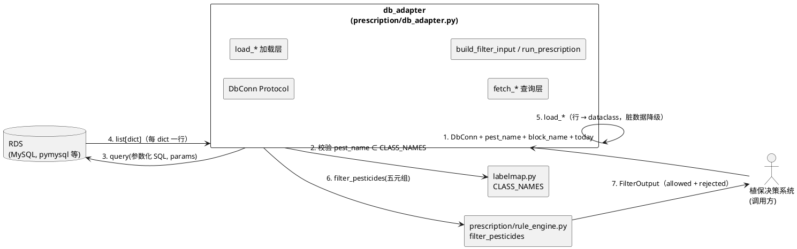
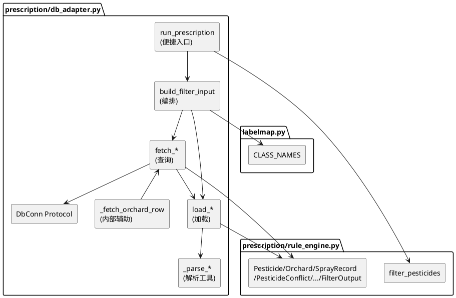
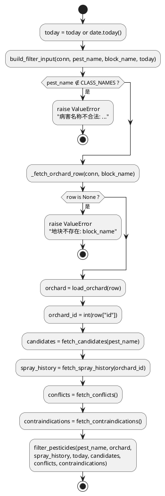
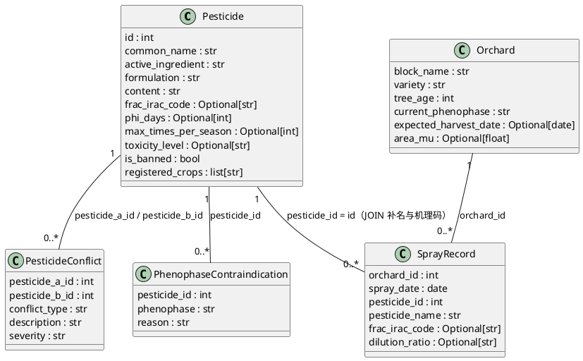
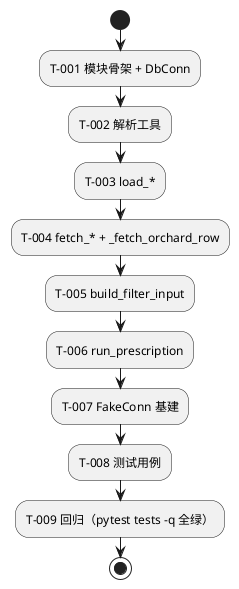

# **db_adapter 组件实现方案**

> **生成时间**：2026-10-29（重试版）
> **上游规格**：`.codeartsdoer/specs/db_adapter/spec.md`
> **任务清单**：`.codeartsdoer/specs/db_adapter/tasks.md`
> **硬约束**：不新增任何第三方依赖；**不修改** `prescription/rule_engine.py` 与 `prescription/schema.sql`；
> 验收口径 `cd code/pomelo-algorithm && "D:/anaconda3/python.exe" -m pytest tests -q` 全绿（含原有约 150 个用例）。

---

## **0. 修订说明（相对上一版的修正）**

本版基于对 `prescription/rule_engine.py`、`prescription/schema.sql`、`labelmap.py` 的逐行核对重写，修正上一版三处**与代码实际约束不符**的设计：

| 编号 | 上一版问题 | 本版修正 |
|------|-----------|---------|
| R-1 | `build_filter_input` 使用 `orchard.id`，但 `Orchard` dataclass **没有 id 字段**，`fetch_spray_history` 无法取得 `orchard_id` | 新增内部辅助 `_fetch_orchard_row()` 返回**原始行**，由 `row["id"]` 取 `orchard_id`，`fetch_orchard` 与 `build_filter_input` 共用该函数 |
| R-2 | `fetch_spray_history` SQL 与"返回升序"要求自相矛盾（`ORDER BY ... DESC LIMIT` 却要求升序） | 明确策略：**SQL 取最近 N 条（DESC LIMIT），Python 端升序排序后返回** |
| R-3 | `load_pesticide` 未处理 `Pesticide` 中**无默认值**的必填字段（`formulation`/`content`/`toxicity_level` 等） | 逐一补齐默认值（`""`/`None`），保证脏数据行不抛 `TypeError` |

---

# **一、需求与存量功能关系分析**

## **1.1 需求功能与存量功能对比**

### **1.1.1 已实现功能**

| 需求功能 | 存量功能 | 代码位置 | 匹配度 |
|---------|---------|---------|--------|
| 农药领域对象（11 字段） | `Pesticide` dataclass | `prescription/rule_engine.py:20-33` | 100% |
| 地块领域对象（6 字段） | `Orchard` dataclass | `prescription/rule_engine.py:47-55` | 100% |
| 施药记录对象（6 字段） | `SprayRecord` dataclass | `prescription/rule_engine.py:58-66` | 100% |
| 配伍禁忌对象（5 字段） | `PesticideConflict` dataclass | `prescription/rule_engine.py:69-76` | 100% |
| 物候期禁忌对象（3 字段） | `PhenophaseContraindication` dataclass | `prescription/rule_engine.py:79-84` | 100% |
| 过滤结果对象 | `FilterResult` / `FilterOutput` | `prescription/rule_engine.py:87-99` | 100% |
| 规则过滤入口 | `filter_pesticides(...)` | `prescription/rule_engine.py:230-324` | 100% |
| 病害白名单常量 | `CLASS_NAMES`（4 类） | `labelmap.py:34` | 100% |
| 六张数据库表结构 | `CREATE TABLE` 定义 | `prescription/schema.sql:8-104` | 100% |

**结论**：本组件的输出类型、规则入口、白名单、表结构在存量代码中**已全部就绪且 100% 匹配**，本组件只需实现"**数据库行 → dataclass**"的适配层，不新增任何领域对象。

### **1.1.2 需要扩展的功能**

| 需求功能 | 存量功能 | 差异说明 | 扩展方向 |
|---------|---------|---------|---------|
| 施药记录携带药剂名与作用机理码 | `SprayRecord` 已有 `pesticide_name`、`frac_irac_code` 字段 | `spray_record` 表**只有** `pesticide_id`，无这两列 | 查询时 `JOIN pesticide` 补齐，**不改表结构**（`schema.sql:63-77`） |
| 地块主键传递到施药记录查询 | `orchard` 表有 `id` 列（`schema.sql:49`），但 `Orchard` dataclass 不承载 `id` | 载体缺失，无法直接 `orchard.id` | 保留原始行 `row["id"]` 作为查询参数，见 §2.1.3 |

### **1.1.3 需要新增的功能或接口**

按模块分组（全部为**新增**，无存量对应实现）：

**（a）协议层**
- `DbConn`：鸭子类型 Protocol，方法 `query(sql, params) -> list[dict]`。

**（b）解析层（私有 `_parse_*`）**
- `_parse_registered_crops(value) -> list[str]`：JSON 优先 → 逗号/顿号回退 → 空列表。
- `_parse_bool(value) -> bool`：6 种写法布尔化。
- `_parse_int_or_none(value) -> Optional[int]`：数值容错。
- `_parse_float_or_none(value) -> Optional[float]`：面积字段容错。
- `_parse_date(value) -> Optional[date]`：日期双格式解析。

**（c）加载层（`load_*`）**
- `load_pesticide` / `load_orchard` / `load_spray_record` / `load_conflict` / `load_contraindication`。
- 输入 `dict`，输出对应 dataclass；核心逻辑为字段映射 + 类型归一化。

**（d）查询层（`fetch_*`）**
- `_fetch_orchard_row`（私有，返回原始行）→ 供 `fetch_orchard`、`build_filter_input` 复用。
- `fetch_candidates(conn, pest_name, citrus_only=True)`：用 `pest_pesticide` 关联 `pesticide`，白名单校验。
- `fetch_spray_history(conn, orchard_id, limit=100)`：`spray_record` JOIN `pesticide`，返回升序。
- `fetch_conflicts(conn)` / `fetch_contraindications(conn)`：全量查询。
- `fetch_orchard(conn, block_name)`：单条查询，缺失返回 `None`。

**（e）编排层**
- `build_filter_input(...)`：一次组装五元组，地块缺失抛 `ValueError`。
- `run_prescription(...)`：`build_filter_input` → `filter_pesticides`，只返回 `FilterOutput`。

**（f）测试层**
- `FakeConn`：内存表 + SQL 路由 + **列名白名单校验器**（断言 SQL 只引用 `schema.sql` 真实列）。

## **1.2 存量功能详细分析**

### **1.2.1 rule_engine.py 接口契约（dataclass 必填/可选字段）**

> **关键**：`@dataclass` 中**无默认值**的字段为构造必填项，`load_*` 必须显式提供，否则 `TypeError`。

| dataclass | 必填字段（无默认值） | 可选字段（有默认值） |
|-----------|---------------------|---------------------|
| `Pesticide` | `id`, `common_name`, `active_ingredient`, `formulation`, `content`, `frac_irac_code`, `phi_days`, `max_times_per_season`, `toxicity_level` | `is_banned=False`, `registered_crops=[]` |
| `Orchard` | `block_name`, `variety`, `tree_age`, `current_phenophase` | `expected_harvest_date=None`, `area_mu=None` |
| `SprayRecord` | `orchard_id`, `spray_date`, `pesticide_id`, `pesticide_name`, `frac_irac_code` | `dilution_ratio=None` |
| `PesticideConflict` | `pesticide_a_id`, `pesticide_b_id`, `conflict_type`, `description` | `severity="中等"` |
| `PhenophaseContraindication` | `pesticide_id`, `phenophase`, `reason` | 无 |

**约束推导**：
1. `Pesticide.formulation`、`content` 为 `str` 且**必填** → 缺失时必须补 `""`（不能给 `None`）。
2. `Pesticide.frac_irac_code` 为 `Optional[str]`，但**必填**（无默认）→ 需显式传 `None` 或字符串。
3. `Orchard` **不含 `id`** → 见 R-1 修正；`Orchard.tree_age` 为 `int` 必填 → 缺失补 `0`。
4. `SprayRecord.spray_date` 为 `date` 且**必填** → 解析失败需兜底（见 §3.3）。
5. `filter_pesticides` 第 1 参数为**位置**参数 `disease`，调用时必须传 `pest_name`。

### **1.2.2 schema.sql 约束分析**

**六张表实际列清单（逐行摘自 `prescription/schema.sql`）**：

| 表名 | 实际列（按 schema.sql 顺序） | 备注 |
|------|------------------------------|------|
| `pesticide` | `id`, `common_name`, `trade_names`, `active_ingredient`, `formulation`, `content`, `frac_irac_code`, `phi_days`, `max_times_per_season`, `registered_crops`, `toxicity_level`, `is_banned`, `data_source`, `notes`, `created_at`, `updated_at` | `registered_crops` 为 TEXT（JSON/逗号分隔）；`is_banned` 为 TINYINT(1) |
| `pest_pesticide` | `id`, `pest_name`, `pesticide_id`, `is_registered_for_citrus`, `dilution_ratio`, `application_method`, `application_timing`, `data_source`, `notes` | `pest_name` 对应 labelmap label |
| `orchard` | `id`, `block_name`, `variety`, `tree_age`, `current_phenophase`, `expected_harvest_date`, `area_mu`, `location`, `created_at`, `updated_at` | `expected_harvest_date` 为 DATE |
| `spray_record` | `id`, `orchard_id`, `spray_date`, `pesticide_id`, `dilution_ratio`, `dosage_per_mu`, `sprayed_by`, `notes`, `created_at` | **无** `pesticide_name` / `frac_irac_code`，须 JOIN |
| `pesticide_conflict` | `id`, `pesticide_a_id`, `pesticide_b_id`, `conflict_type`, `description`, `severity`, `data_source`, `notes` | |
| `phenophase_contraindication` | `id`, `pesticide_id`, `phenophase`, `reason`, `data_source` | |

**关键约束**：
- `spray_record` 的 `pesticide_name`、`frac_irac_code` **不是真实列**，只能从 `pesticide` 表 JOIN 得出。
- `pesticide.registered_crops` 是 `TEXT`，MySQL 驱动返回 `str`（不是原生 list），必须做解析。
- `orchard.id` 真实存在，但**不映射到 `Orchard` dataclass**（R-1）。

---

# **二、增量设计方案**

## **2.1 实现模型**

### **2.1.1 上下文视图**

`db_adapter` 处于"RDS ↔ 规则引擎"之间的适配位置，**只做数据搬运与转换，不含业务规则**。



**通信契约**：
- 与 RDS：仅通过 `DbConn.query(sql, params)`，`%s` 占位符参数化；调用频率 ≤ 5 次/处方（1 次地块 + 1 次候选 + 1 次施药 + 2 次字典表）。
- 与 labelmap：单向只读（`CLASS_NAMES` 白名单）。
- 与 rule_engine：单向只读（导入 dataclass 与 `filter_pesticides`）；**不修改**该模块。

### **2.1.2 服务/组件总体架构**

**模块依赖关系（分层，上层依赖下层）**：



**模块职责与依赖频率**：

| 组件 | 职责 | 依赖 | 调用频率 |
|------|------|------|---------|
| `run_prescription` | 一站式入口，返回 `FilterOutput` | `build_filter_input`、`filter_pesticides` | 1 次/处方 |
| `build_filter_input` | 组装五元组，校验 pest_name / 地块 | `_fetch_orchard_row`、`fetch_*`、`load_orchard` | 1 次/处方 |
| `fetch_*` | 执行参数化 SQL，逐行 `load_*` | `DbConn`、`load_*` | ≤ 5 次/处方 |
| `load_*` | 行 → dataclass，字段归一化 | `_parse_*`、rule_engine dataclass | N 行 |
| `_parse_*` | 单字段类型转换，不抛异常 | 标准库 `json`/`re`/`datetime` | N 字段 |
| `_fetch_orchard_row` | 取地块原始行（含 `id`） | `DbConn` | 1 次/处方 |

**配置项**：默认 `limit=100`（施药记录条数）、`citrus_only=True`（只看柑橘登记药）、`lookback` 由 rule_engine 控制，本组件不介入。

### **2.1.3 实现设计文档**

**（1）主流程（`run_prescription` 活动图）**



**（2）`orchard_id` 传递方案（R-1 修正核心）**

`Orchard` dataclass 不承载 `id`，而 `fetch_spray_history` 需要 `orchard_id`。设计如下：

- 全程保留**原始行** `row`（`fetch_orchard` 的底层 `_fetch_orchard_row` 返回 `dict | None`）。
- `build_filter_input` 内部：`orchard = load_orchard(row)`（面向业务）与 `orchard_id = _parse_int_or_none(row.get("id")) or 0`（面向查询）**双轨使用**，二者源自同一行，保证一致。
- `fetch_orchard`（对外）仅暴露 `Orchard`，不暴露 `id`，符合 spec 接口定义。
- 备选方案（未采纳）：改用 `block_name` 做 `spray_record JOIN orchard` 查询绕开 id。否决理由：与 spec 明确要求的 `fetch_spray_history(conn, orchard_id, limit)` 签名冲突，且多一次 JOIN 无收益。

**（3）脏数据降级流（字段级异常一律不抛）**

```plantuml
@startuml
start
:输入 row（可能缺字段/含非法值）;
:value = row.get(field);   ' 缺字段 → None
if (value is None / 空串 ?) then (是)
  :使用默认值（[] / None / "" / 0）;
else (否)
  if (可转换 ?) then (是)
    :转换后赋值;
  else (否)
    :降级为默认值 + logger.debug 记录;
  endif
endif
stop
@enduml
```

## **2.2 接口设计**

### **2.2.1 总体设计**

| 分类 | 接口 | 稳定性 | 调用方 |
|------|------|--------|--------|
| Protocol | `DbConn` | 稳定 | 所有 `fetch_*` |
| 解析 | `_parse_registered_crops` / `_parse_bool` / `_parse_int_or_none` / `_parse_float_or_none` / `_parse_date` | 私有 | `load_*` |
| 加载 | `load_pesticide` / `load_orchard` / `load_spray_record` / `load_conflict` / `load_contraindication` | 稳定 | `fetch_*`、`build_filter_input` |
| 查询 | `fetch_candidates` / `fetch_spray_history` / `fetch_conflicts` / `fetch_contraindications` / `fetch_orchard` | 稳定 | `build_filter_input` |
| 内部 | `_fetch_orchard_row` | 私有 | `fetch_orchard`、`build_filter_input` |
| 编排 | `build_filter_input` | 稳定 | `run_prescription` |
| 入口 | `run_prescription` | 稳定 | 植保决策系统 |

**依赖隔离**：`DbConn` 为 `Protocol`，不 import 任何 MySQL 驱动；如需类型标注驱动对象，仅用 `TYPE_CHECKING` 导入。**无版本管理需求**（组件首发，接口未对外发布）。

### **2.2.2 接口清单**

> 以下为**接口契约**（签名 + 语义），实现代码见 tasks.md，本文档不含逐行实现。

#### **2.2.2.1 `DbConn`（Protocol）**

```
class DbConn(Protocol):
    def query(self, sql: str, params: Sequence[Any] | None = None) -> list[dict]: ...
```
- **业务说明**：数据库连接抽象，鸭子类型。
- **前置条件**：`sql` 使用 `%s` 占位符；`params` 为与占位符等长的序列。
- **后置条件**：返回 `list[dict]`，每 dict 键为列名。
- **异常映射**：驱动异常（连接失败、SQL 错误）原样向上传播，组件不吞。
- **调用示例**：
  ```
  conn: DbConn = MySqlConn(dsn)          # 真实实现
  conn = FakeConn({"orchard": [row]})    # 测试实现
  rows = conn.query("SELECT id FROM orchard WHERE block_name = %s", ("A区",))
  ```

#### **2.2.2.2 `load_pesticide(row: dict) -> Pesticide`**

- **入参**：`pesticide` 表行（或 `fetch_candidates` 的 JOIN 行）。
- **出参**：`Pesticide`。
- **必填字段兜底**：`formulation`/`content` → `""`；`toxicity_level`/`frac_irac_code` → `None`；`id` 缺失 → `0`。
- **前置**：`row` 可为**缺任意字段**的 dict。
- **后置**：返回合法 `Pesticide`，不抛异常。
- **边界**：`registered_crops` 见 §3.1；`is_banned` 见 §3.2；`phi_days`/`max_times_per_season` 见 §3.4。

#### **2.2.2.3 `load_orchard(row: dict) -> Orchard`**

- **兜底**：`tree_age` → `0`；`current_phenophase` → `""`；`variety`/`block_name` → `""`；`area_mu` → `None`。
- **边界**：`expected_harvest_date` 支持 `date` 与 `"YYYY-MM-DD"`（§3.3）。
- **注意**：**不**从 `row` 取 `id`（`Orchard` 无该字段）。

#### **2.2.2.4 `load_spray_record(row: dict) -> SprayRecord`**

- **兜底**：`pesticide_name` → `""`；`frac_irac_code` → `None`；`orchard_id`/`pesticide_id` → `0`。
- **边界**：`spray_date` 双格式；**解析失败兜底为 `date.today()`**（保证 `date` 类型；真表 NOT NULL，几乎不触发，见 §7.3）。
- **前置**：`row` 须为 `fetch_spray_history` 的 JOIN 结果（含 `pesticide_name`、`frac_irac_code`）。

#### **2.2.2.5 `load_conflict(row: dict) -> PesticideConflict`**

- **兜底**：`severity` → `"中等"`；`conflict_type`/`description` → `""`；id 缺失 → `0`。

#### **2.2.2.6 `load_contraindication(row: dict) -> PhenophaseContraindication`**

- **兜底**：`phenophase`/`reason` → `""`；`pesticide_id` 缺失 → `0`。

#### **2.2.2.7 `fetch_candidates(conn, pest_name, citrus_only=True) -> list[Pesticide]`**

- **业务说明**：查某病害在柑橘上登记的候选药剂。
- **前置**：`pest_name ∈ labelmap.CLASS_NAMES`，否则 `raise ValueError(f"病害名称不合法: {pest_name}")`。
- **后置**：返回 `Pesticide` 列表（按 `p.id` 升序）；`citrus_only=True` 时仅含 `pp.is_registered_for_citrus = 1`。
- **异常映射**：白名单失败 → `ValueError`；驱动异常 → 向上传播。
- **SQL**：见 §4.1.1。

#### **2.2.2.8 `fetch_spray_history(conn, orchard_id, limit=100) -> list[SprayRecord]`**

- **业务说明**：取该地块**最近 `limit` 条**施药记录，**返回按 `spray_date` 升序**（便于阅读/调试）。
- **实现要点（R-2）**：SQL 用 `ORDER BY spray_date DESC LIMIT %s` 取"最近 N 条"，Python 端再 `sort(key=spray_date)` 升序返回。
- **后置**：`pesticide_name`、`frac_irac_code` 已由 JOIN 补齐。
- **边界**：`limit ≤ 0` 时仍执行（返回空）；`orchard_id` 无记录返回 `[]`。

#### **2.2.2.9 `fetch_conflicts(conn) -> list[PesticideConflict]`**

- 全量查询 `pesticide_conflict`；无记录返回 `[]`。

#### **2.2.2.10 `fetch_contraindications(conn) -> list[PhenophaseContraindication]`**

- 全量查询 `phenophase_contraindication`；无记录返回 `[]`。

#### **2.2.2.11 `fetch_orchard(conn, block_name) -> Orchard | None`**

- 单条查询；不存在返回 `None`（**不抛异常**）。
- 内部复用 `_fetch_orchard_row`。

#### **2.2.2.12 `build_filter_input(conn, pest_name, block_name, today) -> tuple[...]`**

- **出参**：`(Orchard, list[Pesticide], list[SprayRecord], list[PesticideConflict], list[PhenophaseContraindication])`，长度恒为 5。
- **异常**：`pest_name` 非法 → `ValueError`；地块缺失 → `ValueError(f"地块不存在: {block_name}")`。
- **说明**：`today` 为接口对齐保留（供日志），组装本身不依赖它；实际日期由 `run_prescription` 统一注入。

#### **2.2.2.13 `run_prescription(conn, pest_name, block_name, today=None) -> FilterOutput`**

- `today` 默认 `date.today()`；链式调用 `build_filter_input` → `filter_pesticides`。
- **不生成中文报告**（`format_rejection_report` 由调用方决定）。
- **异常**：`build_filter_input` 的 `ValueError` 与驱动异常向上传播。

## **2.3 数据模型**

### **2.3.1 设计目标**

1. **忠实映射**：`pesticide/orchard/spray_record/pesticide_conflict/phenophase_contraindication` 五行 → rule_engine 既有 dataclass，**不新增字段、不改 dataclass**。
2. **容错优先**：任何字段缺失/非法都降级为默认值（`[] / None / "" / 0`），满足 spec 4.2 脏数据容忍。
3. **兼容存量**：`SprayRecord.pesticide_name`、`frac_irac_code` 由 JOIN 补，属"冗余字段"，保持与 rule_engine 注释一致（`rule_engine.py:65`）。
4. **不引入技术字段**：dataclass 中不出现 `data_source`、`created_at` 等 schema 技术列。

### **2.3.2 模型实现**



**字段来源映射（列 → 字段 → 容错）**：

| dataclass | 字段 | 来源列 | 容错规则 |
|-----------|------|--------|---------|
| `Pesticide` | `id` | `pesticide.id` | 缺失/非法 → `0` |
| | `common_name` | `pesticide.common_name` | 缺失 → `""` |
| | `active_ingredient` | `pesticide.active_ingredient` | 缺失 → `""` |
| | `formulation` | `pesticide.formulation` | 缺失 → `""` |
| | `content` | `pesticide.content` | 缺失 → `""` |
| | `frac_irac_code` | `pesticide.frac_irac_code` | `""`/缺失 → `None` |
| | `phi_days` | `pesticide.phi_days` | 缺失/`""`/非法 → `None` |
| | `max_times_per_season` | `pesticide.max_times_per_season` | 同上 |
| | `toxicity_level` | `pesticide.toxicity_level` | 缺失 → `None` |
| | `is_banned` | `pesticide.is_banned` | 6 种写法布尔化 |
| | `registered_crops` | `pesticide.registered_crops` | JSON → 分隔符回退 → `[]` |
| `Orchard` | `block_name` | `orchard.block_name` | 缺失 → `""` |
| | `variety` | `orchard.variety` | 缺失 → `""` |
| | `tree_age` | `orchard.tree_age` | 缺失/非法 → `0` |
| | `current_phenophase` | `orchard.current_phenophase` | 缺失 → `""` |
| | `expected_harvest_date` | `orchard.expected_harvest_date` | 双格式 → 失败 `None` |
| | `area_mu` | `orchard.area_mu` | 缺失/非法 → `None` |
| `SprayRecord` | `orchard_id` | `spray_record.orchard_id` | 缺失 → `0` |
| | `spray_date` | `spray_record.spray_date` | 双格式 → 失败 `date.today()` |
| | `pesticide_id` | `spray_record.pesticide_id` | 缺失 → `0` |
| | `pesticide_name` | `pesticide.common_name`（JOIN → 别名） | 缺失 → `""` |
| | `frac_irac_code` | `pesticide.frac_irac_code`（JOIN） | 缺失 → `None` |
| | `dilution_ratio` | `spray_record.dilution_ratio` | 缺失 → `None` |

> 生命周期：均为**短生命周期值对象**（一次处方内创建、用完即弃），无持久化、无状态流转。

---

# **三、关键解析逻辑**

## **3.1 `registered_crops` 解析（`_parse_registered_crops`）**

**优先级链**：原生 list → JSON 数组字符串 → 逗号/顿号/中文逗号分隔 → `[]`。

**伪代码**：
```
function _parse_registered_crops(value):
    if value is None: return []
    if isinstance(value, (list, tuple)):
        return [str(x).strip() for x in value if str(x).strip()]
    if not isinstance(value, str): return []
    s = value.strip()
    if s == "": return []
    try:
        parsed = json.loads(s)
        if isinstance(parsed, list):
            return [str(x).strip() for x in parsed if str(x).strip()]
    except (ValueError, TypeError):
        pass                      # 回退到分隔符切分
    parts = re.split(r"[,，、;；]", s)
    return [p.strip() for p in parts if p.strip()]
```

| 输入 | 输出 | 依据 |
|------|------|------|
| `'["柑橘","柚子"]'` | `["柑橘","柚子"]` | JSON 命中 |
| `'["柑橘", "柚"]'`（含空格） | `["柑橘","柚"]` | JSON + strip |
| `"柑橘,柚子"` | `["柑橘","柚子"]` | `json.loads` 失败 → 逗号切分 |
| `"柑橘、柚子"` | `["柑橘","柚子"]` | 顿号切分 |
| `None` / `""` / `"  "` | `[]` | 空值 |
| `"[bad json"` | `["[bad json"]` | JSON 失败 → 分隔符回退（保留原串） |
| `123`（非 str/list） | `[]` | 类型不符 |

## **3.2 `is_banned` 布尔化（`_parse_bool`）**

**规则**：`1 / "1" / True / "true" / "True" / "TRUE" / "yes"` → `True`；`0 / "0" / False / None / ""` → `False`。

**伪代码**：
```
function _parse_bool(value):
    if isinstance(value, bool): return value
    if isinstance(value, int):  return value != 0
    if isinstance(value, str):  return value.strip().lower() in {"1","true","yes"}
    return False               # None、float 等
```

| 输入 | 输出 |
|------|------|
| `1` / `"1"` / `True` | `True` |
| `"true"` / `"True"` / `"TRUE"` | `True` |
| `0` / `"0"` / `False` / `None` / `""` | `False` |

## **3.3 日期解析（`_parse_date`）**

**规则**：`datetime` → `.date()`；`date` → 原样；字符串按 `"%Y-%m-%d"`、`"%Y/%m/%d"`、`"%Y-%m-%d %H:%M:%S"` 依次尝试；失败 → `None`。**注意先判 `datetime`**（`datetime` 是 `date` 子类）。

| 输入 | 输出 |
|------|------|
| `date(2026,11,20)` | `date(2026,11,20)` |
| `"2026-11-20"` | `date(2026,11,20)` |
| `"2026/11/20"` | `date(2026,11,20)`（容错扩展） |
| `"invalid"` / `None` / `""` | `None` |

**用途差异**：`load_orchard` —— 失败给 `None`（规则引擎跳过 PHI）；`load_spray_record` —— 失败给 `date.today()`（保 `date` 类型）。

## **3.4 数值字段容错（`_parse_int_or_none` / `_parse_float_or_none`）**

```
function _parse_int_or_none(value):
    if value is None: return None
    if isinstance(value, bool): return None          # True/False 不是有效天数
    if isinstance(value, int):  return value
    if isinstance(value, float): return int(value)
    if isinstance(value, str):
        s = value.strip()
        if s == "": return None
        try: return int(s)
        except ValueError:
            try: return int(float(s))                # "15.0" → 15
            except ValueError: return None           # "abc" → None
    return None
```

| 输入 | 输出 |
|------|------|
| `15` / `"15"` / `"15.0"` | `15` |
| `""` / `"abc"` / `None` | `None` |

`_parse_float_or_none` 规则同构，返回 `float`（`area_mu` 为 `DECIMAL(10,2)`，驱动可能返回 `Decimal`，用 `float()` 转换）。

---

# **四、SQL 设计**

> **原则**：所有 SQL 使用 `%s` 占位符 + `params` 元组，**禁止任何字符串拼接用户输入**；列名**逐列显式列出**（不写 `SELECT *`），便于 §5.1 列名白名单校验。

## **4.1 参数化查询模板**

### **4.1.1 `fetch_candidates`**

```sql
-- citrus_only = True
SELECT p.id, p.common_name, p.active_ingredient, p.formulation, p.content,
       p.frac_irac_code, p.phi_days, p.max_times_per_season, p.toxicity_level,
       p.is_banned, p.registered_crops
FROM pesticide p
JOIN pest_pesticide pp ON pp.pesticide_id = p.id
WHERE pp.pest_name = %s
  AND pp.is_registered_for_citrus = 1
ORDER BY p.id;

-- citrus_only = False：删除 "AND pp.is_registered_for_citrus = 1"
```
- **参数**：`(pest_name,)`。
- **说明**：`pest_name` 只以参数出现，SQL 文本中**不含任何病害字面量**（TC-19 断言点）。

### **4.1.2 `fetch_spray_history`**

```sql
SELECT sr.orchard_id, sr.spray_date, sr.pesticide_id,
       p.common_name AS pesticide_name, p.frac_irac_code, sr.dilution_ratio
FROM spray_record sr
JOIN pesticide p ON p.id = sr.pesticide_id
WHERE sr.orchard_id = %s
ORDER BY sr.spray_date DESC
LIMIT %s;
```
- **参数**：`(orchard_id, limit)`。
- **返回顺序（R-2）**：SQL 侧 DESC 取最近 N 条 → **Python 侧按 `spray_date` 升序排序后返回**。

### **4.1.3 `_fetch_orchard_row` / `fetch_orchard`**

```sql
SELECT id, block_name, variety, tree_age, current_phenophase,
       expected_harvest_date, area_mu
FROM orchard
WHERE block_name = %s;
```
- **参数**：`(block_name,)`。
- **返回**：首行 `dict` 或 `None`；`id` 供 `build_filter_input` 取 `orchard_id`。

### **4.1.4 `fetch_conflicts`**

```sql
SELECT pesticide_a_id, pesticide_b_id, conflict_type, description, severity
FROM pesticide_conflict;
```
- 无参数，全量。

### **4.1.5 `fetch_contraindications`**

```sql
SELECT pesticide_id, phenophase, reason
FROM phenophase_contraindication;
```
- 无参数，全量。

## **4.2 JOIN 策略**

| 查询 | JOIN | 动机 | 代价 |
|------|------|------|------|
| `fetch_candidates` | `pesticide ⨝ pest_pesticide`（`pp.pesticide_id = p.id`） | 由病害定位候选药 | `idx_pest(pest_name)` 命中 |
| `fetch_spray_history` | `spray_record ⨝ pesticide`（`p.id = sr.pesticide_id`） | 补 `pesticide_name`、`frac_irac_code` | 主键等值 JOIN，成本低 |

- 均为**内连接**：`spray_record.pesticide_id`、`pest_pesticide.pesticide_id` 均有外键约束，不会丢失孤儿行。
- 未做多表广播查询：字典表（conflicts / contraindications）全量拉取后在 Python 侧按需筛选，避免复杂 JOIN。

## **4.3 排序与分页**

| 查询 | 排序 | 分页 | 理由 |
|------|------|------|------|
| `fetch_candidates` | `ORDER BY p.id` | 无 | 候选量小（单病害），顺序稳定 |
| `fetch_spray_history` | `ORDER BY sr.spray_date DESC` + `LIMIT %s` | `limit=100` | 只取最近 100 条，防大表全扫；Python 端转升序返回 |
| 其余 | 无 | 无 | 字典表数据量小 |

**注意**：`LIMIT %s` 的参数由 `params` 传入（部分驱动对 `LIMIT` 占位符支持不同，设计允许退化为在 Python 侧截断，见 §7.1）。

## **4.4 列名对照表（每个 `fetch_*` 引用列 vs schema.sql 实际列）**

> **核对方式**：逐字符比对 §1.2.2 实际列清单。**结论：全部命中，无引用不存在的列**。

| 函数 | SQL 中引用列（别名.列） | 归属表 | schema.sql 行号 | 是否存在 |
|------|------------------------|--------|----------------|---------|
| `fetch_candidates` | `p.id` | `pesticide` | 9 | ✅ |
| | `p.common_name` | `pesticide` | 10 | ✅ |
| | `p.active_ingredient` | `pesticide` | 12 | ✅ |
| | `p.formulation` | `pesticide` | 13 | ✅ |
| | `p.content` | `pesticide` | 14 | ✅ |
| | `p.frac_irac_code` | `pesticide` | 15 | ✅ |
| | `p.phi_days` | `pesticide` | 16 | ✅ |
| | `p.max_times_per_season` | `pesticide` | 17 | ✅ |
| | `p.toxicity_level` | `pesticide` | 19 | ✅ |
| | `p.is_banned` | `pesticide` | 20 | ✅ |
| | `p.registered_crops` | `pesticide` | 18 | ✅ |
| | `pp.pesticide_id` | `pest_pesticide` | 34 | ✅ |
| | `pp.pest_name` | `pest_pesticide` | 33 | ✅ |
| | `pp.is_registered_for_citrus` | `pest_pesticide` | 35 | ✅ |
| `fetch_spray_history` | `sr.orchard_id` | `spray_record` | 65 | ✅ |
| | `sr.spray_date` | `spray_record` | 66 | ✅ |
| | `sr.pesticide_id` | `spray_record` | 67 | ✅ |
| | `sr.dilution_ratio` | `spray_record` | 68 | ✅ |
| | `p.id` | `pesticide` | 9 | ✅ |
| | `p.common_name`（别名 `pesticide_name`） | `pesticide` | 10 | ✅ |
| | `p.frac_irac_code` | `pesticide` | 15 | ✅ |
| `_fetch_orchard_row` | `id` | `orchard` | 49 | ✅ |
| | `block_name` | `orchard` | 50 | ✅ |
| | `variety` | `orchard` | 51 | ✅ |
| | `tree_age` | `orchard` | 52 | ✅ |
| | `current_phenophase` | `orchard` | 53 | ✅ |
| | `expected_harvest_date` | `orchard` | 54 | ✅ |
| | `area_mu` | `orchard` | 55 | ✅ |
| `fetch_conflicts` | `pesticide_a_id` | `pesticide_conflict` | 83 | ✅ |
| | `pesticide_b_id` | `pesticide_conflict` | 84 | ✅ |
| | `conflict_type` | `pesticide_conflict` | 85 | ✅ |
| | `description` | `pesticide_conflict` | 86 | ✅ |
| | `severity` | `pesticide_conflict` | 87 | ✅ |
| `fetch_contraindications` | `pesticide_id` | `phenophase_contraindication` | 100 | ✅ |
| | `phenophase` | `phenophase_contraindication` | 101 | ✅ |
| | `reason` | `phenophase_contraindication` | 102 | ✅ |

**反向核查（易错点）**：
- ❌ `spray_record.pesticide_name` —— **不存在**，故 `fetch_spray_history` 用 `p.common_name AS pesticide_name` 别名输出。
- ❌ `spray_record.frac_irac_code` —— **不存在**，取自 `p.frac_irac_code`。
- ❌ `orchard.id` 作为 dataclass 字段 —— dataclass 无该字段，仅作为 `fetch_spray_history` 的参数来源（R-1）。

---

# **五、测试策略**

> 新增测试文件：`tests/test_db_adapter.py`。**不得**改动 `tests/test_rule_engine.py` 等既有用例。全部用 `unittest` 风格（与项目其余测试一致，`pytest` 可直接收集）。

## **5.1 FakeConn 实现方案**

### **5.1.1 结构与职责**

```
class FakeConn:                       # 实现 DbConn Protocol
    def __init__(self, tables: dict[str, list[dict]]):
        self._tables = tables         # 表名 → 行列表
        self.queries: list[tuple[str, tuple]] = []   # 记录 (sql, params) 供断言

    def query(self, sql: str, params=None) -> list[dict]:
        # 1) 记录调用
        # 2) _assert_columns_exist(sql)：列名白名单校验（见 5.1.3）
        # 3) _route(sql, params)：正则识别主表与 WHERE 条件 → 返回匹配行
```

### **5.1.2 SQL 路由规则（正则识别表名 + WHERE 条件）**

| 匹配特征（`re.search`） | 识别结果 | 路由行为 |
|------------------------|---------|---------|
| `FROM\s+pesticide\s+p\s+JOIN\s+pest_pesticide\s+pp` | 候选查询 | 内存内 `pest_pesticide` 按 `pest_name` 过滤 + `is_registered_for_citrus`，再按 `pesticide_id` 关联 `pesticide` 行，按 `p.id` 升序 |
| `FROM\s+spray_record\s+sr` | 施药查询 | 按 `orchard_id` 过滤；按 `spray_date` 倒序取前 `limit` 条；join `pesticide` 补 `pesticide_name`/`frac_irac_code` |
| `FROM\s+orchard\b` | 地块查询 | 按 `block_name` 过滤，返回首行 |
| `FROM\s+pesticide_conflict\b` | 配伍字典 | 全量返回 |
| `FROM\s+phenophase_contraindication\b` | 禁忌字典 | 全量返回 |

- WHERE 参数绑定：从 `params` 顺序取第 1 个作主过滤值（`pest_name` / `orchard_id` / `block_name`），`fetch_spray_history` 的第 2 个作 `limit`。
- 未命中的 SQL 抛 `AssertionError`，避免静默返回空导致假绿。

### **5.1.3 列名白名单校验器（核心断言能力）**

> 目标：**断言 `fetch_*` 传出的 SQL 只引用 `schema.sql` 真实存在的列**。

```
def _schema_columns() -> dict[str, set[str]]:
    # 读取 prescription/schema.sql（Path(__file__).parent.parent / "prescription/schema.sql"）
    # 用 re 提取每个 "CREATE TABLE [IF NOT EXISTS] <name> (...)" 的列名：
    #   - 跳过 PRIMARY KEY / UNIQUE / INDEX / FOREIGN / CONSTRAINT 开头的行
    #   - 取每行首个标识符作列名（剥离反引号）
    # 返回 {table: {col, ...}}

def _assert_columns_exist(sql: str, tables: dict[str, set[str]]) -> None:
    # 1) 建立别名映射：FROM <table> [AS] <alias> / JOIN <table> [AS] <alias>
    # 2) 提取所有 "<alias>.<col>" 与裸列引用（在 SELECT/WHERE 中）
    # 3) 校验 col ∈ tables[alias 对应表]；否则 AssertionError("<col> 不在 <table>")
```

**注意**：别名输出列（如 `p.common_name AS pesticide_name`）中 `pesticide_name` 是**别名**，校验时须排除 `AS xxx` 右侧标识符，只校验左侧真实列。

### **5.1.4 参数化断言接口**

```
def assert_no_literal(self, literal: str) -> bool:
    """断言任意被记录的 SQL 文本中都不含 literal 字面量（如 'anthracnose'）。"""
    return all(literal not in sql for sql, _ in self.queries)
```

## **5.2 测试用例设计（20 个，含中文 docstring）**

### **5.2.1 解析函数（TC-01 ~ TC-12）**

| 编号 | 测试函数 | 输入 | 预期 |
|------|---------|------|------|
| TC-01 | `test_registered_crops_json` | `'["柑橘","柚子"]'` | `["柑橘","柚子"]` |
| TC-02 | `test_registered_crops_comma` | `"柑橘,柚子"` | `["柑橘","柚子"]` |
| TC-03 | `test_registered_crops_empty` | `None` / `""` | `[]` |
| TC-04 | `test_is_banned_six_forms` | `1,"1",True,"true","True","TRUE"` | 全 `True` |
| TC-05 | `test_is_banned_falsy` | `0,"0",False,None,""` | 全 `False` |
| TC-06 | `test_phi_days_empty_str` | `""` | `None` |
| TC-07 | `test_phi_days_invalid_str` | `"abc"` | `None` |
| TC-08 | `test_phi_days_valid` | `15` / `"15"` | `15` |
| TC-09 | `test_harvest_date_object` | `date(2026,11,20)` | `date(2026,11,20)` |
| TC-10 | `test_harvest_date_str` | `"2026-11-20"` | `date(2026,11,20)`（与 TC-09 一致） |
| TC-11 | `test_spray_date_two_forms` | `date(...)` 与 `"2026-11-20"` | 均得同一 `date` |
| TC-12 | `test_tree_age_and_phenophase_default` | 缺失 `tree_age`/`current_phenophase` | `0` / `""` |

### **5.2.2 加载函数（TC-13 ~ TC-14）**

| 编号 | 测试函数 | 内容 |
|------|---------|------|
| TC-13 | `test_load_pesticide_full_row` | 完整行 → 11 字段逐一断言（含 `is_banned`/`registered_crops`） |
| TC-14 | `test_load_orchard_row` | 行 → `Orchard`；`expected_harvest_date` 解析、`area_mu` 为 `float` |

### **5.2.3 查询函数（TC-15 ~ TC-18）**

| 编号 | 测试函数 | 内容 | 关键断言 |
|------|---------|------|---------|
| TC-15 | `test_fetch_candidates_invalid_pest` | `fetch_candidates(fake, "melanose")` | `assertRaises(ValueError)`，消息含病害名 |
| TC-16 | `test_fetch_candidates_parametrized` | 合法 `pest_name` 查询 | `fake.assert_no_literal("anthracnose")` **为真**；`params == ("anthracnose",)` |
| TC-17 | `test_fetch_spray_history_ascending_and_joined` | 乱序输入 3 条 | 返回**升序**；每行 `pesticide_name` 非空、`frac_irac_code` 来自农药表 |
| TC-18 | `test_fetch_all_sql_columns_exist` | 调用全部 `fetch_*` | `FakeConn` 未抛列名校验异常（证明所有列存在于 schema.sql） |

### **5.2.4 编排与集成（TC-19 ~ TC-20 + 脏数据组）**

| 编号 | 测试函数 | 内容 | 关键断言 |
|------|---------|------|---------|
| TC-19 | `test_build_filter_input_tuple` | 正常地块 | 返回 `tuple` **长度 5**；类型依次为 `Orchard, list[Pesticide], list[SprayRecord], list[PesticideConflict], list[PhenophaseContraindication]` |
| TC-20 | `test_build_filter_input_missing_orchard` | 荒地地块名 | `assertRaises(ValueError)`，`str(e)` 含 `地块不存在` 与地块名 |
| TC-21 | `test_run_prescription_output` | 构造可被拒数据（禁用药 + 正常药） | 返回 `FilterOutput`；`allowed` 与 `rejected` 均非空（`rejected` 含"已被禁用"） |
| TC-22 | `test_dirty_missing_registered_crops` | 行缺 `registered_crops` | 不抛异常，`registered_crops == []` |
| TC-23 | `test_dirty_missing_phi_days` | 行缺 `phi_days` | 不抛异常，`phi_days is None` |
| TC-24 | `test_dirty_missing_frac_irac_code` | 行缺 `frac_irac_code` | 不抛异常，`frac_irac_code is None` |

> TC-01~TC-24 覆盖任务指定的 14 类场景，并额外覆盖参数化断言、列名白名单、双重脏数据组合。

## **5.3 脏数据场景覆盖矩阵**

| 脏数据类型 | 覆盖用例 | 期望行为 |
|-----------|---------|---------|
| 字段缺失 | TC-22/23/24 | 用默认值，不抛异常 |
| 非法数值字符串 | TC-07 | `None`，不抛异常 |
| 非法日期字符串 | TC-10（对照） | `None`（orchard）/ 兜底（spray_record） |
| 空字符串 | TC-03/06 | `[]` / `None` |
| `None` 值 | TC-03/05 | `[]` / `False` |

---

# **六、实现步骤**

> 详细子任务、依赖、验收见 `.codeartsdoer/specs/db_adapter/tasks.md`。此处给出**任务分解概要**：

| 任务 | 名称 | 前置 | 主要交付 |
|------|------|------|---------|
| T-001 | 新建模块与 `DbConn` Protocol | 无 | `prescription/db_adapter.py` 骨架 |
| T-002 | 实现 5 个 `_parse_*` 解析工具 | T-001 | 纯函数，无 IO |
| T-003 | 实现 5 个 `load_*` 加载函数 | T-002 | 行 → dataclass |
| T-004 | 实现 5 个 `fetch_*` + `_fetch_orchard_row` | T-001, T-003 | 参数化 SQL + 白名单校验 |
| T-005 | 实现 `build_filter_input` | T-004 | 五元组组装 + 两处 `ValueError` |
| T-006 | 实现 `run_prescription` | T-005 | 链式调用 `filter_pesticides` |
| T-007 | `FakeConn` + schema 列名校验器 | T-001 | `tests/test_db_adapter.py` 测试基建 |
| T-008 | 编写 20 个测试用例 | T-002~T-007 | 覆盖全部导出函数 |
| T-009 | 全量回归 | T-008 | `python -m pytest tests -q` 全绿 |

**依赖关系图**：


---

# **七、风险与缓解**

## **7.1 SQL 注入风险**

- **风险**：`pest_name`、`block_name` 直接拼进 SQL。
- **缓解**：全部 `%s` 占位符 + `params` 元组；`pest_name` 先过 `CLASS_NAMES` 白名单（`fetch_candidates`、`build_filter_input` 双重校验）。
- **验证**：TC-16 `assert_no_literal`，断言 SQL 文本不含病害字面量。
- **残余风险**：个别驱动对 `LIMIT %s` 支持不一致 → 设计允许退化：SQL 固定 `LIMIT 1000` 上限，Python 侧再按 `limit` 截断（保留能力，不影响正确性）。

## **7.2 脏数据风险**

- **风险**：历史数据缺字段、格式混乱导致 `TypeError` 中断。
- **缓解**：所有字段经 `_parse_*` 归一或 `row.get(..., default)` 兜底；**任何解析失败只降级、不抛异常**。
- **验证**：TC-22/23/24 + 5.3 覆盖矩阵。
- **残余风险**：兜底值可能掩盖真实数据问题 → `logger.debug` 记录降级事件，便于排查。

## **7.3 日期格式风险**

- **风险**：`DATE` 列在不同驱动下返回 `date` / `str` / `datetime`；`spray_date` 解析失败破坏 `date` 类型。
- **缓解**：`_parse_date` 兼容三种类型与三种字符串格式（§3.3）；`load_orchard` 失败给 `None`（PHI 校验自动跳过），`load_spray_record` 失败兜底 `date.today()`。
- **残余风险**：`spray_date` 兜底为今日会让该记录落入抗药性 30 天回溯窗口，产生保守拒绝 → 因真表 `NOT NULL`，触发概率极低；文档显式标注。

## **7.4 依赖风险**

- **风险**：误引入 `pymysql`/`mysql-connector` 硬依赖，破坏测试环境。
- **缓解**：`DbConn` 用 `typing.Protocol`（运行期零依赖）；如需标注驱动对象类型，仅 `if TYPE_CHECKING: import pymysql`；**不新增任何第三方包**。
- **验证**：`python -m pytest tests -q` 在无 MySQL 环境下全绿。

## **7.5 与存量用例兼容风险**

- **风险**：新增模块或测试影响既有 ~150 个用例。
- **缓解**：只**新增** `prescription/db_adapter.py` 与 `tests/test_db_adapter.py`，**不改**任何既有文件；`db_adapter.py` 不 import 测试代码。

---

## **附录 A：文件清单**

| 文件 | 动作 | 说明 |
|------|------|------|
| `prescription/db_adapter.py` | 新增 | 组件实现（Protocol + parse + load + fetch + 编排） |
| `tests/test_db_adapter.py` | 新增 | FakeConn + 列名校验器 + 20 个用例 |
| `prescription/rule_engine.py` | **只读** | 不改 |
| `prescription/schema.sql` | **只读** | 不改（仅作为测试列名来源） |
| `labelmap.py` | **只读** | 不改（`CLASS_NAMES` 白名单） |

## **附录 B：类型注解与代码规范**

- 所有函数**必须**完整类型注解；模块首行 `from __future__ import annotations`（与 `rule_engine.py:13` 一致）。
- 统一使用 PEP 604 风格：`int | None`、`list[dict]`（项目 Python ≥ 3.10）。
- 命名遵循 snake_case（`fetch_spray_history`、`_parse_bool`）。
- 禁止使用 `Any` 作为返回值；入口参数可用 `Any` 表示"驱动原始值"。
- 关键路径 `logger.debug(...)` 记录：查询 SQL、降级事件、白名单校验结果。
- **禁止**在 `db_adapter.py` 中复制业务规则（PHI/抗药性判断一律交给 `rule_engine.py`）。

**文档结束**