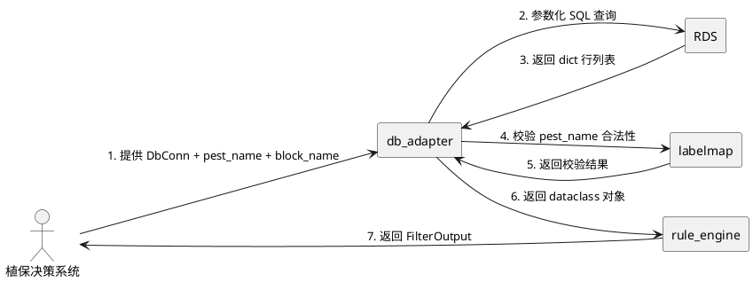
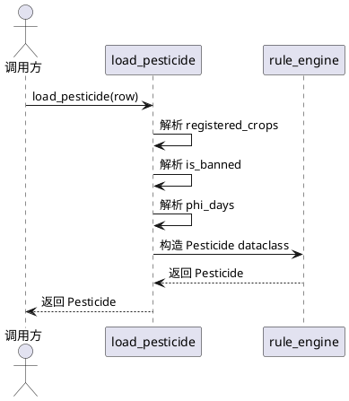
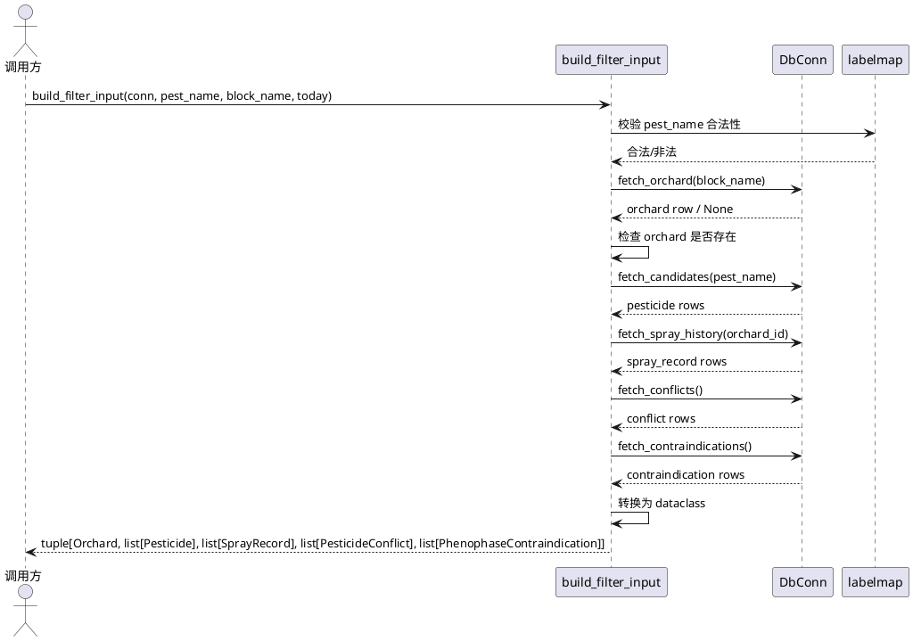
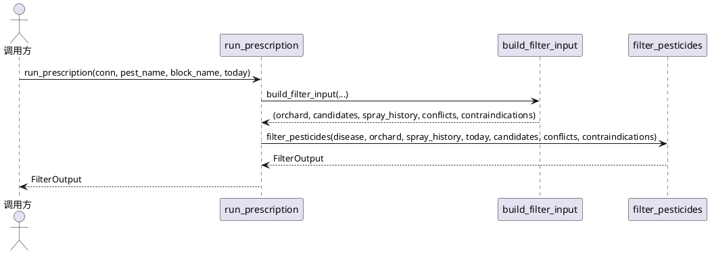

# **1. 组件定位**

## **1.1 核心职责**
本组件负责将 RDS 查询结果转换为规则引擎所需的 dataclass 对象，实现数据库行到业务对象的无损映射。

## **1.2 核心输入**
1. **DbConn 协议对象**：实现 `query(sql, params) -> list[dict]` 方法的任意对象（真实 MySQL 封装、SQLite 封装、测试 FakeConn 均可）
2. **病害名称（pest_name）**：用于 fetch_candidates 查询，必须是 labelmap.CLASS_NAMES 之一
3. **地块名称（block_name）**：用于 fetch_orchard 查询
4. **当前日期（today）**：用于 build_filter_input，默认 date.today()

## **1.3 核心输出**
1. **Pesticide 对象列表**：农药信息 dataclass 列表
2. **Orchard 对象**：地块信息 dataclass
3. **SprayRecord 对象列表**：施药记录 dataclass 列表
4. **PesticideConflict 对象列表**：配伍禁忌 dataclass 列表
5. **PhenophaseContraindication 对象列表**：物候期禁忌 dataclass 列表
6. **FilterOutput 对象**：规则引擎过滤结果（通过 + 拒绝列表）

## **1.4 职责边界**

**本组件负责：**
- 数据库行到 dataclass 的字段映射与类型转换
- 数据清洗（JSON 解析、日期解析、布尔值归一化）
- 参数化查询构建（防止 SQL 注入）
- 校验输入合法性（pest_name 白名单校验）

**本组件不负责：**
- 数据库连接管理（调用方负责提供 DbConn）
- SQL 语句优化与索引设计（schema.sql 已定义）
- 业务规则校验（rule_engine.py 负责）
- 用户交互与报告生成（调用方负责 format_rejection_report）

---

# **2. 领域术语**

**DbConn（数据库连接协议）**
: 一个实现了 `query(sql: str, params: Sequence | None = None) -> list[dict]` 方法的协议对象。
: 备注：鸭子类型，不依赖具体 MySQL 驱动。

**Pesticide（农药）**
: 农药信息 dataclass，包含 id、common_name、active_ingredient、frac_irac_code、phi_days 等字段。
: 备注：对应 pesticide 表。

**Orchard（地块）**
: 地块信息 dataclass，包含 block_name、variety、tree_age、current_phenophase、expected_harvest_date 等字段。
: 备注：对应 orchard 表。

**SprayRecord（施药记录）**
: 施药记录 dataclass，包含 orchard_id、spray_date、pesticide_id、pesticide_name、frac_irac_code 等字段。
: 备注：对应 spray_record 表，pesticide_name 与 frac_irac_code 需 join pesticide 表获取。

**PesticideConflict（配伍禁忌）**
: 药剂间配伍禁忌 dataclass，包含 pesticide_a_id、pesticide_b_id、conflict_type、description 等字段。
: 备注：对应 pesticide_conflict 表。

**PhenophaseContraindication（物候期禁忌）**
: 物候期禁忌 dataclass，包含 pesticide_id、phenophase、reason 等字段。
: 备注：对应 phenophase_contraindication 表。

**FRAC/IRAC 码**
: 作用机理分组码，用于抗药性轮换判断。
: 备注：如 "11"、"11+3" 等格式。

**安全间隔期（PHI）**
: 距采收最少天数，PHI 天内禁止施药。
: 备注：phi_days 字段。

---

# **3. 角色与边界**

## **3.1 核心角色**

**植保决策系统**
: 调用本组件获取数据库数据，喂给规则引擎，生成农药处方推荐。

**测试开发者**
: 使用 FakeConn 实现单元测试，验证数据转换逻辑正确性。

## **3.2 外部系统**

**RDS（云数据库）**
: 提供 pesticide、orchard、spray_record、pesticide_conflict、phenophase_contraindication 五张表的数据存储。

**labelmap 模块**
: 提供 CLASS_NAMES 常量，用于校验 pest_name 合法性。

**rule_engine 模块**
: 提供 Pesticide、Orchard、SprayRecord、PesticideConflict、PhenophaseContraindication、FilterOutput 等 dataclass 定义。

## **3.3 交互上下文**



---

# **4. DFX约束**

## **4.1 性能**

1. **核心接口响应时间上限**：fetch_candidates、fetch_spray_history、fetch_orchard 单次查询应在 100ms 内完成（RDS 网络正常条件下）。
2. **内存占用上限**：fetch_spray_history(limit=100) 返回列表内存占用不超过 1MB。

## **4.2 可靠性**

1. **数据一致性**：字段转换失败时必须降级为默认值（None/空列表/空字符串），禁止抛异常中断流程。
2. **脏数据容忍**：数据库行缺失字段、字段值非法时，必须能正常处理并返回合理默认值。

## **4.3 安全性**

1. **SQL 注入防护**：所有 SQL 查询必须使用参数化（%s 占位符），禁止字符串拼接用户输入。
2. **输入校验**：pest_name 必须为 labelmap.CLASS_NAMES 之一，否则抛 ValueError。

## **4.4 可维护性**

1. **依赖隔离**：禁止硬依赖 pymysql / mysql-connector，使用 TYPE_CHECKING 导入。
2. **日志规范**：关键操作（查询、转换、校验）应记录 DEBUG 级别日志。
3. **类型注解**：所有函数必须有完整的类型注解，便于 IDE 提示与静态检查。

## **4.5 兼容性**

1. **日期格式兼容**：expected_harvest_date、spray_date 必须同时支持 datetime.date 对象与 "YYYY-MM-DD" 字符串。
2. **JSON 格式兼容**：registered_crops 必须同时支持 JSON 数组字符串与逗号分隔字符串。
3. **布尔值兼容**：is_banned 必须支持 1/"1"/True/"true"/"True" 等多种格式。

---

# **5. 核心能力**

## **5.1 数据加载（load_* 系列函数）**

### **5.1.1 业务规则**

1. **registered_crops 解析规则**：先尝试 json.loads，失败按逗号/顿号切分并 strip，空值给 []。
   a. 验收条件：输入 '["柑橘","柚"]' → 输出 ["柑橘", "柚"]
   b. 验收条件：输入 "柑橘,柚" → 输出 ["柑橘", "柚"]
   c. 验收条件：输入 None → 输出 []
   d. 验收条件：输入 "" → 输出 []

2. **is_banned 布尔化规则**：接受 1 / "1" / True / "true" / "True" 为 True，其余为 False。
   a. 验收条件：输入 1 → 输出 True
   b. 验收条件：输入 "1" → 输出 True
   c. 验收条件：输入 True → 输出 True
   d. 验收条件：输入 "true" → 输出 True
   e. 验收条件：输入 0 → 输出 False
   f. 验收条件：输入 None → 输出 False

3. **phi_days / max_times_per_season / id 解析规则**：None 或 "" 时给 None（id 缺失给 0），非法字符串给 None 不抛异常。
   a. 验收条件：输入 "" → 输出 None
   b. 验收条件：输入 "abc" → 输出 None
   c. 验收条件：输入 15 → 输出 15

4. **expected_harvest_date 解析规则**：支持 datetime.date 对象与 "YYYY-MM-DD" 字符串，无法解析给 None。
   a. 验收条件：输入 date(2026, 11, 20) → 输出 date(2026, 11, 20)
   b. 验收条件：输入 "2026-11-20" → 输出 date(2026, 11, 20)
   c. 验收条件：输入 "invalid" → 输出 None

5. **tree_age 缺失处理**：缺失给 0。
   a. 验收条件：输入 None → 输出 0

6. **current_phenophase 缺失处理**：缺失给 ""。
   a. 验收条件：输入 None → 输出 ""

### **5.1.2 交互流程**



### **5.1.3 异常场景**

1. **字段缺失异常**
   a. 触发条件：数据库行缺少 registered_crops / phi_days / frac_irac_code 等字段
   b. 系统行为：使用默认值（[] / None / ""）继续处理，不抛异常
   c. 用户感知：无感知，返回合法 dataclass 对象

2. **非法日期格式**
   a. 触发条件：expected_harvest_date 为 "invalid-date" 等无法解析的字符串
   b. 系统行为：返回 None
   c. 用户感知：无感知，规则引擎跳过 PHI 校验

3. **非法数值格式**
   a. 触发条件：phi_days 为 "abc" 等无法转为 int 的字符串
   b. 系统行为：返回 None
   c. 用户感知：无感知，规则引擎跳过 PHI 校验

---

## **5.2 数据查询（fetch_* 系列函数）**

### **5.2.1 业务规则**

1. **fetch_candidates 查询规则**：
   - SQL：`SELECT p.* FROM pesticide p JOIN pest_pesticide pp ON pp.pesticide_id = p.id WHERE pp.pest_name = %s [AND pp.is_registered_for_citrus = 1] ORDER BY p.id`
   - 参数化查询，禁止字符串拼接 pest_name
   - pest_name 必须是 labelmap.CLASS_NAMES 之一，否则 ValueError

2. **fetch_spray_history 查询规则**：
   - SQL：`SELECT sr.orchard_id, sr.spray_date, sr.pesticide_id, p.common_name AS pesticide_name, p.frac_irac_code, sr.dilution_ratio FROM spray_record sr JOIN pesticide p ON p.id = sr.pesticide_id WHERE sr.orchard_id = %s ORDER BY sr.spray_date DESC LIMIT %s`
   - 返回按 spray_date 升序（便于调试）

3. **build_filter_input 组装规则**：
   - 一次取全：orchard + candidates + spray_history + conflicts + contraindications
   - orchard 查不到时抛 ValueError(f"地块不存在: {block_name}")

### **5.2.2 交互流程**



### **5.2.3 异常场景**

1. **pest_name 非法**
   a. 触发条件：pest_name 不在 labelmap.CLASS_NAMES 中
   b. 系统行为：抛 ValueError
   c. 用户感知：错误信息提示 pest_name 不合法

2. **地块不存在**
   a. 触发条件：fetch_orchard 返回 None
   b. 系统行为：抛 ValueError(f"地块不存在: {block_name}")
   c. 用户感知：错误信息提示地块不存在，建议先建地块

3. **SQL 注入风险**
   a. 触发条件：调用方传入含 SQL 注入字符的 pest_name
   b. 系统行为：参数化查询自动转义，注入失败
   c. 用户感知：无感知，查询正常执行

4. **数据库连接失败**
   a. 触发条件：DbConn.query 抛异常
   b. 系统行为：异常向上传播，由调用方处理
   c. 用户感知：调用方捕获异常并提示

---

## **5.3 便捷入口（run_prescription）**

### **5.3.1 业务规则**

1. **run_prescription 规则**：
   - 内部调用 build_filter_input → filter_pesticides
   - today 默认 date.today()
   - 只返回 FilterOutput，不生成中文报告

2. **职责边界**：
   - format_rejection_report 由调用方自行生成
   - 本函数不处理用户交互

### **5.3.2 交互流程**



### **5.3.3 异常场景**

1. **build_filter_input 异常**
   a. 触发条件：地块不存在或 pest_name 非法
   b. 系统行为：异常向上传播
   c. 用户感知：调用方捕获异常并提示

---

# **6. 数据约束**

## **6.1 Pesticide 领域对象**

1. **id**：int，非负整数，缺失时为 0
2. **common_name**：str，非空字符串
3. **active_ingredient**：str，非空字符串
4. **frac_irac_code**：Optional[str]，可为 None
5. **phi_days**：Optional[int]，非负整数，缺失时为 None
6. **max_times_per_season**：Optional[int]，非负整数，缺失时为 None
7. **is_banned**：bool，布尔值
8. **registered_crops**：list[str]，字符串列表，空列表表示未登记作物

## **6.2 Orchard 领域对象**

1. **block_name**：str，非空字符串
2. **variety**：str，品种名称
3. **tree_age**：int，非负整数，缺失时为 0
4. **current_phenophase**：str，物候期名称，缺失时为 ""
5. **expected_harvest_date**：Optional[date]，日期对象，无法解析时为 None
6. **area_mu**：Optional[float]，面积（亩）

## **6.3 SprayRecord 领域对象**

1. **orchard_id**：int，非负整数
2. **spray_date**：date，日期对象
3. **pesticide_id**：int，非负整数
4. **pesticide_name**：str，农药名称，join 获取，缺失时为 ""
5. **frac_irac_code**：Optional[str]，作用机理码，join 获取，缺失时为 None
6. **dilution_ratio**：Optional[str]，稀释倍数

## **6.4 PesticideConflict 领域对象**

1. **pesticide_a_id**：int，非负整数
2. **pesticide_b_id**：int，非负整数
3. **conflict_type**：str，禁忌类型
4. **description**：str，禁忌说明
5. **severity**：str，严重程度，默认 "中等"

## **6.5 PhenophaseContraindication 领域对象**

1. **pesticide_id**：int，非负整数
2. **phenophase**：str，物候期名称
3. **reason**：str，禁用原因

---

# **7. 验收测试清单**

| 编号 | 测试场景 | 预期结果 |
|------|---------|---------|
| TC-01 | registered_crops 为 '["柑橘","柚"]' | 解析为两个元素 |
| TC-02 | registered_crops 为 "柑橘,柚" | 解析为两个元素 |
| TC-03 | registered_crops 为 None | 返回空列表 |
| TC-04 | registered_crops 为 "" | 返回空列表 |
| TC-05 | is_banned 为 1 | 返回 True |
| TC-06 | is_banned 为 "1" | 返回 True |
| TC-07 | is_banned 为 True | 返回 True |
| TC-08 | is_banned 为 "true" | 返回 True |
| TC-09 | is_banned 为 0 | 返回 False |
| TC-10 | is_banned 为 None | 返回 False |
| TC-11 | phi_days 为 "" | 返回 None |
| TC-12 | phi_days 为 "abc" | 返回 None |
| TC-13 | phi_days 为 15 | 返回 15 |
| TC-14 | expected_harvest_date 为 date 对象 | 正常解析 |
| TC-15 | expected_harvest_date 为 "2026-11-20" | 正常解析 |
| TC-16 | spray_date 为 date 对象 | 正常解析 |
| TC-17 | spray_date 为 "2026-11-20" | 正常解析 |
| TC-18 | fetch_candidates pest_name 为 "melanose" | 抛 ValueError |
| TC-19 | fetch_candidates SQL 含 pest_name 字面量 | 断言失败（必须参数化） |
| TC-20 | fetch_spray_history 返回列表按日期升序 | 断言通过 |
| TC-21 | build_filter_input 返回 tuple 长度 5 | 断言通过 |
| TC-22 | orchard 查不到 | 抛 ValueError 且消息含地块名 |
| TC-23 | run_prescription 返回 FilterOutput | 断言通过 |
| TC-24 | 脏数据：缺 registered_crops/phi_days/frac_irac_code | 不抛异常 |

---

# **8. 接口定义**

```python
from typing import Protocol, Sequence, Optional
from datetime import date
from prescription.rule_engine import (
    Pesticide, Orchard, SprayRecord, 
    PesticideConflict, PhenophaseContraindication, FilterOutput
)

class DbConn(Protocol):
    def query(self, sql: str, params: Sequence | None = None) -> list[dict]: ...

def load_pesticide(row: dict) -> Pesticide: ...
def load_orchard(row: dict) -> Orchard: ...
def load_spray_record(row: dict) -> SprayRecord: ...
def load_conflict(row: dict) -> PesticideConflict: ...
def load_contraindication(row: dict) -> PhenophaseContraindication: ...

def fetch_candidates(conn: DbConn, pest_name: str, citrus_only: bool = True) -> list[Pesticide]: ...
def fetch_spray_history(conn: DbConn, orchard_id: int, limit: int = 100) -> list[SprayRecord]: ...
def fetch_conflicts(conn: DbConn) -> list[PesticideConflict]: ...
def fetch_contraindications(conn: DbConn) -> list[PhenophaseContraindication]: ...
def fetch_orchard(conn: DbConn, block_name: str) -> Orchard | None: ...

def build_filter_input(
    conn: DbConn, pest_name: str, block_name: str, today: date
) -> tuple[Orchard, list[Pesticide], list[SprayRecord], list[PesticideConflict], list[PhenophaseContraindication]]: ...

def run_prescription(conn, pest_name: str, block_name: str, today=None) -> FilterOutput: ...
```