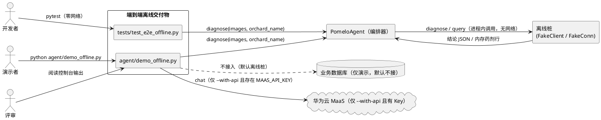
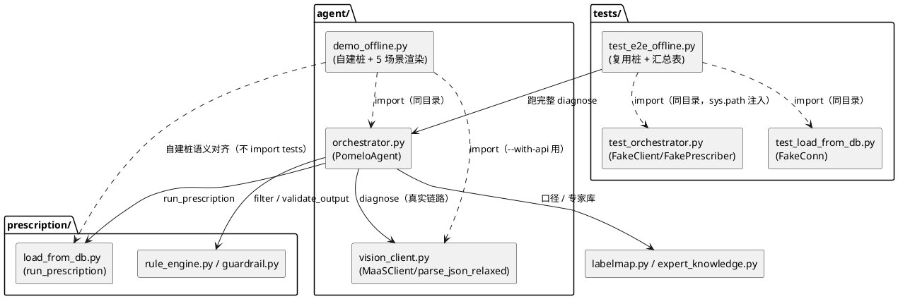
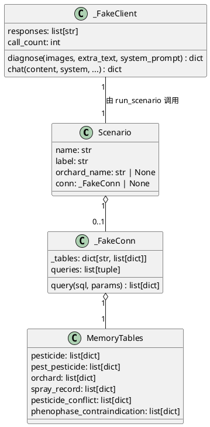

# 柚子树病虫害 AI 识别 · 全离线端到端交付物 技术设计文档

> 本文档对应 `.codeartsdoer/specs/e2e_offline/spec.md`，把"全离线冒烟测试 + 一键离线演示脚本 + 主链路文档"三项需求，映射为可落地的增量架构设计。
> 设计对象仓库：`E:\柚子病虫害AI识别\code\pomelo-algorithm`。

---

# 一、需求与存量功能关系分析

本章明确新需求与现有代码的关系，是增量设计的基础。所有代码位置均精确到文件（复杂逻辑标注行号），匹配度分档：100% / 75% / 50% / 25%。

## 1.1 需求功能与存量功能对比

### 1.1.1 已实现功能

存量代码已完整支撑的链路能力，本任务**直接复用、零改动**。

| 需求功能 | 存量功能 | 代码位置 | 匹配度 |
|---------|---------|---------|--------|
| 看图→判据→问诊→处方→输出的完整编排 | `PomeloAgent` 八分支短路口序编排 | `agent/orchestrator.py:121-490`（`diagnose` 157、`_finalize` 222） | 100% |
| 处方文案组件缺失时的本地直出卡片 | `_branch_local_card` / `_render_local_card`（仅用规则引擎放行药剂渲染） | `agent/orchestrator.py:362-381`、`416-436` | 100% |
| 出口护栏复核（白名单外药名拦截） | `validate_output(text, allowed)` 返回 `{is_valid, detected, violations, suggested_text}` | `prescription/guardrail.py:108-243` | 100% |
| 数据库适配层（行→dataclass→规则引擎） | `run_prescription(conn, pest, block, today) -> FilterOutput` | `prescription/load_from_db.py:336-359` | 100% |
| 类别口径唯一来源（含健康标签） | `CLASS_NAMES`、`HEALTHY_LABEL = "healthy"` | `labelmap.py:19-37` | 100% |
| 专家库通用防治建议与检疫判定 | `get_advice` / `get_general_advice` / `is_quarantine` | `expert_knowledge.py:149-190` | 100% |
| 图文诊断客户端与宽松 JSON 解析 | `MaaSClient.diagnose`、`parse_json_relaxed`、`validate_diagnosis` | `agent/vision_client.py:193-260` | 100% |
| 诊断桩（返回可解析结论 JSON + 模拟 Token） | `FakeClient.diagnose` | `tests/test_orchestrator.py:28-77` | 100% |
| 数据库桩（内存表按 SQL 路由） | `FakeConn.query/_route/_candidates` | `tests/test_load_from_db.py:103-170` | 100% |
| Token 汇总串（同 MaaSClient 风格） | `PomeloAgent.token_summary()` | `agent/orchestrator.py:149-153` | 100% |
| 八分支降级触发（解析失败/无组件/无药/无库） | `_build_result` 与各 `_branch_*` 的 `degraded` 标记 | `agent/orchestrator.py:175-399` | 100% |

### 1.1.2 需要扩展的功能

需求与存量部分匹配，需在既有基础上改造（**不改既有行为，仅做展示层扩展**）。

| 需求功能 | 存量功能 | 差异说明 | 扩展方向 |
|---------|---------|---------|---------|
| 冒烟测试结果汇总表（病害→结论→降级→Token→药名） | `token_summary()` 仅返回单行字符串 | 存量只给 Token 单行，缺"5 场景 × 5 字段"的表格化输出 | 在 `tests/test_e2e_offline.py` 内新增汇总表打印函数，聚合各 `AgentResult`；不改 `token_summary` |
| 一键离线演示（打印完整对话 + 卡片） | `agent/orchestrator.py:main` 已有 CLI，但强依赖 `MaaSClient`（无 Key 即退出） | 存量 CLI 无离线桩入口，无 Top 离线提示，无 Token 汇总表 | 新增 `agent/demo_offline.py` 作为独立入口，复用 `PomeloAgent`，自建桩；不改 `orchestrator.main` |
| 主 README 顶部模块清单登记新文件 | 主 README "项目结构"块（`README.md:7-30`） | 存量清单未登记 agent/、prescription/ 与新增文件 | 在既有代码块内插入新条目并标注状态，不改动其余章节 |

### 1.1.3 需要新增的功能或接口

需求在存量代码中完全没有对应实现，需新建。按业务模块分组：

**A. 自动化验证模块（新增测试）**
1. `tests/test_e2e_offline.py`（文件级新增）
   - **输入**：无外部输入，自包含构造 5 个场景。
   - **输出**：pytest 用例结果 + 标准输出中文汇总表。
   - **核心逻辑**：复用 `FakeClient`/`FakeConn`，跑完整 `PomeloAgent.diagnose`，按场景口径断言，末尾打印汇总表。
   - **依赖**：`agent/orchestrator.py`、`prescription/load_from_db.py`、`prescription/guardrail.py`、`tests/test_orchestrator.py`（桩）、`tests/test_load_from_db.py`（桩）。

**B. 演示模块（新增脚本）**
2. `agent/demo_offline.py`（文件级新增）
   - **输入**：命令行 `--with-api`、`--month`（可选）。
   - **输出**：控制台 5 场景对话 + 处方卡片 + 顶部离线提示 + 末尾 Token 汇总表。
   - **核心逻辑**：自建语义等价桩（`FakeClient`/`FakeConn`），按 `MAAS_API_KEY` 存在性决定走离线桩或 `MaaSClient`。
   - **依赖**：`agent/orchestrator.py`、`agent/vision_client.py`、`prescription/load_from_db.py`。
   - **关键约束**：**禁止** import `tests` 目录（避免生产代码反向依赖测试）。

**C. 文档模块（新增章节）**
3. `agent/README.md` 追加"智能体主链路"章节（六要素：定位 / ASCII 顺序图 / Token 标注 / 三种运行方式 / 降级说明 / 药名红线）。
4. 主 `README.md` "项目结构"块登记 `prescription/load_from_db.py`、`agent/orchestrator.py`、`agent/demo_offline.py`、`tests/test_e2e_offline.py` 并标注状态。

## 1.2 存量功能详细分析

本节对 1.1.1"已实现功能"做深入解读，明确其接口契约、扩展点与约束，作为增量设计的落点依据。

### 1.2.1 `PomeloAgent`（编排器）

- **接口契约**：
  - `__init__(client, conn=None, month=None, conf_floor=0.6, margin=0.15, prescriber=None)`：`conn=None` 表示未接数据库（自动降级）；`prescriber` 为注入点（测试可注入 `FakePrescriber`）。
  - `diagnose(images, extra_text="", orchard_name=None) -> AgentResult`：主链路唯一入口。
  - `answer_followup(result, answer_key, orchard_name=None) -> AgentResult`：问诊后验续答。
  - `token_summary() -> str`：Token 汇总串。
- **业务规则（八分支短路口序）**：`_finalize` 依次判定 → 低置信问诊(B2) → 健康(B3) → 检疫(B4) → 有库有地块开方(B5)/无药(B6) → 无库或无地块降级(B7/D0、D2)。
- **D1 直出触发点**：`_branch_prescribe` 中 `_load_prescriber()` 返回 `None`（`agent/prescribe_prompt.py` 不存在）→ 转 `_branch_local_card`。
- **扩展点**：`prescriber` 注入点；`_load_prescriber` 惰性导入 `agent.prescribe_prompt` 或 `prescribe_prompt`。
- **约束**：`_last_orchard` 记录地块名，`answer_followup` 缺省复用；`skip_guardrail=True` 仅用于 B3/B4/B6/解析失败，其余分支必经护栏。

### 1.2.2 `AgentResult`（结果对象，数据契约）

| 字段 | 类型 | 冒烟场景下的取值口径 |
|------|------|---------------------|
| `label` | `str` | 类别口径之一或 `healthy` |
| `confidence` | `float` | [0.0, 1.0] |
| `symptom` / `distinguish` | `str` | 来自诊断结论 `parsed` |
| `final_text` | `str` | 唯一对用户展示正文，冒烟场景必须非空 |
| `prescription` | `dict \| None` | D1 路径下为 `{"parsed": None, "text": ..., "allowed": list[Pesticide], "source": "local_rule_engine", "used_fallback": True}` |
| `degraded` | `bool` | D1=True；B3/B4=False |
| `warnings` | `list[str]` | 含降级原因（如"文案生成组件缺失，处方为规则引擎直出"） |
| `steps` | `list[str]` | 中文步骤日志 |
| `tokens` | `dict` | 含 `prompt/completion/total/calls`，离线桩下为模拟值 |
| `detection` | `dict \| None` | 归一化检测对象（含 top2） |

### 1.2.3 `validate_output`（出口护栏）

- **签名**：`validate_output(text: str, allowed_pesticide_names: list[str]) -> dict`
- **返回结构**：`{"is_valid": bool, "detected": list[str], "violations": list[str], "suggested_text": str}`
- **关键约束（对本任务的直接影响）**：
  1. `PESTICIDE_SUFFIXES` 含 `"药"`（`guardrail.py:43`），故含"药"字的措辞（黄龙"无药可治"、健康"停止用药"）会被判为**疑似药名**并进入 `violations`。
  2. 因此检疫/健康场景**不可能**整段 `is_valid=True`，须改用"违规项 ∩ 真实药剂名黑名单 = ∅"口径（对应 spec R5）。
- **扩展点**：无；只读使用。

### 1.2.4 测试桩口径（复用契约）

- `FakeClient.diagnose` 返回 `{text, parsed, prompt_tokens=10, completion_tokens=5, total_tokens=15, latency_s, model}`，`parsed` 由真实 `parse_json_relaxed` 解析（`tests/test_orchestrator.py:38-55`）。
- `FakeConn.query` 按表名/SQL 路由（`pesticide` JOIN `pest_pesticide` → `_candidates`；`orchard` → `_orchard`；`spray_record`；`pesticide_conflict`；`phenophase_contraindication`），并记录 `conn.queries`（`tests/test_load_from_db.py:103-170`）。
- **复用方式**：`tests/` 无 `__init__.py`，pytest 将测试文件所在目录注入 `sys.path`。`tests/test_orchestrator.py:22` 已用 `from test_load_from_db import FakeConn, _pesticide_row`。故 `tests/test_e2e_offline.py` 可同法 `from test_orchestrator import FakeClient, FakePrescriber, _diag` 与 `from test_load_from_db import FakeConn, _pesticide_row`。

### 1.2.5 存量约束（继承红线）

1. **只读文件**：`labelmap.py`、`prescription/rule_engine.py`、`prescription/guardrail.py`、`expert_knowledge.py` 既有行为不得改动。
2. **编排器既有行为**：八分支短路口序与降级判定不得改动；本任务只新增外围文件。
3. **白名单取值路径（关键核实结论）**：D1 卡片场景下 `result.prescription["parsed"] is None`，`_build_whitelist` 的 `parsed` 分支不生效；白名单**仅有** `result.prescription["allowed"]` 各项 `common_name` 一条来源。即：
   - 白名单 = `[item.common_name for item in result.prescription["allowed"]]`（`allowed` 为 `list[Pesticide]`）。
   - 这也是 `_branch_local_card` 内 `whitelist` 的构造依据（`agent/orchestrator.py:367-368`）。
   - E2E 断言须走**同一路径**取白名单，禁止自行硬编码药名。
4. **零网络**：默认链路不得发起真实请求；`MaaSClient` 仅在显式 Key + `--with-api` 下使用。
---

# 二、增量设计方案

本章把需求转化为可落地的技术方案。组织顺序：先整体（上下文/架构）后局部（子系统流程）；接口设计优先于数据模型；每个决策附选择理由。

## 2.1 实现模型

### 2.1.1 上下文视图

本交付物（冒烟测试 + 演示脚本）对外只依赖"Python/pytest 运行环境"，对下游只依赖编排器与桩；仅演示脚本在 `--with-api` 且存在 Key 时外联 MaaS。



**通信口径**：
1. 测试与演示默认对桩为**进程内直调**（无网络、无中间件）。
2. 演示脚本 `--with-api` 分支才可能外联 MaaS（`requests.post`），调用频率为每场景 1 次诊断。
3. 无消息队列、无缓存、无跨进程通信。

### 2.1.2 服务/组件总体架构



依赖频率标注：`E2E → Agent` 每用例 1 次；`Demo → Agent` 每场景 1 次；`Agent → LDB/RE` 每开方场景 1 次；`Demo → tests/*` **无依赖（红线）**。

### 2.1.3 实现设计文档

#### A. E2E 冒烟测试设计（`tests/test_e2e_offline.py`）

**A1. 桩来源（复用，非自建）**

复用 `tests/test_orchestrator.py` 与 `tests/test_load_from_db.py` 的桩，导入方式与既有 `test_orchestrator.py` 一致（同目录 + `sys.path` 注入）：

```python
ROOT = Path(__file__).resolve().parent.parent
for _path in (str(ROOT), str(ROOT / "tests")):
    if _path not in sys.path:
        sys.path.insert(0, _path)

from test_load_from_db import FakeConn, _pesticide_row          # 数据库桩
from test_orchestrator import FakeClient, _diag, _make_conn     # 诊断桩与工具

from agent.orchestrator import PomeloAgent                       # 被侧对象
from prescription.guardrail import validate_output               # 断言用护栏
```

理由：`tests/` 无 `__init__.py`，pytest 已把测试目录注入 `sys.path`，既有 `test_orchestrator.py:22` 即用此法复用，属既有约定，不引入新机制。

**A2. 五场景构造表**

| 场景 | `_diag` 构造 | `FakeConn` 候选 | `orchard_name` | 预期分支 | `degraded` | 白名单来源 |
|------|-------------|----------------|----------------|---------|-----------|-----------|
| 红蜘蛛 | `_diag("red_spider_mite", 0.9)` | 阿维菌素 | `"测试地块"` | B5→D1 | `True` | `prescription["allowed"]` → 阿维菌素 |
| 炭疽 | `_diag("anthracnose", 0.9)` | 螺螨酯 | `"测试地块"` | B5→D1 | `True` | 同左 → 螺螨酯 |
| 溃疡 | `_diag("canker", 0.9)` | 氢氧化铜 | `"测试地块"` | B5→D1 | `True` | 同左 → 氢氧化铜 |
| 黄龙 | `_diag("greening", 0.9)` | 不查库（`conn=None`） | `None` | B4 检疫 | `False` | 空集合 |
| 健康 | `_diag("healthy", 0.9)` | 不查库 | `None` | B3 健康 | `False` | 空集合 |

构造要点：
1. 可开方场景的 `conn` 用 `_make_conn` 建"测试地块"（含 `orchard` 行），候选药剂通过 `pest_pesticide` 链接绑定对应 `pest_name`。
2. 测试固定 `month=10`（`PomeloAgent(client, conn=conn, month=10)`），避免依赖运行当日月份，保证健康建议文本可复现。
3. 不使用 `prescriber`（保持 `agent/prescribe_prompt.py` 缺失现状），以真实触发 D1 直出。

**A3. 断言口径（按场景分档，与 spec R4/R5/R6 对齐）**

- **可开方场景（红蜘蛛/炭疽/溃疡）**：
  1. `result.final_text` 为非空字符串；
  2. `result.degraded is True`；
  3. 白名单经**同路径**取值：`whitelist = [p.common_name for p in result.prescription["allowed"]]`；
  4. `validate_output(result.final_text, whitelist)["is_valid"] is True` 且 `violations == []`。
- **检疫场景（黄龙）**：
  1. `final_text` 非空；含"上报""木虱""挖除"；
  2. 真药剂黑名单逐个断言**不出现**于 `final_text`；
  3. `violations = validate_output(final_text, [])["violations"]`，断言 `set(violations) & set(BLACKLIST) == set()`（允许"无药"等误报）。
- **健康场景**：
  1. `final_text` 非空；含"未检出目标病害"；
  2. 真药剂黑名单逐个不出现；
  3. 同上交集断言为 ∅。

**A4. 零网络策略**：以 `monkeypatch.setattr("requests.post", boom)`（`boom` 抛 `AssertionError`）覆盖**整个测试文件**的所有用例；桩为纯进程内实现，任何被误触发的真实请求都会因异常而失败并暴露问题。测试文件级别的 `autouse` fixture 保证无一遗漏。

**A5. 汇总表打印**：文件末尾用一个"汇总"用例（或 `module` 级 fixture 收集结果后打印）打印中文表，列头固定为"病害 | 结论 | 是否降级 | Token 数 | 处方药名"。Token 数取 `result.tokens["total"]`，药名取白名单或"—"。表头与 5 行数据一次性 `print`，供 `capsys` 捕获断言。

**A6. 异常场景处理**：若某场景白名单为空导致断言失败，说明规则引擎在该候选下全部拒绝（需修测试构造或定位真实缺陷），不得改只读文件规避；修复优先落于新写文件。

#### B. 一键离线演示脚本设计（`agent/demo_offline.py`）

**B1. 桩来源（自建等价桩，禁止反向依赖）**

脚本位于 `agent/`，**禁止** import `tests`。脚本内自建两名桩，语义与字段口径对齐测试桩：

| 桩 | 对齐对象（semantics） | 实现要点 |
|----|---------------------|---------|
| `FakeClient` | `tests/test_orchestrator.py:FakeClient` | `diagnose(images, extra_text="", system_prompt=None)` 返回 `{text, parsed=parse_json_relaxed(text), prompt_tokens=10, completion_tokens=5, total_tokens=15, latency_s, model}` |
| `FakeConn` | `tests/test_load_from_db.py:FakeConn` | `query(sql, params)` 按 SQL 路由返回内存行；实现 `pesticide` JOIN `pest_pesticide`、`orchard`、`spray_record`、`pesticide_conflict`、`phenophase_contraindication` 五类路由 |

差异（可控）：演示桩**不做** `_assert_columns_exist` 列校验（那是测试专用职责），仅做路由；`parse_json_relaxed` 直接复用生产模块 `agent.vision_client`。

**B2. 五场景渲染**：与 A2 场景表完全一致（红蜘蛛/炭疽/溃疡/黄龙/健康），逐场景打印：诊断结论（中文 via `CLASS_CN`）→ `final_text` → 步骤日志 → 是否降级 → Token。可开方场景额外调用 `_render_local_card` 产出的卡片即 `final_text`，直接打印。

**B3. 顶部离线提示**（`print` 醒目横幅）：含"【离线演示】未调用真实 API，Token 为模拟值；配置 MAAS_API_KEY 后自动切到真实链路"关键字。

**B4. `--with-api` 分支**：
- 参数解析用 `argparse`：`--with-api`（开关）、`--month`（默认 10 或当前月）。
- 判定：`use_api = args.with_api and os.getenv("MAAS_API_KEY")`。
- 为真 → `client = MaaSClient()`（真实链路，可能联网）；为假 → `client = _FakeClient(...)`；若 `--with-api` 但无 Key → 回退离线桩并打印提示，不中断。
- 真实调用异常用 `try/except` 包住并给可读提示，**禁止**打印 Key 内容。

**B5. 末尾 Token 汇总表**：聚合 5 场景 `result.tokens`，打印"调用次数 / 输入 / 输出 / 合计"四列汇总。

**B6. 可选 `--out=token_usage.jsonl`** 之类落盘**不实现**（避免产生需 gitignore 的产物）；如用户后续需要再议。

#### C. README 更新方案

**C1. `agent/README.md` 追加"智能体主链路"章节**

- 插入位置：文件**末尾**（当前 140 行文档结束）**之后**追加，**不触碰**既有"病害鉴别判断模块对接说明"各章节（附录位置与行号见 2.1.4 落地清单）。
- 章节内容六要素：
  1. **一句话定位**：这是本项目唯一对外入口。
  2. **ASCII 顺序图**：
     ```
     图片 → [MaaS 多模态诊断] → 口径校验 → 置信度判据 → 鉴别问诊(可选)
          → 处方规则引擎(本地) → 文案生成(MaaS) → 药名护栏(本地) → 输出
     ```
  3. **Token 标注**：诊断（消耗）/ 问诊（不新增调用，避免二次消耗）/ 文案生成（消耗，现缺失故走 D1）；口径校验、规则引擎、护栏**纯本地不消耗**。
  4. **三种运行方式**：离线演示（`python agent/demo_offline.py`）/ 接数据库（传入 conn）/ 接真实 API（`setx MAAS_API_KEY "..."` + `python agent/orchestrator.py --image ...`）。
  5. **降级说明**：`degraded=True` 四种触发条件（解析失败 / 文案组件缺失 / 可用药剂为空 / 无库或无地块）。
  6. **红线**：药名只能来自处方引擎放行清单（allowed），护栏是最后一道闸。

**C2. 主 `README.md` 登记模块清单**

- 插入位置：文件现有"项目结构"代码块内，`README.md:28`（`│   └── README.md ...` postprocess 行）之后、`README.md:29`（`└── tests/` 行）处。将原 `└── tests/` 行**替换**为下列多行（保持 ASCII 树连接符正确）：

  ```
  ├── agent/                        # 智能体主链路（唯一对外入口）
  │   ├── orchestrator.py           # 主编排器：八分支编排 + D1 本地直出卡片（已完成）
  │   ├── demo_offline.py           # 一键离线演示脚本（已完成；--with-api 待接真实 API）
  │   ├── vision_client.py          # 华为云 MaaS 多模态客户端
  │   └── README.md                 # 病害鉴别 + 智能体主链路说明
  ├── prescription/                 # 处方规则引擎与出口护栏
  │   ├── load_from_db.py           # 数据库适配层：行 → dataclass → 规则引擎（已完成）
  │   ├── rule_engine.py            # 安全间隔期/抗药性/配伍禁忌规则（只读）
  │   └── guardrail.py              # 药名白名单出口护栏（只读）
  ├── tests/
  │   ├── test_e2e_offline.py       # 全离线端到端冒烟（已完成）
  │   └── （既有测试）
  └── ...
  ```

- 状态标注口径：`load_from_db.py` / `orchestrator.py` / `demo_offline.py` / `test_e2e_offline.py` 标"已完成"；真实 API 链路标"待接真实 API"。
- **不改动**"类别映射表""算法操作守则"等其余章节。

#### D. 实现步骤概览

见 2.4 实现步骤。

#### E. 风险与缓解

见 2.5 风险与缓解。

### 2.1.4 落地清单（准确插入点与行号）

| 文件 | 操作 | 插入位置（当前行号） | 不改动范围 |
|------|------|-------------------|-----------|
| `tests/test_e2e_offline.py` | 新建 | 整体新建 | — |
| `agent/demo_offline.py` | 新建 | 整体新建 | — |
| `agent/README.md` | 追加 | 第 140 行之后（文档末尾） | 1-139 行原样保留 |
| `README.md` | 替换一行 | 第 29 行 `└── tests/...` 整行替换为 2.1.3-C2 的块 | 1-28、30-77 行保留 |
| `.codeartsdoer/specs/e2e_offline/design.md` / `tasks.md` | 新建 | 本目录 | — |

## 2.2 接口设计

### 2.2.1 总体设计

接口分类依据：**测试入口**、**演示入口**、**桩契约**、**断言辅助**四类。命名与业务语言一致。

| 接口 | 分类 | 载体 | 稳定性 | 说明 |
|------|------|------|--------|------|
| `PomeloAgent.diagnose` | 复用（下游） | `agent/orchestrator.py` | 稳定，只读使用 | 主链路入口 |
| `validate_output` | 复用（下游） | `prescription/guardrail.py` | 稳定，只读使用 | 断言护栏 |
| `_FakeClient.diagnose` | 新建（桩契约） | `agent/demo_offline.py` | 实验（内部） | 演示桩，与测试桩同构 |
| `_FakeConn.query` | 新建（桩契约） | `agent/demo_offline.py` | 实验（内部） | 演示桩路由 |
| `build_scenarios()` | 新建（辅助） | 两个新文件各一份 | 实验 | 构造 5 场景输入 |
| `print_summary(rows)` | 新建（辅助） | 两文件各一份 | 实验 | 中文汇总表 |
| `main(argv)` | 新建（演示入口） | `agent/demo_offline.py` | 稳定 | CLI 入口 |

**接口变更策略**：新增文件内部辅助接口不对外承诺；对 `PomeloAgent`/`validate_output` 只做调用，不修改其签名。

### 2.2.2 接口清单

**接口组 1：E2E 测试入口与辅助**

```python
# tests/test_e2e_offline.py
def build_scenarios() -> list[Scenario]
def run_scenario(scenario: Scenario) -> AgentResult
def assert_valid_prescribe(result: AgentResult) -> None   # 可开方场景口径
def assert_quarantine_or_healthy(result: AgentResult) -> None  # 检疫/健康口径
def print_summary(rows: list[tuple[str, str, bool, int, str]]) -> None
```

- 业务说明：5 场景构造、执行与分档断言、汇总表输出。
- 前置条件：`sys.path` 已注入 `tests/` 与仓库根。
- 后置条件：pytest 收集 ≥ 5（实测更多）用例；汇总表写入 stdout。
- 异常映射：断言失败 → `AssertionError`；桩返回空 → 触发非空断言。
- 调用示例：
  ```python
  result = PomeloAgent(client, conn=conn, month=10).diagnose(["leaf.jpg"], orchard_name="测试地块")
  whitelist = [item.common_name for item in result.prescription["allowed"]]
  assert validate_output(result.final_text, whitelist)["is_valid"] is True
  ```

**接口组 2：演示入口**

```python
# agent/demo_offline.py
class _FakeClient:
    def diagnose(self, images, extra_text="", system_prompt=None) -> dict: ...
    def chat(self, content, system=None, temperature=0.0, max_tokens=2048, model=None) -> dict: ...

class _FakeConn:
    def query(self, sql: str, params=None) -> list[dict]: ...

def build_scenarios() -> list[tuple[str, str, dict | None, str | None]]: ...
def render_scenario(client, conn, label, orchard_name) -> tuple[str, bool, int, str]: ...
def print_banner(use_api: bool) -> None: ...
def print_token_summary(results: list[AgentResult]) -> None: ...
def main(argv: list[str] | None = None) -> int: ...
```

- 业务说明：离线演示 5 场景；`--with-api` 时切真实客户端。
- 前置条件：无（离线默认）。
- 后置条件：stdout 含 5 场景标记、离线横幅、Token 汇总表；返回 0。
- 异常映射：真实调用失败 → 捕获后打印可读提示（不打印 Key、不抛堆栈）。
- 调用示例（断言用，非实现）：
  ```python
  # 离线：断言未使用真实客户端
  code = main([])                      # 无 --with-api
  # 联网：存在 Key 时
  code = main(["--with-api"])          # MAAS_API_KEY 存在 → MaaSClient
  ```

**接口组 3：桩契约（与测试桩对齐）**

```python
# 桩返回的 diagnose 载荷字段
{
    "text": str,
    "parsed": dict | None,     # parse_json_relaxed(text)
    "prompt_tokens": int,      # 固定 10
    "completion_tokens": int,  # 固定 5
    "total_tokens": int,       # 15
    "latency_s": float,
    "model": str,
}
```

- 业务说明：模拟单次多模态诊断返回，供 `PomeloAgent` 解析。
- 前置条件：`images` 元素可为任意占位路径（桩不做磁盘校验）。
- 后置条件：`parsed` 可被 `_normalize_detection` 消费。
- 异常映射：无。
- 调用示例（桩内部）：
  ```python
  parsed = parse_json_relaxed(text)
  return {"text": text, "parsed": parsed, "prompt_tokens": 10,
          "completion_tokens": 5, "total_tokens": 15, "latency_s": 0.0, "model": "fake-vl"}
  ```

## 2.3 数据模型

### 2.3.1 设计目标

1. **支持场景**：5 个冒烟场景（4 病害 + 健康）各一例，覆盖开方/检疫/健康三类输出；演示脚本复用同构场景。
2. **性能/容量**：单场景端到端 ≤ 50ms（纯内存字符串拼装与内存查询），冒烟测试全文件 ≤ 5s。
3. **兼容策略**：桩数据字段与 `FakeConn` 内存表口径一致，与 `schema.sql` 列语义对齐；不引入任何持久化，不与存量数据冲突。
4. **零产物**：模型不落盘，不产生 `token_usage.jsonl` / `eval_*.json`。

### 2.3.2 模型实现

演示桩与测试桩共享同一内存数据结构模型（概念层）：



模型要点：
1. **`Scenario`**：单场景输入封装（名称/标签/地块名/连接）。
2. **`_FakeConn._tables`**：六类内存表，路由按 SQL 文本匹配，返回 `list[dict]`。
3. **对象生命周期**：每个场景独立构造 `_FakeConn`，用完即弃；`_FakeClient` 每场景新建，避免状态串场。
4. **持久化策略**：无（内存），不产生任何文件。
## 2.4 实现步骤

> 顺序遵循"先回归基线，再补测试，再演示，最后文档；文档与仓库卫生收尾"。每步均可独立验证。

| 步骤 | 名称 | 主要动作 | 涉及文件 | 完成判据 |
|------|------|---------|---------|---------|
| S0 | 基线回归 | 跑全量测试，确认既有 200 全绿；如有失败，优先在新写三文件内修复 | 无（只读排查） | `pytest tests -q` 退出码 0 |
| S1 | 编写 E2E 冒烟 | 复用 `FakeClient`/`FakeConn`，构造 5 场景，分档断言，零网络 fixture，打印汇总表 | `tests/test_e2e_offline.py` | 新文件全绿、零网络 |
| S2 | 编写离线演示 | 自建等价桩，5 场景渲染，顶部横幅，`--with-api` 分支，Token 汇总表 | `agent/demo_offline.py` | `python agent/demo_offline.py` 跑完并打印 5 场景 |
| S3 | 更新 agent/README | 末尾追加"智能体主链路"六要素章节 | `agent/README.md` | 章节含全部要素 |
| S4 | 更新主 README | 替换 `└── tests/` 行，登记新文件与状态 | `README.md` | 清单含 4 新条目与状态标注 |
| S5 | 全量回归与验收 | 重跑全量测试与演示脚本，核对用例数 ≥190 | 无 | 全绿 + 脚本可跑 |
| S6 | 仓库卫生 | `git status --porcelain` 复核；`git check-ignore` 复核产物与密钥 | `.gitignore`（只读核对） | 仅应动文件；产物/密钥不在索引 |

**步骤依赖**：S1、S2 依赖 S0；S3、S4 可并行，依赖 S1/S2 定稿（确保文档与实现一致）；S5 依赖 S1-S4；S6 依赖 S5。

**修复优先级**：任何失败优先改 S1/S2 新写文件；确需改只读文件（`labelmap.py`/`rule_engine.py`/`guardrail.py`/`expert_knowledge.py`）时须先说明理由。

## 2.5 风险与缓解

| 编号 | 风险 | 影响 | 缓解措施 |
|------|------|------|---------|
| RK1 | 护栏"药"字后缀导致检疫/健康整段 `is_valid` 必为假 | 若按"整段通过"断言，测试必然失败 | 采用 spec R5 分档口径：检疫/健康改断言"违规项 ∩ 真药剂黑名单 = ∅"；黄龙单独断言零真药剂 + 四要点 |
| RK2 | 演示桩与测试桩语义漂移 | 演示与测试结论不一致 | 桩字段/返回结构逐项对齐（见 2.1.3-B1、2.2.2 接口组 3）；在 design 记录对齐表，实现后以脚本输出人工核对 |
| RK3 | `螺螨酯` / `氢氧化铜` 在规则引擎被拒导致可开方场景白名单为空 | E2E 断言失败 | 构造候选时 `is_banned=0`、`is_registered_for_citrus=1`、`phi` 合规且无收获期约束；若仍被拒，先定位是否真实缺陷，再决定是否调构造 |
| RK4 | 健康月度建议文本含真药剂名 | 健康场景零药剂断言失败 | 测试固定 `month=10`（文案已核实无真药剂名）；若某月文案含药名，改断言口径须回到 spec 确认（禁止改只读知识库） |
| RK5 | 演示脚本意外 import `tests` | 生产代码反向依赖测试 | 代码评审 + 断言脚本无 `tests` 导入；桩自建于脚本内 |
| RK6 | `--with-api` 真实调用泄漏 Key 或抛堆栈 | 安全/体验风险 | `try/except` 包住，打印可读提示；禁止打印 Key；默认离线不受影响 |
| RK7 | 运行产物误入 git | 仓库卫生风险 | 不实现落盘开关；`.gitignore` 已覆盖 `*.jsonl`/`eval_*.json`/密钥；S6 用 `git check-ignore` 复核 |
| RK8 | 用例总数不足 190 | 验收不达标 | 新增 5 场景各至少 1 用例（可含汇总断言），确保 pytest 正确收集（`test_` 前缀） |
| RK9 | README 插入破坏既有内容 | 文档回归 | 严格按 2.1.4 行号替换/追加，`agent/README.md` 仅末尾追加、主 README 仅替换单行 |

## 2.6 需求追溯

| 需求 | 设计落点 |
|------|---------|
| R1 全量测试全绿 ≥190 | S0/S5；不动只读文件 |
| R2 只读红线 | 1.2.5-1；S0 修复优先级 |
| R3 5 场景非空文本 | 2.1.3-A2、A3 |
| R4 可开方整段 `is_valid=True` | 2.1.3-A3（白名单同路径取值） |
| R5 检疫/健康违规项口径 | 2.1.3-A3、2.5-RK1 |
| R6 黄龙零真药剂 + 四要点 | 2.1.3-A3 |
| R7 零网络 | 2.1.3-A4 |
| R8 中文汇总表 | 2.1.3-A5 |
| R9 演示 5 场景不联网 | 2.1.3-B2 |
| R10 顶部离线提示 | 2.1.3-B3 |
| R11 Token 汇总表 | 2.1.3-B5 |
| R12 `--with-api` 分支 | 2.1.3-B4 |
| R13 桩复用/无反向依赖 | 2.1.3-A1、B1 |
| R14 agent/README 六要素 | 2.1.3-C1 |
| R15 主 README 清单 | 2.1.3-C2 |
| R16 产物/密钥不入库 | 2.1.3-B6、2.5-RK7 |
| R17 仅应动文件 | S6 |

---

## 附录：git 红线（明确口径）

**应纳入 git（新增/修改）**：
- `tests/test_e2e_offline.py`（新增）
- `agent/demo_offline.py`（新增）
- `agent/README.md`（追加章节）
- `README.md`（登记模块清单）
- `.codeartsdoer/specs/e2e_offline/design.md`、`tasks.md`（本设计产物）

**禁止纳入 git（根 `.gitignore` 已覆盖）**：
- `agent/token_usage.jsonl` 及一切 `*.jsonl`
- `eval_*.json` 及运行报告类 json
- 含密钥文件：`.env`、`*.key`、`*secret*`、`*credential*`
- `__pycache__/`、`.pytest_cache/` 等构建缓存

**复核命令**：`git status --porcelain`（仅应动文件）、`git check-ignore -v <路径>`（确认产物被忽略）。