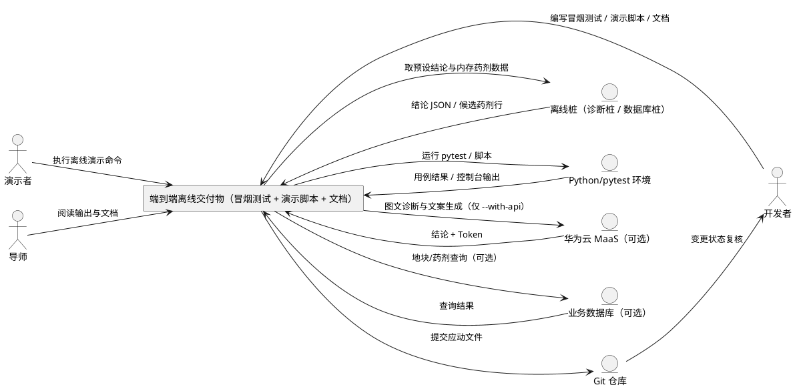
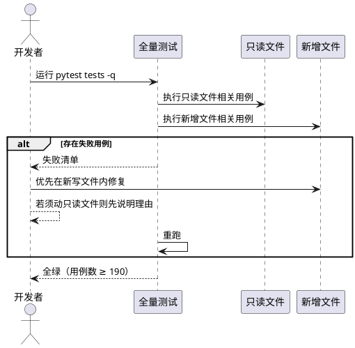
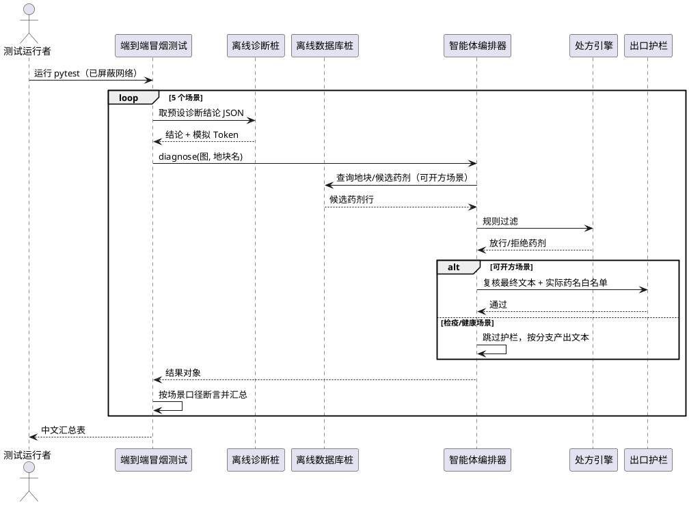
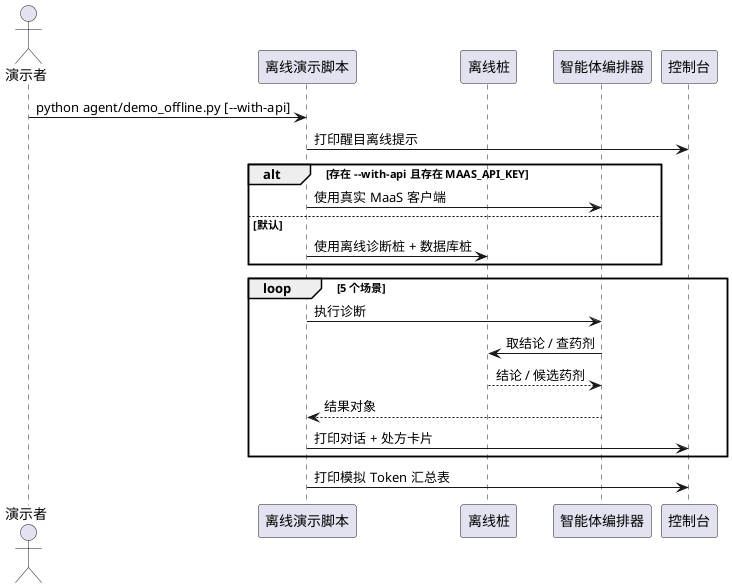
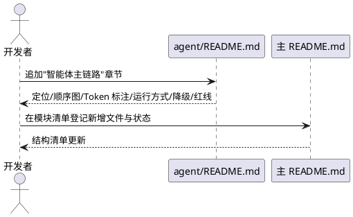
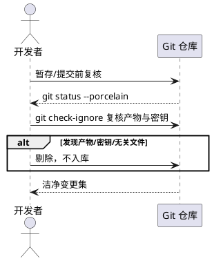

# **1. 组件定位**

## **1.1 核心职责**
本组件负责交付"全离线端到端冒烟测试 + 一键离线演示脚本 + 主链路技术文档"三件产物，为导师演示提供不联网也能跑通完整链路、且可复现的合规证据。

## **1.2 核心输入**
1. 全量测试命令（`python -m pytest tests -q`），来源为开发者/评审操作。
2. 一键离线演示命令（`python agent/demo_offline.py`），来源为演示者操作。
3. 离线桩数据：诊断结论 JSON 文本与内存候选药剂数据，来源为测试桩（FakeClient / FakeConn）。
4. 可选真实链路配置：`MAAS_API_KEY` 环境变量与业务数据库连接，来源为系统管理员（仅离线演示脚本的开关分支使用）。
5. 既有主链路实现：智能体编排器、数据库适配层、处方规则引擎、出口护栏，来源为已交付代码。
6. 既有测试基线：200 个全绿用例，来源为仓库既有测试集。

## **1.3 核心输出**
1. 全绿的全量测试结果（用例总数不低于 190）。
2. 新增的端到端冒烟测试文件，及其在标准输出打印的中文汇总表。
3. 一键离线演示脚本的 5 个场景对话与处方卡片，及末尾的模拟 Token 汇总表。
4. 更新后的 `agent/README.md`"智能体主链路"章节与主 `README.md` 顶部模块清单。
5. 仅含本任务应动文件的洁净 git 变更集。

## **1.4 职责边界**
1. 不负责实现尚未存在的处方文案生成组件（`agent/prescribe_prompt.py`）；本任务明确其在离线链路中**保持缺失**。
2. 不负责修改 `labelmap.py`、`prescription/rule_engine.py`、`prescription/guardrail.py`、`expert_knowledge.py` 的既有行为（只读红线）。
3. 不负责真实 MaaS 联调与真实数据库接入，仅为离线演示脚本保留开关与文档说明。
4. 不负责改动智能体编排器的既有分支行为（含八分支短路口序与降级判定）。
5. 不负责把运行产物（`token_usage.jsonl`、`eval_*.json`）或任何含密钥的文件纳入版本库。

---

# **2. 领域术语**

**全离线端到端冒烟**
: 在完全不发起真实网络请求的前提下，用桩客户端与桩数据库跑通"看图诊断 → 判据 → 处方 → 输出"完整链路，并断言最终文本合规的自动化测试。

**离线桩（FakeClient / FakeConn）**
: 测试与演示共用的替身。FakeClient 返回可直接解析的诊断结论 JSON 文本；FakeConn 以内存数据表按 SQL 路由返回候选药剂行。

**降级（degraded）**
: 因缺少数据库、缺少处方文案生成组件、结论解析失败、可用药剂为空等原因，无法产出完整链路结果时的兜底输出状态。

**D1 本地直出卡片**
: 当处方文案生成组件缺失、但有数据库与地块名时的降级路径——仍执行处方规则引擎过滤，再由编排器本地渲染处方卡片，不调用大模型文案生成。

**出口护栏**
: 产出最终文本前对药名做白名单复核的本地防护机制，拦截未登记农药。

**白名单**
: 出口护栏允许出现的药名集合，本任务中取"本次处方实际放行的药剂通用名"。

**真实药剂名黑名单**
: 验收断言使用的显式药剂名集合（如阿维菌素、螺螨酯、氢氧化铜、吡虫啉等），用于校验检疫/健康输出中不含任何真实药剂。

**检疫性病害（greening）**
: 柑橘黄龙病。检出即须上报；该病害无有效治疗药剂，输出中禁止出现任何治疗药剂名。

**模拟 Token**
: 离线桩在无真实调用时返回的 Token 计量值（固定输入/输出值），仅用于离线演示与测试断言，不代表真实消耗。

---

# **3. 角色与边界**

## **3.1 核心角色**
**导师/评审**：观看离线演示、核对链路完整性与合规红线。
**开发者**：把全量测试修到全绿，编写端到端冒烟测试与离线演示脚本。
**演示者**：执行一键离线演示脚本、阅读中文输出与 Token 汇总。

## **3.2 外部系统**
**华为云 MaaS**：仅在离线演示脚本 `--with-api` 开关且存在 Key 时被调用；默认不参与链路。
**业务数据库**：提供地块、候选药剂、施药历史等查询；离线链路由桩数据库承担。
**Python/pytest 运行环境**：承载测试与脚本执行（`D:/anaconda3/python.exe`）。
**Git 仓库**：承载变更提交，须保证运行产物与密钥文件不入库。

## **3.3 交互上下文**

---

# **4. DFX约束**

## **4.1 性能**
1. 离线演示脚本单场景端到端耗时上限：50 毫秒（纯本地字符串拼装与内存查询）。
2. 端到端冒烟测试全文件执行耗时上限：5 秒（不含 pytest 收集开销）。
3. 全量测试执行须在本地一次性完成，不得依赖外部服务。

## **4.2 可靠性**
1. 5 个冒烟场景（红蜘蛛/炭疽/溃疡/黄龙/健康）任一场景必须产出非空最终文本，不得抛出未捕获异常。
2. 处方文案生成组件缺失、数据库未接入等情形，必须自动降级且不影响产出，不得中断链路。
3. 离线演示脚本在无 `MAAS_API_KEY` 时也必须完整跑完 5 个场景。

## **4.3 安全性**
1. 默认链路**零真实网络请求**；端到端冒烟测试须在屏蔽网络（`requests.post` 抛异常）时仍全绿。
2. 检疫性病害（黄龙病）与健康结论的最终文本中禁止出现任何真实药剂名。
3. 任何含密钥的文件（`.env`、`*.key`、`*secret*`、`*credential*`）与运行产物（`token_usage.jsonl`、`eval_*.json`）禁止加入 git；脚本禁止打印密钥内容。

## **4.4 可维护性**
1. 端到端冒烟测试与离线演示脚本的中文输出须包含"病害 → 结论 → 是否降级 → Token 数 → 处方药名"字段，便于评审核对。
2. 演示脚本顶部须有醒目离线提示，避免把模拟 Token 误读为真实消耗。
3. 测试与脚本的中文注释、函数命名须与仓库既有风格一致（蛇形命名、中文 docstring）。

## **4.5 兼容性**
1. 处方文案生成组件（`prescribe_prompt`）缺失时，有数据库与地块名的链路必须自动走 D1 本地直出卡片路径，不得因缺失而放弃处方规则引擎的安全校验。
2. 离线演示脚本的桩复用不得引入"生产代码反向依赖 tests 目录"的耦合；若物理复用会形成反向依赖，则须在脚本内自建语义等价的桩。
3. 所有新增/修改须与既有类别口径（labelmap）一致，不得自行维护类别定义。

---

# **5. 核心能力**

## **5.0 需求总览**

| 编号 | 类型 | 需求描述（EARS） | 验证方法 | 优先级 | 依赖 |
|---|---|---|---|---|---|
| R1 | 强制·普遍型 | 系统应保证全量测试全绿且用例总数不低于 190 | 运行 pytest，断言退出码为 0 且收集用例数 ≥190 | P0 | 既有测试集 |
| R2 | 强制·约束型 | 修复缺陷时禁止改变四个只读文件的既有行为 | 对应只读文件测试保持通过；代码评审确认 | P0 | labelmap/rule_engine/guardrail/expert_knowledge |
| R3 | 强制·事件驱动 | 当运行端到端冒烟时，系统应对 5 个场景各一例跑完整诊断且每例最终文本非空 | 断言 5 例 final_text 均为非空字符串 | P0 | 编排器、处方适配层、离线桩 |
| R4 | 强制·事件驱动 | 当可开方病害（红蜘蛛/炭疽/溃疡）产出最终文本时，系统应以本次处方实际药名为白名单复核并判定通过 | 断言 validate_output(final_text, 实际药名).is_valid 为 True | P0 | 出口护栏、处方引擎 |
| R5 | 强制·状态型 | 当结论为检疫性或健康时，系统应把断言口径由"整段通过"改为"违规项不含任何真实药剂名" | 断言 violations 与真实药剂名黑名单交集为空 | P0 | 出口护栏 |
| R6 | 强制·状态型 | 当结论为检疫性（greening）时，系统应断言最终文本不含任何药剂名且含四项处置要点 | 黑名单断言 + 断言含"上报""木虱""挖除" | P0 | 专家知识库 |
| R7 | 强制·普遍型 | 系统应在整个冒烟测试中不发起任何真实网络请求 | 屏蔽 requests.post 使其抛异常后测试仍全绿 | P0 | — |
| R8 | 强制·事件驱动 | 当冒烟测试结束时应打印中文汇总表（病害/结论/降级/Token/药名） | 捕获 stdout 断言含 5 行场景与 5 列字段 | P1 | — |
| R9 | 强制·事件驱动 | 当执行离线演示脚本时应打印 5 场景完整对话与处方卡片且全程不联网 | 运行脚本断言含 5 场景标记且零网络 | P0 | 离线桩、编排器 |
| R10 | 强制·普遍型 | 系统应在脚本顶部打印醒目离线提示（未调用真实 API、Token 为模拟值、配 Key 后切换） | 断言输出含该提示关键字 | P1 | — |
| R11 | 强制·事件驱动 | 当脚本结束时应打印模拟 Token 汇总表 | 断言输出含调用次数/输入/输出/合计 | P1 | — |
| R12 | 可选·事件驱动 | 当提供 `--with-api` 且存在 MAAS_API_KEY 时应改用真实客户端，否则回退离线桩 | 有 Key 断言用真实客户端；无 Key 断言用离线桩 | P2 | 视觉诊断客户端 |
| R13 | 强制·约束型 | 系统应在离线脚本中复用与测试等价的桩口径，且不得引入生产对测试的反向依赖 | 断言脚本不依赖 tests 目录且桩语义一致 | P1 | 桩策略 |
| R14 | 强制·事件驱动 | 当更新 agent/README.md 时应追加"智能体主链路"章节（定位/顺序图/Token 标注/三种运行方式/降级说明/药名红线） | 断言 README 含该章节及各要素 | P0 | agent/README.md |
| R15 | 强制·事件驱动 | 当更新主 README 时应将新增文件登记进顶部模块清单并标注状态 | 断言主 README 清单含新条目与状态 | P1 | 主 README |
| R16 | 强制·禁止项 | 系统禁止把 token_usage.jsonl、eval_*.json、含密钥文件加入 git | git check-ignore 复核被忽略；无暂存 | P0 | .gitignore |
| R17 | 强制·普遍型 | 系统应保证 git 变更仅包含本任务应动文件 | git status --porcelain 人工复核 | P0 | — |

---

## **5.1 全量测试回归与只读红线**

### **5.1.1 业务规则**

**R1【强制·普遍型】**
: **系统应**保证全量测试命令 `"D:/anaconda3/python.exe" -m pytest tests -q` 退出码为 0，且收集到的用例总数不低于 190。
: 验证方法：执行该命令，断言退出码为 0、无 failed/error、用例总数 ≥190。
: 优先级：P0。
: 依赖：仓库既有测试集（基线 200 个全绿用例）。

**R2【强制·约束型】**
: **系统应**把 `labelmap.py`、`prescription/rule_engine.py`、`prescription/guardrail.py`、`expert_knowledge.py` 视为只读文件；修复缺陷时**禁止**改变其既有行为。确需改动时，必须在回复中显式说明理由并先行确认。
: 验证方法：①对应只读文件测试（类别口径/规则引擎/护栏/专家库）全部保持通过；②git diff 复核上述文件未被改动，或改动处附有说明。
: 优先级：P0。
: 依赖：上述四个文件及其既有测试。

**修复优先级（非硬约束，供开发参考）**
: 当出现失败用例时，**应当**优先修改本任务新写的三个文件（`prescription/load_from_db.py`、`agent/orchestrator.py`、新增测试与演示脚本）来修复，不得以改动只读文件规避问题。
: 验证方法：失败用例的修复 diff 不触及只读文件。
: 优先级：P1。

### **5.1.2 交互流程**

### **5.1.3 异常场景**
1. **失败用例源于只读文件**
   a. 触发条件：失败可归因于只读文件既有行为。
   b. 系统行为：不得直接改只读文件；须先在回复中说明理由并确认后再动。
   c. 用户感知：得到变更说明与影响评估。
2. **用例总数不足 190**
   a. 触发条件：新增测试未被收集或命名不符规范。
   b. 系统行为：检查文件命名与路径，确保被 pytest 收集。
   c. 用户感知：用例计数达到验收线。

---

## **5.2 全离线端到端冒烟**

### **5.2.1 业务规则**

**R3【强制·事件驱动】**
: **当**运行端到端冒烟测试时，**系统应**对红蜘蛛、炭疽、溃疡、黄龙（greening）、健康共 5 个场景各构造一例，以离线桩跑完整诊断链路，且每一例的最终文本均为非空。
: 验证方法：断言 5 例结果对象的最终文本均为非空字符串。
: 优先级：P0。
: 依赖：智能体编排器、数据库适配层、处方规则引擎、离线桩。

**R4【强制·事件驱动】**
: **当**可开方病害（红蜘蛛/炭疽/溃疡）产出最终文本时，**系统应**以"本次处方实际放行的药剂通用名"为白名单做出口护栏复核，并断言复核结果为通过（is_valid 为真）。
: 验证方法：取本用例处方实际药名列表调用护栏复核，断言 is_valid 为 True 且违规项为空。
: 优先级：P0。
: 依赖：出口护栏、处方引擎。
: 备注：在 `prescribe_prompt` 缺失的现实下，这三类走 D1 本地直出卡片路径，白名单即规则引擎放行药剂的通用名。

**R5【强制·状态型】（对已知冲突的调和）**
: **在**结论为检疫性（黄龙）或健康时，**系统应**不使用"整段文本 is_valid 为真"作为断言口径，改为断言"护栏复核的违规项集合与真实药剂名黑名单的交集为空"。原因：编排器在检疫分支与健康分支**按设计跳过出口护栏**，且护栏对"药"字措辞敏感——检疫文案中的"无药可治"、健康月度建议中的"停止用药"会被护栏误判为疑似药名，导致整段复核必然 is_valid 为假。
: 验证方法：对黄龙/健康用例，断言最终文本不含黑名单中任一真实药剂名；并对护栏复核结果断言 `violations ∩ 黑名单 = ∅`（允许出现"龙病无药""停止用药"等非真实药剂名的误报项）。
: 优先级：P0。
: 依赖：出口护栏、专家知识库。

**R6【强制·状态型】**
: **在**结论为检疫性病害（黄龙）时，**系统应**断言最终文本中不含任何真实药剂名，且包含"上报""木虱""挖除"四项处置要点内容。
: 验证方法：以显式药剂名黑名单逐一断言不出现在最终文本中；断言文本含"上报""木虱""挖除"。
: 优先级：P0。
: 依赖：专家知识库的检疫性处置文案。
: 备注：黄龙病场景白名单为空集合，且检疫分支禁止出现任何治疗药剂。

**R7【强制·普遍型】**
: **系统应**保证端到端冒烟测试文件在整个执行过程中不发起任何真实网络请求。
: 验证方法：以 monkeypatch 使 `requests.post` 抛异常，断言测试仍全绿。
: 优先级：P0。
: 依赖：无。

**R8【强制·事件驱动】**
: **当**端到端冒烟测试执行结束时，**系统应**在标准输出打印一份中文汇总表，逐行包含"病害 → 结论 → 是否降级 → Token 数 → 处方药名"。
: 验证方法：捕获标准输出，断言包含 5 个场景行与上述 5 类字段。
: 优先级：P1。
: 依赖：无。

### **5.2.2 场景构造与断言口径表**

| 场景 | 构造（诊断结论） | 数据库候选 | 预期分支 | 是否降级 | 断言口径 |
|---|---|---|---|---|---|
| 红蜘蛛 | label=red_spider_mite，高置信度 | 阿维菌素 | B5→D1 本地卡片 | 是 | 文本非空；含阿维菌素；以"阿维菌素"为白名单复核通过 |
| 炭疽 | label=anthracnose，高置信度 | 螺螨酯 | B5→D1 本地卡片 | 是 | 文本非空；以实际放行药名为白名单复核通过 |
| 溃疡 | label=canker，高置信度 | 氢氧化铜 | B5→D1 本地卡片 | 是 | 文本非空；以实际放行药名为白名单复核通过 |
| 黄龙 | label=greening，高置信度 | 不查库 | B4 检疫 | 否 | 文本非空；不含任何真实药剂名；含四项要点；违规项不含真实药剂名 |
| 健康 | label=healthy，高置信度 | 不查库 | B3 健康 | 否 | 文本非空；含"未检出目标病害"与月度建议；不含真实药剂名 |

### **5.2.3 交互流程**

### **5.2.4 异常场景**
1. **护栏对非药名措辞误报**
   a. 触发条件：检疫/健康文案含"药"字措辞（"无药可治""停止用药"）。
   b. 系统行为：按 R5 调和口径，仅断言违规项不含真实药剂名，不要求整段 is_valid。
   c. 用户感知：测试稳定通过，且不掩盖真实药剂名风险。
2. **桩数据缺地块或地块名缺失**
   a. 触发条件：构造用例未提供地块名或地块不存在。
   b. 系统行为：链路走降级路径，仍产出非空文本。
   c. 用户感知：结果标记降级并在汇总表中体现。
3. **真实网络被意外触发**
   a. 触发条件：桩实现不当导致底层发起网络请求。
   b. 系统行为：屏蔽后的 `requests.post` 抛异常，测试失败并暴露问题。
   c. 用户感知：明确"不应发起真实网络请求"的失败信号。

---

## **5.3 一键离线演示脚本**

### **5.3.1 业务规则**

**R9【强制·事件驱动】**
: **当**执行 `"D:/anaconda3/python.exe" agent/demo_offline.py` 时，**系统应**打印红蜘蛛、炭疽、溃疡、黄龙、健康共 5 个场景的完整对话与处方卡片，全部经由离线诊断桩与离线数据库桩完成，全程不联网。
: 验证方法：运行脚本，断言标准输出含 5 个场景标记与各自卡片内容；断言整个过程无真实网络请求。
: 优先级：P0。
: 依赖：离线桩、智能体编排器。

**R10【强制·普遍型】**
: **系统应**在演示脚本输出顶部打印醒目离线提示，明确"本次为离线演示、未调用真实 API、Token 为模拟值、配置 MAAS_API_KEY 后自动切换真实链路"。
: 验证方法：断言输出含"离线演示""模拟值""MAAS_API_KEY"等关键字。
: 优先级：P1。
: 依赖：无。

**R11【强制·事件驱动】**
: **当**演示脚本执行结束时，**系统应**打印模拟 Token 汇总表，包含调用次数、输入 Token、输出 Token 与合计。
: 验证方法：断言输出含 Token 汇总字段与合计数值。
: 优先级：P1。
: 依赖：编排器的 Token 计量能力。

**R12【可选·事件驱动】**
: **当**提供 `--with-api` 开关且环境中存在 MAAS_API_KEY 时，**系统应**改用真实 MaaS 客户端；当开关缺省或 Key 不存在时，**系统应**回退到离线桩。
: 验证方法：①存在 Key 时断言使用真实客户端；②无 Key 时断言使用离线桩且不报错。
: 优先级：P2。
: 依赖：视觉诊断客户端对 Key 的处理。

**R13【强制·约束型】（桩复用策略）**
: **系统应**使离线演示脚本具备与测试等价的离线能力（诊断桩返回可直接解析的诊断结论 JSON；数据库桩按病害返回内存候选药剂行），同时**禁止**形成"生产代码（agent 目录）反向依赖 tests 测试目录"的耦合。
: 决策口径：若物理复用测试桩会引入上述反向依赖，**应当**在演示脚本内自建语义等价的桩（命名与字段口径与测试桩保持一致，如 FakeClient / FakeConn 语义）。
: 验证方法：断言演示脚本不导入 tests 目录中的模块；断言其桩返回结构与测试桩一致（结论 JSON 可被宽松解析、数据库行字段完整）。
: 优先级：P1。
: 依赖：既有测试桩的口径（tests/test_orchestrator.py 的 FakeClient、tests/test_load_from_db.py 的 FakeConn）。

### **5.3.2 交互流程**

### **5.3.3 异常场景**
1. **无 MAAS_API_KEY**
   a. 触发条件：未配置 Key 且未提供开关。
   b. 系统行为：正常走离线桩，完整跑完 5 场景。
   c. 用户感知：完整演示输出，顶部提示为模拟 Token。
2. **提供 --with-api 但无 Key**
   a. 触发条件：有开关、无 Key。
   b. 系统行为：回退离线桩并给出提示。
   c. 用户感知：演示不中断。
3. **真实调用失败（--with-api 且联网异常）**
   a. 触发条件：真实客户端调用失败。
   b. 系统行为：给出可读错误提示，不抛出堆栈、不泄露密钥。
   c. 用户感知：明确失败原因。

---

## **5.4 主链路与技术文档**

### **5.4.1 业务规则**

**R14【强制·事件驱动】**
: **当**更新 `agent/README.md` 时，**系统应**追加"智能体主链路"章节，且至少包含：
: 1. 一句话定位：这是唯一对外入口；
: 2. 架构顺序图（纯文本/ASCII）：图片 → MaaS 多模态诊断 → 口径校验 → 置信度判据 → 鉴别问诊(可选) → 处方规则引擎(本地) → 文案生成(MaaS) → 药名护栏(本地) → 输出；
: 3. 每一步**是否消耗 Token**的标注（诊断消耗 / 问诊消耗 / 文案生成消耗；口径校验、规则引擎、护栏均不消耗，纯本地）；
: 4. 三种运行方式：离线演示、接数据库、接真实 API（含 `setx MAAS_API_KEY` 与命令示例）；
: 5. 降级说明：`degraded=True` 的四种触发条件与含义；
: 6. 红线：药名只能来自处方引擎放行清单（allowed），护栏是最后一道闸。
: 验证方法：断言 README 含该章节标题及上述六项要素。
: 优先级：P0。
: 依赖：已存在的 `agent/README.md`（当前为"病害鉴别判断模块对接说明"）。

**degraded=True 的四种触发条件（文档须列明）**
: 1. 诊断结论无法解析为 JSON：输出固定重拍兜底提示；
: 2. 处方文案生成组件缺失：走 D1 本地直出卡片（保留规则引擎校验）；
: 3. 处方引擎放行药剂为空：输出"无合规可用药剂，请联系当地农技人员"；
: 4. 未接入数据库 或 未提供地块名：改用专家知识库通用防治建议。
: 验证方法：断言文档逐条列出并说明含义。
: 优先级：P1。

**R15【强制·事件驱动】**
: **当**更新主 `README.md` 时，**系统应**在顶部模块/项目结构清单中登记本任务新增文件（`prescription/load_from_db.py`、`agent/orchestrator.py`、`tests/test_e2e_offline.py`、`agent/demo_offline.py`），并标注状态（已完成 / 待接真实 API）。
: 验证方法：断言主 README 结构清单含上述条目与状态标注。
: 优先级：P1。
: 依赖：已存在的主 `README.md`（顶部当前为"项目结构"清单）。

### **5.4.2 交互流程**

### **5.4.3 异常场景**
1. **文档要素缺失**
   a. 触发条件：章节漏写 Token 标注或降级说明。
   b. 系统行为：按 R14 六项要素补齐。
   c. 用户感知：评审可完整理解链路与消耗。
2. **顺序图与实现不一致**
   a. 触发条件：文档所述顺序与编排器实际分支不符。
   b. 系统行为：以编排器既有八分支短路口序为准修订文档。
   c. 用户感知：文档与代码一致。

---

## **5.5 仓库卫生**

### **5.5.1 业务规则**

**R16【强制·禁止项】**
: **禁止**把 `token_usage.jsonl`、`eval_*.json` 及任何含密钥的文件加入 git。
: 验证方法：执行 `git check-ignore` 复核这些路径被忽略；确认索引与暂存区中无此类文件。
: 优先级：P0。
: 依赖：根 `.gitignore`（已覆盖 `*.jsonl`、`eval_*.json` 与密钥规则）。

**R17【强制·普遍型】**
: **系统应**保证本次 `git status` 的变更仅包含本任务应动文件（新增测试、演示脚本、被更新的文档，以及必要的主链路修复）。
: 验证方法：执行 `git status --porcelain` 人工复核，确认无运行产物、无密钥文件、无无关文件。
: 优先级：P0。
: 依赖：无。

### **5.5.2 交互流程**

### **5.5.3 异常场景**
1. **运行产物被误加**
   a. 触发条件：演示或测试生成了 jsonl/json 产物并被 `git add`。
   b. 系统行为：从暂存区剔除，确认被 `.gitignore` 覆盖。
   c. 用户感知：仓库保持清洁。
2. **密钥泄漏风险**
   a. 触发条件：脚本打印或文件包含 Key。
   b. 系统行为：禁止打印 Key；含密钥文件不入库。
   c. 用户感知：无密钥外泄。

---

# **6. 数据约束**

## **6.1 智能体结果（AgentResult，结果对象）**
1. **label**：字符串，取类别口径之一或健康标签。
2. **confidence**：浮点数，范围 [0.0, 1.0]。
3. **final_text**：字符串，唯一对用户展示的正文，冒烟场景下必须非空。
4. **prescription**：字典或空；D1 路径下为本地直出卡片结构，来源标记为本地规则引擎。
5. **degraded**：布尔值，是否走降级；冒烟场景的预期值见 5.2.2 表。
6. **warnings**：字符串列表，至少包含降级原因（如"文案生成组件缺失，处方为规则引擎直出"）。
7. **steps**：字符串列表，按执行顺序的中文步骤日志。
8. **tokens**：字典，含 `prompt/completion/total/calls` 四个整数；离线桩下为模拟值。

## **6.2 冒烟场景用例（5 例构造口径）**
1. **红蜘蛛**：label 为 red_spider_mite、高置信度；数据库候选含阿维菌素；预期 D1 本地卡片、降级为真、文本含阿维菌素。
2. **炭疽**：label 为 anthracnose、高置信度；数据库候选含螺螨酯；预期 D1 本地卡片、降级为真。
3. **溃疡**：label 为 canker、高置信度；数据库候选含氢氧化铜；预期 D1 本地卡片、降级为真。
4. **黄龙**：label 为 greening、高置信度；不查库；预期检疫分支、降级为假、文本含四项要点且无真实药剂名。
5. **健康**：label 为 healthy、高置信度；不查库；预期健康分支、降级为假、文本含"未检出目标病害"与月度建议。
6. 全部场景均须提供地块名以触发可开方路径（红蜘蛛/炭疽/溃疡）。

## **6.3 离线桩数据（FakeClient / FakeConn 口径）**
1. **诊断桩输出**：含可被宽松解析为 JSON 对象的诊断结论文本，含 `label/confidence/symptom/distinguish/is_quarantine/image_quality/need_more_info/follow_up_question` 字段。
2. **诊断桩 Token**：每次调用返回固定的模拟输入/输出 Token 值，供汇总表展示。
3. **数据库桩表**：至少覆盖 Pesticide、PestPesticide、Orchard、SprayRecord、PesticideConflict、PhenophaseContraindication 六类数据的语义字段；按病害名返回候选药剂。
4. **时间口径**：施药历史与地块信息的日期为可解析的日期值；当前月份取运行当日月份或显式指定。

## **6.4 Token 汇总（展示口径）**
1. **calls**：整数，模拟大模型调用次数；诊断分支 1 次。
2. **prompt / completion / total**：整数，模拟输入/输出/合计 Token；`total = prompt + completion`。
3. 汇总字符串格式：`调用 N 次 | 输入 X | 输出 Y | 合计 Z tokens`。

## **6.5 断言口径（白名单与黑名单）**
1. **实际药名白名单**：取自本次处方实际放行药剂的通用名（D1 路径下即放行药剂 `common_name`），仅用于可开方场景的护栏复核。
2. **真实药剂名黑名单**：显式列举的真实药剂名集合（至少含吡虫啉、阿维菌素、螺螨酯、氢氧化铜、代森锰锌、咪鲜胺、苯醚甲环唑、农用链霉素、联苯菊酯、噻虫嗪、矿物油），用于检疫/健康场景"零真实药剂"断言与 R5 的违规项交集断言。
3. **误报容忍**：护栏对含"药"字措辞（如"无药可治""停止用药"）的疑似检出，在检疫/健康场景不作为失败条件，但须确保其不属于真实药剂名黑名单。

---

# **7. 验收标准汇总**

| 验收项 | 判据 |
|---|---|
| 全量测试 | `"D:/anaconda3/python.exe" -m pytest tests -q` 退出码 0，用例数 ≥ 190 |
| 端到端冒烟 | `tests/test_e2e_offline.py` 全绿；5 场景非空文本；可开方场景护栏复核通过；黄龙零真实药剂且含四要点；零网络请求 |
| 一键演示 | `"D:/anaconda3/python.exe" agent/demo_offline.py` 跑完并打印 5 场景、离线提示与模拟 Token 汇总表 |
| 文档 | `agent/README.md` 含"智能体主链路"章节六要素；主 README 模块清单登记新增文件与状态 |
| 仓库卫生 | `git status` 仅含应动文件；token_usage.jsonl / eval_*.json / 密钥文件均不入库 |

---

# **8. 需求澄清结论（关键调和）**

1. **关于 `prescribe_prompt` 缺失**：`agent/prescribe_prompt.py` 当前不存在（已核实）。因此"前三个模块联调"在离线链路中实际走**D1 本地直出卡片路径**——有数据库与地块名时仍执行处方规则引擎过滤（保留安全间隔期/抗药性/配伍禁忌等本地校验价值），由编排器本地渲染卡片，`degraded=True`。本规格不假定文案生成组件存在。
2. **关于"每个用例 is_valid=True"与黄龙的冲突**：经核实，冲突真实存在且有两重原因——①编排器在检疫分支（B4）与健康分支（B3）**按设计跳过出口护栏**；②护栏对"药"字措辞敏感，检疫文案"无药可治"会被检出为疑似药名"龙病无药"、健康建议"停止用药"会被检出为疑似药名，导致整段复核在空/实际白名单下必然 is_valid 为假。故采用 R5 的调和口径：**可开方场景断言整段 is_valid=True；检疫/健康场景改断言"违规项不含真实药剂名"，并单独断言黄龙零真实药剂与四要点**。
3. **关于桩复用策略**：`tests/` 目录无 `__init__.py`，测试桩依赖 `sys.path` 注入复用。为**避免生产代码（agent）反向依赖测试目录**，离线演示脚本宜在脚本内自建语义等价的桩（FakeClient / FakeConn 语义与命名对齐），而非直接导入 tests 模块。此决策已固化为 R13。
4. **关于 README 更新范围**：`agent/README.md` 与主 `README.md` 均已存在（已核实），本任务为**追加/更新**而非新建；主 README 顶部现有清单为"项目结构"，新增文件须登记于其中并标注状态。