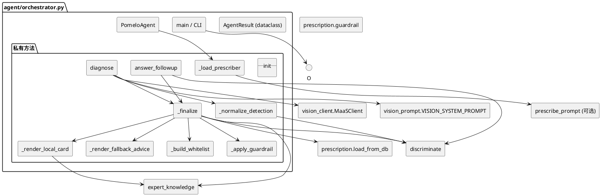
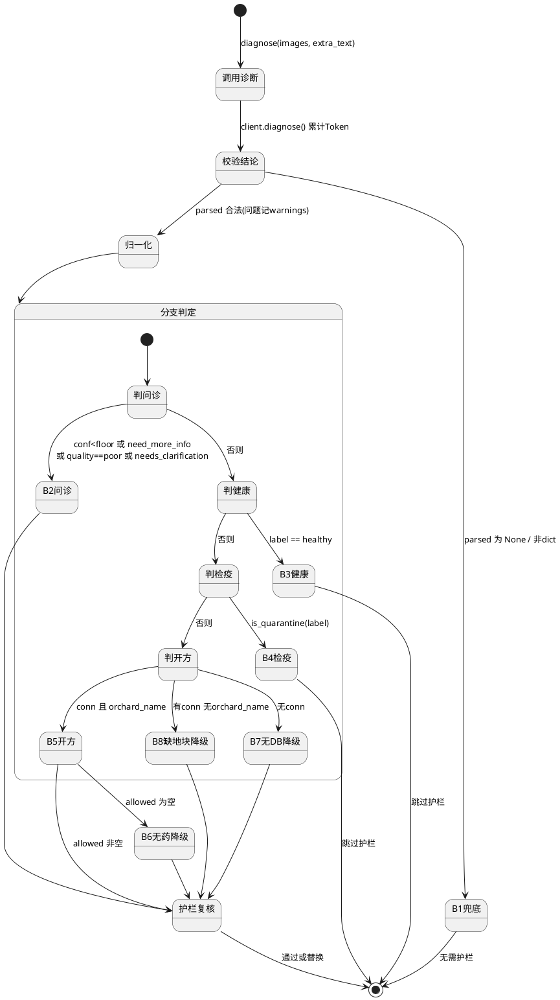
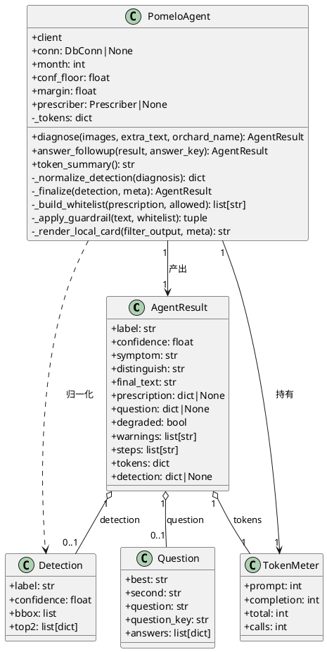

# 一、需求与存量功能关系分析

本组件新增文件仅两个：`agent/orchestrator.py`（编排器）与 `tests/test_orchestrator.py`（测试）。编排器本身几乎不含业务算法，其价值在于把**已存在但彼此独立**的六个模块串成一条主链路。因此本章逐一定位每个下游能力的真实代码位置、接口契约与约束，作为增量设计的依据。

## 1.1 需求功能与存量功能对比

### 1.1.1 已实现功能

| 需求功能 | 存量功能 | 代码位置 | 匹配度 |
|---------|---------|---------|--------|
| 图文诊断调用 + Token 计量 | `MaaSClient.diagnose()` / `chat()` / `summary()` | `agent/vision_client.py:193-215`、`117-189`、`212-215` | 100% |
| 结论类别口径校验 | `validate_diagnosis(parsed)` | `agent/vision_client.py:241-260` | 100% |
| 模型输出宽松 JSON 解析 | `parse_json_relaxed(text)` | `agent/vision_client.py:220-238` | 100% |
| 低置信/前二候选过近判定 | `needs_clarification(detection, margin)` | `agent/discriminate.py:41-68` | 100% |
| 关键鉴别问题匹配 | `next_question(detection)` | `agent/discriminate.py:71-113` | 100% |
| 追问答案后验更新 | `apply_answer(detection, answer_key)` | `agent/discriminate.py:116-216` | 100% |
| 月度常规养护建议 | `get_general_advice(month)` | `expert_knowledge.py:179-184` | 100% |
| 检疫性病害判定 | `is_quarantine(label)` | `expert_knowledge.py:149-154` | 100% |
| "已发生"防治建议三段文本 | `get_advice(label, "occurred")` | `expert_knowledge.py:162-176` | 100% |
| 月度真实风险类别 | `get_risk_labels(month)` | `expert_knowledge.py:141-146` | 100% |
| 药名白名单出口护栏 | `validate_output(text, allowed)` | `prescription/guardrail.py:108-243` | 100% |
| 药剂硬规则过滤 | `run_prescription()` / `build_filter_input()` | `prescription/load_from_db.py:336-359`、`306-333` | 100% |
| 类别唯一口径 | `CLASS_NAMES` / `HEALTHY_LABEL` | `labelmap.py:34-37` | 100% |

### 1.1.2 需要扩展的功能

| 需求功能 | 存量功能 | 差异说明 | 扩展方向 |
|---------|---------|---------|---------|
| diagnosis→detection 归一化 | 无对应实现（`discriminate` 消费 `top2`，模型只输出 `alternatives`） | 字段名不同（`alternatives[].confidence` vs `top2[].score`）；结构不同（`alternatives` 与主结论并列，`top2` 第二项是"次优候选"） | 新增纯函数归一化，`diagnosis.label/confidence` 作 `top2[0]`，`alternatives[0]` 映射为 `top2[1]`（`confidence`→`score`），并按兜底规则 A/B/C 裁剪 |
| 降级三段文本拼装 | `get_advice(label, "occurred")` 返回 `PreventionAdvice` dataclass | 存量返回结构化对象，需求要求一段中文文本，且须透出 `data_source` 合规字段 | 新增拼装函数，按"预防措施 / 用药建议 / 农事管理 / 数据来源"四段拼接 |
| 处方结果→护栏白名单 | `validate_output` 需要入参白名单，但无"从 `FilterOutput` + `parsed` 构造白名单"的逻辑 | 缺构造规则 | 新增白名单构造：`allowed[].common_name` ∪ `parsed.prescription[].pesticide_name`，无处方时为 `[]` |
| 处方卡片渲染（降级态） | 无（`agent/prescribe_prompt.py` 尚不存在） | 正常态由文案生成组件负责；缺失时编排器需自行兜底 | 新增编排器内置极简渲染器，把 `FilterOutput` 直出为中文卡片（不点名未放行药剂） |

### 1.1.3 需要新增的功能或接口

**模块 A：编排器核心（`agent/orchestrator.py`）**

| 功能点 | 输入 | 输出 | 核心逻辑 |
|---|---|---|---|
| `PomeloAgent.__init__` | `client` / `conn` / `month` / `conf_floor` / `margin` / `prescriber` | 实例 | 记录依赖与阈值；`prescriber` 为注入点（`None` 时惰性导入），用于解耦缺失的文案组件 |
| `PomeloAgent.diagnose` | `images` / `extra_text` / `orchard_name` | `AgentResult` | 10 步主链路（见 2.1.3） |
| `PomeloAgent.answer_followup` | `result` / `answer_key` | `AgentResult` | 后验更新后复用 `_finalize`，不二次调用大模型 |
| `PomeloAgent.token_summary` | — | `str` | `"调用 N 次 \| 输入 X \| 输出 Y \| 合计 Z tokens"` |
| `_normalize_detection`（私有） | `diagnosis` dict | detection dict | alternatives→top2 精确映射与兜底 |
| `_finalize`（私有） | detection + 元信息 | `AgentResult` | 分支 3-9 的可复用收口（含护栏） |
| `_build_whitelist`（私有） | prescription / allowed | `list[str]` | 白名单构造 |
| `_apply_guardrail`（私有） | text / whitelist | `(text, warnings)` | 护栏复核与替换 |
| `_render_local_card`（私有） | `FilterOutput` / 元信息 | `str` | 处方引擎直出卡片（文案组件缺失时兜底） |
| `main`（CLI） | argparse 参数 | 退出码 | 缺 Key 友好退出 |

**模块 B：测试（`tests/test_orchestrator.py`）**

| 功能点 | 说明 |
|---|---|
| `FakeClient` | 实现 `diagnose` / `chat` / `summary` / 累计字段；按序返回预设 JSON；记录 `call_count` |
| `FakeConn` | 复用 `tests/test_load_from_db.py:103-170` 的内存表 + SQL 路由 + 列名白名单校验器 |
| `FakePrescriber` | 实现 `generate_prescription` / `render_prescription_card`，绕过真实网络 |
| 12+ 用例 | 见 2.4 测试策略 |

**依赖关系**：`orchestrator` → {`vision_client`、`vision_prompt`、`discriminate`、`expert_knowledge`、`labelmap`、`guardrail`、`load_from_db`（可选）、`prescribe_prompt`（可选）}。编排器**不修改**上述任何存量文件。

## 1.2 存量功能详细分析

### 1.2.1 视觉诊断客户端（`agent/vision_client.py`）

- **接口契约**：`diagnose(images, extra_text="", system_prompt=None) -> dict`，返回键为 `text / prompt_tokens / completion_tokens / total_tokens / latency_s / model / parsed`。`parsed` 由 `parse_json_relaxed` 得到，可能为 `None` 或非 dict。
- **业务规则**：`chat` 内部已累加 `total_prompt_tokens / total_completion_tokens / call_count`；`diagnose` 强制"至少一张图"否则 `ValueError`。
- **副作用**：`chat` 默认落盘 `agent/token_usage.jsonl`（测试需 `log_usage=False` 或注入 FakeClient 规避）。
- **约束**：构造函数在缺 Key 时抛 `RuntimeError`（带中文指引）。编排器 CLI 必须捕获此异常并 exit 1；`diagnose` 对图片不存在抛 `FileNotFoundError`。
- **扩展点**：`system_prompt` 可注入 `VISION_SYSTEM_PROMPT`；编排器不得在本模块外重复累加。

### 1.2.2 鉴别问诊模块（`agent/discriminate.py`）

- **`needs_clarification(detection, margin=0.15)`**：读 `detection["top2"]`；`len(top2) < 2` 直接 `False`；否则 `top2[0]["score"] - top2[1]["score"] < margin` 为 `True`。**键名必须是 `score`（不是 `confidence`）**。
- **`next_question(detection) -> dict | None`**：`len(top2) < 2` 或任一 label 为空返回 `None`；否则按 `sorted([best, second])` 查 `questions.json` 的 `pairs`，命中则返回 `{"best","second","question","question_key","answers"}`，未命中返回 `None`。
- **`apply_answer(detection, answer_key) -> dict`**：`top2` 不足两项时原样返回 `label/confidence`；否则做贝叶斯式后验（`likelihood` 取自问题库 `answers[].likelihood`），返回 `{"best","second","confidence","top2","likelihood_used","answer_key"}`，`confidence` 已 `round(...,4)`。
- **约束**：`questions.json` 的病害对仅覆盖检测类之间的组合（如 `canker↔anthracnose`）；`healthy`/`greening` 无对应问题，因此这两类的 `next_question` 必然 `None`。
- **兼容性风险**：`apply_answer` 的返回值中 `best` 可能与原 `label` 不同（后验翻转），编排器更新 `label` 时必须同步更新 `detection["label"]` 与 `detection["confidence"]`。

### 1.2.3 专家知识库（`expert_knowledge.py`）

- **`PreventionAdvice`（frozen dataclass）**：字段 `prevention_measures / medication_advice / farming_advice / data_source`，四字段均为非空断言。`data_source` 是合规字段，上层必须透出。
- **`is_quarantine(label) -> bool`**：仅 `greening` 为 `True`（`QUARANTINE_PESTS = frozenset({"greening"})`）。
- **`get_advice(label, status) -> PreventionAdvice`**：`status` 取 `"prevention"` / `"occurred"`；不匹配时返回默认"无特定风险"口径，**不抛异常**。
- **`get_general_advice(month) -> str`**：越界月份返回空串，不抛异常（编排器需容忍空串）。
- **`get_risk_labels(month) -> list[str]`**：已剔除 `NO_RISK_LABEL`。
- **关键事实约束**：`("greening","occurred")` 的 `medication_advice` 明确写有"**无有效治疗药剂**"，但同一字段同时含木虱防治药名（吡虫啉等）。因此分支三（检疫）**不得直接透出该字段的药名部分**，必须改为编排器自撰的四要点文案（见 2.1.3 B4）。

### 1.2.4 出口护栏（`prescription/guardrail.py`）

- **接口契约**：`validate_output(text, allowed_pesticide_names) -> {"is_valid": bool, "detected": list[str], "violations": list[str], "suggested_text": str}`。
- **检测策略**：精确白名单屏蔽 → 2-10 字汉字串扫描 → 药名后缀模式扫描（`[\u4e00-\u9fff]{1,3}(后缀)`）→ 英文 token。**宁可误报不可漏报**，短候选不被剔除。
- **约束**：`violations` 非空时 `suggested_text` 已把违规药名替换为"请咨询当地农技人员"；`is_valid=False` 时**必须**采用 `suggested_text` 作为最终文本。
- **本组件用法**：白名单为空集时，任何药名（含专家知识库参考药名）均判违规 → 这是分支四降级路径"不得出现具体药剂"的天然保证。

### 1.2.5 处方引擎与数据库适配层

- **`run_prescription(conn, pest_name, block_name, today=None) -> FilterOutput`**：内部 `build_filter_input` + `filter_pesticides`。`pest_name` 必须 ∈ `CLASS_NAMES`，否则 `ValueError`；地块不存在时 `build_filter_input` 抛 `ValueError` —— 编排器必须捕获并降级，不得向上抛。
- **`FilterOutput`**：`allowed: list[Pesticide]`（字段含 `common_name / active_ingredient / content / phi_days / toxicity_level / frac_irac_code` 等，**无稀释倍数/施用方法/施用时机**——这些在 `pest_pesticide.dilution_ratio`，落库时未并入 `Pesticide`）；`rejected: list[FilterResult]`（`pesticide_id / name / reason`）。
- **约束**：`load_from_db` 只做行→dataclass 搬运，不含业务规则；`today` 参数保留但组装不依赖它。

### 1.2.6 存量约束清单（增量设计必须遵守）

1. 不得修改 `labelmap.py / vision_client.py / vision_prompt.py / expert_knowledge.py`（以及 `discriminate.py`、`guardrail.py`、`load_from_db.py`）。
2. `top2[].score` 键名固定；`alternatives[].confidence` 与 `top2[].score` 是**两个不同的键**，归一化必须显式改名。
3. `prescribe_prompt.py` 当前缺失 → 必须"可选依赖 + 优雅降级"。
4. `FakeConn` 的 SQL 路由依赖 SQL 文本特征（`FROM pesticide p JOIN pest_pesticide pp` 等），编排器**不得改写 `load_from_db` 的 SQL**，只能调用 `run_prescription`。
5. 测试禁止真实网络：必须注入 FakeClient；`MaaSClient` 构造时缺 Key 会抛异常，故 FakeClient 不得继承 `MaaSClient`。

# 二、增量设计方案

## 2.1 实现模型

### 2.1.1 上下文视图

编排器是**唯一对外入口**，向上只暴露 `PomeloAgent` 与 CLI；向下以"可选依赖"方式调用本地模块，以"硬依赖"方式调用视觉客户端与护栏。

```plantuml
@startuml
left to right direction
skinparam componentStyle rectangle

actor 柚农
actor 评审 as 管理员

rectangle "智能体编排器\nagent/orchestrator.py" as Agent

cloud "华为云 MaaS\n(多模态图文)" as MaaS
database "业务数据库\n(可选, 未接则降级)" as DB

rectangle "本地能力" {
  [专家知识库\nexpert_knowledge]
  [鉴别问诊\ndiscriminate]
  [处方引擎\nload_from_db + rule_engine]
  [出口护栏\nguardrail]
  [类别口径\nlabelmap]
  [文案生成(可选)\nprescribe_prompt]
}

柚农 --> Agent : 图片 + 补充文本 + 地块名
柚农 --> Agent : 追问回答 key
管理员 --> Agent : 查看 Token 汇总
Agent --> MaaS : diagnose()\n每次1次; 开方态再+1次
MaaS --> Agent : 结论JSON + Token用量
Agent --> 专家知识库 : 月度建议/检疫判定/防治建议
Agent --> 鉴别问诊 : needs_clarification/next_question/apply_answer
Agent --> 处方引擎 : run_prescription()\n(依赖 DB)
DB --> 处方引擎 : 候选药剂/施药/禁忌
Agent --> 文案生成(可选) : generate_prescription()\n缺失则本地兜底渲染
Agent --> 出口护栏 : validate_output(text, 白名单)
Agent --> 类别口径 : CLASS_NAMES/HEALTHY_LABEL
Agent --> 柚农 : 结论/处方卡片/追问/兜底提示
@enduml
```

### 2.1.2 服务/组件总体架构



**组件职责**：

| 组件 | 职责 | 依赖强度 |
|---|---|---|
| `AgentResult` | 唯一结果数据契约（11 字段 + detection） | — |
| `PomeloAgent.diagnose` | 主链路 10 步 | 硬依赖 client/vision_prompt |
| `_normalize_detection` | alternatives→top2 归一化 | 无外部依赖（纯函数） |
| `_finalize` | 分支 5-9 收口（健康/检疫/开方/护栏） | 硬依赖 EK/GR |
| `_render_local_card` | 规则引擎直出卡片（文案组件缺失兜底） | 依赖 FilterOutput + EK.data_source |
| `_load_prescriber` | 惰性导入可选文案组件 | 可失败（返回 None） |

### 2.1.3 实现设计文档

#### （1）八分支状态机



#### （2）分支触发条件与优先级顺序

判定采用**短路顺序**（先命中先返回），顺序即优先级：

| 序 | 分支 | 触发条件（命中即返回） | 是否烧 Token | 处方引擎 | 出口护栏 |
|---|---|---|---|---|---|
| B1 | 解析失败兜底 | `parsed is None` 或 `not isinstance(parsed, dict)` | 1 次（已完成） | 否 | 跳过 |
| B2 | 鉴别问诊 | `confidence < conf_floor` **或** `need_more_info is True` **或** `image_quality == "poor"` **或** `needs_clarification(detection, margin)` | 1 次（**禁止再调**） | 否 | 复核（空白名单） |
| B3 | 健康结论 | `label == HEALTHY_LABEL` | 1 次 | 否 | **跳过** |
| B4 | 检疫性病害 | `is_quarantine(label)` 为真（仅 greening） | 1 次 | 否 | **跳过** |
| B5 | 规则引擎开方 | 有 `conn` 且 `orchard_name` 非空 | +1 次（文案生成，若可用） | **是** | 复核（处方白名单） |
| B6 | 无合规药剂降级 | B5 的 `allowed` 为空 | 0（同 B5） | 是（已执行） | 复核（空白名单） |
| B7 | 未接数据库降级 | `conn is None` | 1 次 | 否 | 复核（空白名单） |
| B8 | 缺地块名降级 | `conn` 非空但 `orchard_name` 为空 | 1 次 | 否 | 复核（空白名单） |

**优先级说明**：B2 严格先于 B3/B4——健康或检疫结论若置信度不足，仍应先追问而非硬下结论（符合 spec R5 在归一化后立即判定）。B1 最先，因结论不可用则一切无意义。

#### （3）diagnosis→detection 归一化规则（精确映射）

输入 `diagnosis`（dict）、输出 `detection`（dict），键为 `{"label","confidence","bbox","top2"}`：

| 步骤 | 规则 |
|---|---|
| N1 | `label = diagnosis.get("label") if isinstance(..., str) else ""` |
| N2 | `confidence` 取 `diagnosis.get("confidence")`；非 `int/float` 或缺省 → `0.0`；`bool` 视为非数值 → `0.0` |
| N3 | `bbox = []`（图文诊断不产框） |
| N4 | `top2[0] = {"label": label, "score": float(confidence)}` —— 主结论恒为第一项 |
| N5 | 取 `alts = diagnosis.get("alternatives")`；仅当 `isinstance(alts, list) and len(alts) >= 1` 且 `alts[0]` 为 dict 时，第二候选 `second = {"label": alts[0].get("label"), "score": float(alts[0].get("confidence") or 0.0)}`。**注意键名改名：来源 `confidence` → 目标 `score`** |
| N6 | 兜底 A：`alts` 缺失/非 list/为空 → `top2 = [top2[0]]`（长度 1） |
| N7 | 兜底 B：`alts` 仅一条 → 取该条作第二项（长度 2） |
| N8 | 兜底 C：`second["label"]` 为空 或 等于 `top2[0]["label"]` → 丢弃第二项，`top2 = [top2[0]]`（长度 1，避免同病害自问自答） |

**一致性校验（对应 spec R4 验证方法）**：`alternatives` 含两条 → `top2` 长度 2；含一条 → 长度 2；无 → 长度 1；`detection["confidence"] == diagnosis["confidence"]`。

**精度风险**：`alts[0].get("confidence")` 可能是字符串（如 `"0.3"`），归一化用 `_as_float(v, default=0.0)` 容忍，非法值给 0.0，不抛异常。

#### （4）数据流图（含 Token 流向）

```plantuml
@startuml
skinparam activityBackgroundColor #FFFFFF
|编排器|
start
:images + extra_text + orchard_name;
:client.diagnose(); note right: calls+1\nprompt/completion 累加
if (parsed 为 None?) then (是)
  :B1 固定兜底"重拍";
  stop
else (否)
  :validate_diagnosis → warnings;
  :_normalize_detection → detection;
endif
if (B2 问诊条件?) then (是)
  :next_question;
  :final_text = follow_up 或 question文案;
  :护栏复核(空白名单);
  stop
else (否)
endif
if (label==healthy?) then (是)
  :get_general_advice(month) + "未检出目标病害";
  stop
else (否)
endif
if (is_quarantine(label)?) then (是)
  :B4 四要点文案(无药剂);
  stop
else (否)
endif
if (conn 且 orchard_name?) then (是)
  :run_prescription → FilterOutput;
  if (allowed 为空?) then (是)
    :B6 "无合规可用药剂";
  else (否)
    if (prescriber 可用?) then (是)
      :generate_prescription()\nnote right: calls+1
      :render_prescription_card;
    else (否)
      :_render_local_card (降级直出);
    endif
  endif
else (否)
  :B7/B8 get_advice occurred\n三段文本;
endif
:护栏复核(白名单);
:组装 AgentResult;
stop
@enduml
```

#### （5）降级路径矩阵与 prescribe_prompt 行为边界（重点澄清）

| 代号 | 触发 | 处方引擎是否执行 | final_text 来源 | degraded | 关键 warning |
|---|---|---|---|---|---|
| D0 | `conn is None` | 否 | `get_advice(label,"occurred")` 三段 + data_source | True | "未接数据库，处方未经安全间隔期/抗药性/复配禁忌校验" |
| D1 | conn 有、地块名有、**文案组件不可用** | **是**（`run_prescription` 纯本地，不依赖文案组件） | `_render_local_card(FilterOutput)` | True | "文案生成组件缺失，处方为规则引擎直出" |
| D2 | conn 有、`orchard_name` 为空 | 否 | 三段文本（同 D0） | True | "未提供地块名，未走处方引擎" |
| D3 | B5 的 `allowed` 为空 | 是 | "当前条件下无合规可用药剂，请联系当地农技人员" | True | "全部候选药剂被规则拒绝" |
| D4 | `parsed is None` | 否 | "图片未能识别，请重拍清晰叶片照片后再试。" | True | "结论无法解析为 JSON" |

**`prescribe_prompt` 缺失时的行为边界（明确结论）**：

`run_prescription` 依赖 `prescription/load_from_db.py` + `rule_engine.py`，与 `agent/prescribe_prompt.py` **无任何依赖关系**。因此：

- **可以**在 `prescribe_prompt` 缺失时仍执行 `run_prescription`，拿到结构化 `allowed/rejected`，而**不走 LLM 文案生成**——即 D1 路径。这正是规则引擎（安全间隔期/抗药性/复配禁忌）作为本地硬规则资产的独立价值，丢弃它反而降低处方安全性。
- D1 的渲染由编排器 `_render_local_card` 完成，**只渲染 `allowed` 中的药剂**（来自规则引擎放行，非 LLM 生成），从源头杜绝幻觉；`degraded=True` 仅表示"未经 LLM 文案生成"，不表示"未过规则引擎"。
- 调用边界：`_load_prescriber()` 采用 `try: from agent import prescribe_prompt as mod; except ImportError: return None`，**不写死导入**。若注入（`PomeloAgent(..., prescriber=FakePrescriber())`）则跳过导入。
- 与 spec R9 的兼容：R9 把"文案组件不可用"与"数据库未接入"并列。本设计将其**细化**为 D1（有规则引擎直出）与 D0（无规则引擎、三段建议）两档，属 R9 的增强实现，不违背其"不得因导入失败中断主链路"的硬约束。

**"仅供结构化 allowed 而不走 LLM 文案"的可行性**：可行，且即 D1。此时 `AgentResult.prescription` 记录本地直出结果 `{"parsed": None, "text": 本地卡片, "used_fallback": True, "source": "local_rule_engine"}`，供 `answer_followup` 与护栏复用。

#### （6）出口护栏：白名单来源与宽严策略

**适用**：仅 `final_text` 非空且**不属于 B3/B4** 时执行（用户要求与 R12 一致）。B1 兜底语由编排器自撰、不含药名，可选择跳过；B2/B5/B6/B7/B8 均执行。

**白名单构造（`_build_whitelist`）**：

| 来源 | 取值 | 说明 |
|---|---|---|
| ① 处方结构化推荐药名 | `prescription["parsed"]["prescription"][*]["pesticide_name"]` | 正常态处方卡片推荐药 |
| ② 规则引擎放行药剂通用名 | `FilterOutput.allowed[*].common_name` | 也覆盖 D1 本地渲染态 |
| ③ 无处方结果 | `[]`（空集合） | B2/B6/B7/B8 及 D1 缺省的兜底 |

**宽严策略**：沿用 `validate_output` 的"**宁可误报，不可漏报**"——任何疑似药名（后缀模式/前缀模式奖命中）只要不在白名单即判违规并替换为"请咨询当地农技人员"。**不额外放松**。

**降级文本与护栏的冲突处理（明确决策）**：D0/D2 的三段文本含专家知识库参考药名（如"螺螨酯 240g/L"），白名单为空集时会被护栏替换。这是**预期且正确**的行为：未接数据库即无法校验安全间隔期/抗药性，不应向柚农给出具体药名。因此：
- 最终文本保留预防措施/农事管理段落（不含药名，可读性不受损）；
- 用药建议段中的参考药名被替换为"请咨询当地农技人员"；
- `warnings` 追加"降级路径含未校验参考药名，已由护栏替换"。
- 不做"把专家知识库药名加入白名单"的放宽（会与安全原则冲突，且需从文本反推药名，引入额外复杂度——违反"不过度设计"）。

#### （7）Token 累加与 calls 计数规则

编排器**自持**累加器 `_tokens = {"prompt","completion","total","calls"}`，跨轮次不清零；`total = prompt + completion` 每次重算。

| 触发点 | calls | prompt | completion | 备注 |
|---|---|---|---|---|
| `client.diagnose()` 成功返回 | +1 | `+= r["prompt_tokens"]` | `+= r["completion_tokens"]` | 字段缺失按 0；`bool` 不算 |
| B5 正常态 `generate_prescription()` | +1 | `+= res["prompt_tokens"]` | `+= res["completion_tokens"]` | prescribe spec 6.6 提供该三字段 |
| B5 降级态 `_render_local_card` | +0 | +0 | +0 | 纯本地，未调 LLM |
| B2/B3/B4/B6/B7/B8 | +0 | +0 | +0 | 不烧 Token |
| `answer_followup` | +0（进 B5 时 +1） | 不增 | 不增 | **不调用 `client.diagnose`**，仅 `apply_answer` 复用 detection |

**回退策略**：若 `client` 自带 `total_prompt_tokens / total_completion_tokens / call_count`（真实 `MaaSClient`），`token_summary()` 可优先委托 `client.summary()` 保证与 CLI 一致性；否则用编排器自持累加器输出同格式字符串。两者格式均为 `调用 N 次 | 输入 X | 输出 Y | 合计 Z tokens`。

## 2.2 接口设计

### 2.2.1 总体设计

| 接口 | 稳定性 | 分类 | 说明 |
|---|---|---|---|
| `PomeloAgent.__init__` | 稳定 | 构造 | 依赖注入点（prescriber 可注入） |
| `PomeloAgent.diagnose` | 稳定 | 业务主入口 | 主链路 |
| `PomeloAgent.answer_followup` | 稳定 | 续答入口 | 后验 + 复用 |
| `PomeloAgent.token_summary` | 稳定 | 观测 | Token 汇总 |
| `AgentResult` | 稳定 | 数据契约 | dataclass |
| `PrescriberProtocol` | 实验 | 可选依赖 | duck-typing 协议 |
| `main`（CLI） | 稳定 | 命令行 | 面向评审 |

接口命名与业务语言一致（`diagnose` / `answer_followup` / `token_summary`）。类型安全：`AgentResult` 全字段显式类型注解，`prescription`/`question`/`detection` 为 `dict | None`，避免 `Any`。

### 2.2.2 接口清单

#### 接口组 1：`PomeloAgent.__init__`

```python
def __init__(
    self,
    client: "DiagnoseClient",           # 需具备 diagnose(...) -> dict
    conn: "DbConn | None" = None,        # None = 降级模式
    month: int | None = None,            # 缺省取 datetime.now().month
    conf_floor: float = 0.6,
    margin: float = 0.15,
    prescriber: "Prescriber | None" = None,  # 注入文案组件；None 时惰性导入
) -> None: ...
```

- 业务说明：装配依赖与阈值；`month` 缺省取系统当前月。
- 前置条件：`client` 非空且实现 `diagnose`。
- 后置条件：`self._tokens` 清零初始化；`prescriber` 延迟解析（首次用到处方分支时才尝试导入）。
- 异常映射：无（构造不抛业务异常）。

#### 接口组 2：`PomeloAgent.diagnose`

```python
def diagnose(
    self,
    images: "Iterable[str | Path]",
    extra_text: str = "",
    orchard_name: str | None = None,
) -> AgentResult: ...
```

- 业务说明：执行主链路 10 步（2.1.3 数据流图），每步向 `steps` 追加一行中文日志。
- 前置条件：`images` 至少一张（由 `client.diagnose` 校验）。
- 后置条件：返回 `final_text` 非空的 `AgentResult`；`tokens` 已累加。
- 异常映射：`client.diagnose` 的 `ValueError`/`FileNotFoundError`/`RuntimeError` 由 CLI 层捕获；`run_prescription` 的 `ValueError`（病害/地块非法）在编排器内捕获 → 转 D0/D2 降级并记 warning，**不外抛**。
- 典型调用：

```python
agent = PomeloAgent(client, conn=conn, month=10)
r = agent.diagnose(["leaf.jpg"], extra_text="叶背也有斑", orchard_name="地块A")
print(r.final_text)
```

#### 接口组 3：`PomeloAgent.answer_followup`

```python
def answer_followup(self, result: AgentResult, answer_key: str) -> AgentResult: ...
```

- 业务说明：`apply_answer(result.detection, answer_key)` → 覆盖 `detection["label"]`/`["confidence"]`/`["top2"]` → 若新 `confidence < conf_floor` 则取新 `question` 返回；否则进入 `_finalize` 走 B3/B4/B5/B6。
- 前置条件：`result.detection` 非空（首次问诊分支返回的结果）。
- 后置条件：Token/calls 在 `result.tokens` 基础上继续累加，不清零。
- 异常映射：无（`apply_answer` 容错）。

#### 接口组 4：`PomeloAgent.token_summary`

```python
def token_summary(self) -> str: ...
```

- 返回：`"调用 N 次 | 输入 X | 输出 Y | 合计 Z tokens"`。
- 后置条件：不修改状态。

#### 接口组 5：`PrescriberProtocol`（可选依赖，实验）

```python
class PrescriberProtocol(Protocol):
    def generate_prescription(
        self, client, diagnosis: dict, allowed: list, rejected: list,
        orchard, month: int,
    ) -> dict: ...          # 含 text / parsed / prompt_tokens / completion_tokens / used_fallback
    def render_prescription_card(self, result: dict) -> str: ...
```

- 业务说明：对应 `agent/prescribe_prompt.py`；缺失时由 `_render_local_card` 承担渲染。
- 前置条件：`allowed` 为 `FilterOutput.allowed`（`list[Pesticide]`）。
- 异常映射：`generate_prescription` 内部已降级（见 prescribe spec R9），编排器不重复捕获。

#### 接口组 6：`main`（CLI）

```python
def main(argv: "list[str] | None" = None) -> int: ...
```

- 参数：`--image`（必填）、`--extra`、`--orchard`、`--month`、`--json`。
- 输出：诊断结论 / 症状 / 区分点 / 处方卡片 / Token 汇总 / 降级与告警。
- 异常映射：缺 `MAAS_API_KEY` → `MaaSClient` 抛 `RuntimeError` → 捕获后打印友好指引 → 返回 1（不打印堆栈）。

## 2.3 数据模型

### 2.3.1 设计目标

- **对齐 spec 术语**：`AgentResult` 字段名与 spec 6.1 逐一一致；`detection`/`question`/`tokens` 与 spec 6.2/6.4/6.5 一致。
- **领域对象优先**：`detection` 是鉴别问诊的入参口径，`question` 是追问对象；两者均以领域语义表达，不引入数据库字段。
- **生命周期**：`detection` 在 `diagnose` 归一化时创建，随 `AgentResult` 返回；`answer_followup` 复用并原地更新（不新建对象）。
- **兼容性**：处方结果结构变化时对缺失字段取默认值（`prescription` 缺字段不抛异常）；`tokens` 字段缺失按 0 计。

### 2.3.2 模型实现



**归一化映射表（`alternatives` → `top2`）**：

| 目标键 | 来源键（diagnosis/alternatives） | 缺省 |
|---|---|---|
| `top2[0].label` | `diagnosis.label`（非 str 时空串） | `""` |
| `top2[0].score` | `diagnosis.confidence` | `0.0` |
| `top2[1].label` | `alternatives[0].label`（须非空且 ≠ 第一项 label） | 无第二项 |
| `top2[1].score` | `alternatives[0].confidence`（**改名**） | `0.0` |
| `detection.bbox` | — | `[]` |

## 2.4 测试策略

### 2.4.1 测试桩设计

- **FakeClient**（不继承 `MaaSClient`，避免缺 Key 抛异常）：
  - `diagnose(images, extra_text, system_prompt)`：从预设队列弹出下一条诊断 JSON 文本，用真实 `parse_json_relaxed` 解析，返回 `{text, parsed, prompt_tokens, completion_tokens, total_tokens, latency_s, model}`；`call_count += 1`。
  - `chat(content, system, ...)`：返回预设处方 JSON 文本，供 `generate_prescription` 使用；累计 token。
  - 提供 `total_prompt_tokens / total_completion_tokens / call_count / summary()`，与真实客户端同形。
  - 断言入口：`client.call_count`、`client.last_system_prompt`。
- **FakeConn**：直接复用 `tests/test_load_from_db.py` 的 `FakeConn`（内存表 + SQL 路由 + 列名白名单校验），避免重复实现；若独立运行则内联一份极简版（`query` 只支持所需 5 类 SQL）。
- **FakePrescriber**：`generate_prescription(...)` 返回 `{text, parsed: {"prescription": [{"pesticide_name": ...}]}, prompt_tokens, completion_tokens, used_fallback}`；`render_prescription_card(result)` 返回 `result["text"]`。用于解耦缺失的 `prescribe_prompt`。

### 2.4.2 用例清单（12+）

| # | 用例 | 关键断言 | 覆盖需求 |
|---|---|---|---|
| 1 | 正常病害 + 有 DB（FakePrescriber） | `degraded is False`；`final_text` 含处方；`prescription is not None` | R8 |
| 2 | 无 DB（conn=None） | `degraded is True`；任一 warning 含"未接数据库" | R9 |
| 3 | `label == healthy` | 处方引擎未被调用（`conn.queries == []`）；`final_text` 含当月养护关键词 | R6 |
| 4 | `label == greening` | `final_text` 含"上报""木虱"；`validate_output(final_text, [])["violations"] == []` | R7 |
| 5 | `confidence == 0.45` | `question is not None`；`client.call_count == 1` | R5 |
| 6 | `parsed is None`（非 JSON） | `degraded is True`；`final_text` 含"重拍" | R3 |
| 7 | `validate_diagnosis` 报 label 非法 | `warnings` 含"label 非法" | R2 |
| 8 | `allowed == []`（全部被拒） | `degraded is True`；`final_text` 含"无合规可用药剂" | R10 |
| 9 | 最终文本含白名单外药名 | 护栏返回 `is_valid=False`；`final_text` 含"请咨询当地农技人员"；`warnings` 非空 | R12 |
| 10 | `alternatives` 含两条 / 一条 / 无 | `top2` 长度分别 2 / 2 / 1 | R4 |
| 11 | `answer_followup` 后置信度提升 | 进入开方分支；`tokens["calls"] == 2` | R13 |
| 12 | `answer_followup` 后仍低于地板 | 新 `question is not None`；未调处方 | R14 |
| 13 | `token_summary` 格式 | 含"tokens"与调用次数 | R15 |
| 14 | 有 DB 无地块名 | `degraded is True`；`warnings` 非空 | R11 |
| 15 | 全流程零真实网络 | 所有用例仅用 FakeClient（无 `requests` 调用） | R17 |

### 2.4.3 验收命令

```
cd E:\柚子病虫害AI识别\code\pomelo-algorithm && "D:/anaconda3/python.exe" -m pytest tests -q
```

全绿；不得修改 `labelmap.py / vision_client.py / vision_prompt.py / expert_knowledge.py`。

## 2.5 实现步骤

| 步骤 | 内容 | 产出 |
|---|---|---|
| S1 | 定义 `AgentResult` dataclass 与类型别名（`DiagnoseClient`/`DbConn`/`Prescriber` Protocol） | 数据契约 |
| S2 | 实现 `_normalize_detection`（N1-N8 规则）与 `_as_float` 容错 | 归一化 |
| S3 | 实现 `PomeloAgent.__init__` 与 `_tokens` 累加器、`token_summary` | 骨架 |
| S4 | 实现 `diagnose` 第 1-3 步（调用/校验/归一化/Token 累加/steps） | B1/B2 前置 |
| S5 | 实现 `_finalize`：B3 健康、B4 检疫（四要点硬编码）、B5 开方（run_prescription + prescriber/本地渲染）、B6/D1 | 分支 5-8 |
| S6 | 实现 `_build_whitelist` 与 `_apply_guardrail`，接入 B2/B5/B6/B7/B8 | 护栏 |
| S7 | 实现 `answer_followup`（后验 + 复用 `_finalize`） | 续答 |
| S8 | 实现 `_load_prescriber` 惰性导入与 `prescriber` 注入 | 可选依赖 |
| S9 | 实现 CLI `main`（argparse + 缺 Key 友好退出 + `--json`） | 命令行 |
| S10 | 实现 `tests/test_orchestrator.py` 的 FakeClient/FakeConn/FakePrescriber 与 15 用例 | 测试 |
| S11 | 全量回归 `pytest tests -q` 并修复 | 验收 |

## 2.6 风险与缓解

| 风险 | 影响 | 缓解 |
|---|---|---|
| `prescribe_prompt.py` 缺失（当前事实） | B5 正常态不可达 | 惰性导入 + 注入点；D1 本地渲染兜底；测试用 FakePrescriber |
| `alternatives[].confidence` 类型脏（字符串） | `top2` 结构异常，问诊误触发 | `_as_float` 容错为 0.0；非 dict 元素丢弃 |
| `apply_answer` 翻转 `best`，`detection.label` 未同步 | 后续分支用错 label | `answer_followup` 显式覆盖 `detection["label"]/["confidence"]/["top2"]` |
| `run_prescription` 抛 `ValueError`（地块不存在） | 主链路中断 | 编排器 try/except 捕获 → 转 D0/D2 降级 + warning |
| 降级三段文本药名被护栏替换 | 用药建议段可读性下降 | 视为安全预期；warnings 记录；不改白名单放宽 |
| 检疫分支误用知识库含药名文本 | 违反 R7 禁药硬约束 | B4 文案由编排器**硬编码四要点**，不取 `medication_advice` |
| `FakeClient` 误继承 `MaaSClient` | 测试因缺 Key 抛异常 | FakeClient 独立实现，不继承 |
| Token 双重累加（client 内部 + 编排器） | 计数虚高 | 编排器只从**返回值**累加，不叠加 `client` 内部状态；`token_summary` 二选一 |
| `healthy` 低置信被误判 | 健康场景返回追问 | 属预期（B2 优先级高）；由 `image_quality/need_more_info` 语义控制，不特殊绕过 |

## 2.7 方案要点小结

1. **编排器是"薄"的**：所有业务算法在存量模块，编排器只做串接、归一化、分支与护栏，新增文件仅 2 个。
2. **归一化是关键适配层**：`alternatives[].confidence → top2[].score` 的改名与兜底 A/B/C 决定鉴别问诊是否会误触发。
3. **八分支、短路口序**：B1 兜底 → B2 问诊 → B3 健康 → B4 检疫 → B5 开方 → B6/D1/D0/D2 降级，B2 严格优先于 B3/B4。
4. **可选依赖优雅降级**：`prescribe_prompt` 缺失不影响主链路；有 DB 时仍走 `run_prescription` 直出（D1），保留规则引擎的安全校验价值。
5. **护栏宁严勿松**：白名单 = 处方药名 ∪ 放行药剂通用名，无处方为空集；健康/检疫跳过；降级文本药名被替换是**安全预期**。
6. **Token 主战场**：诊断 1 次 + 开方文案 1 次；问诊分支严禁二次调用；`answer_followup` 复用 detection 不烧 Token。
</content>