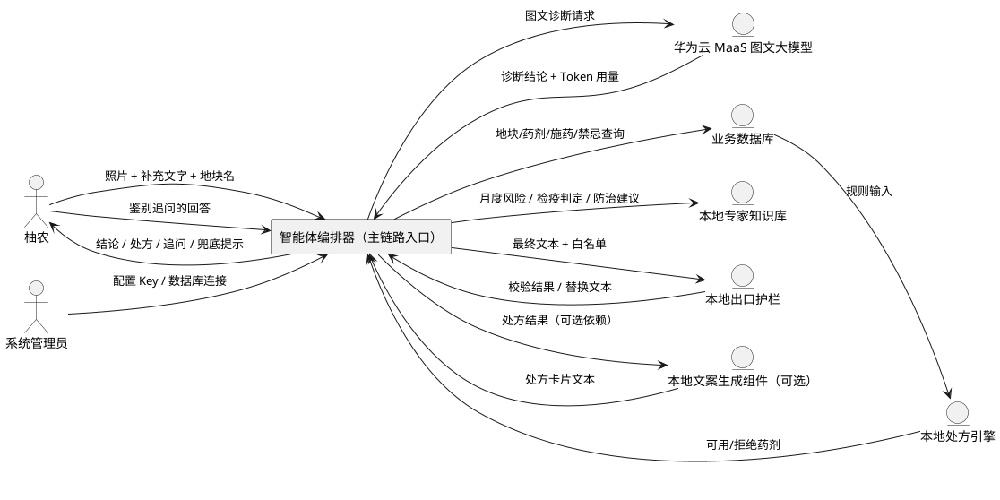
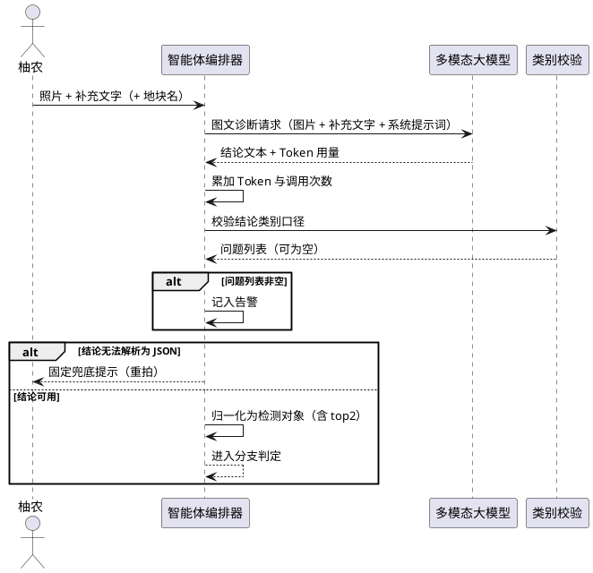
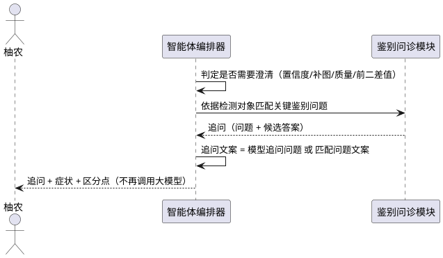
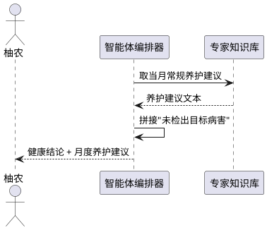
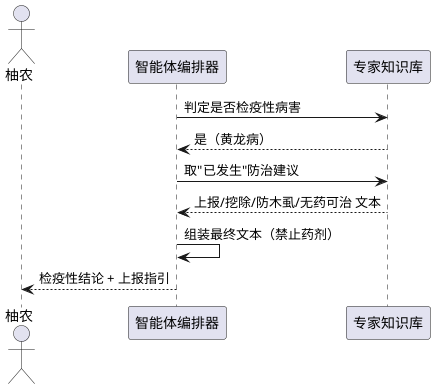
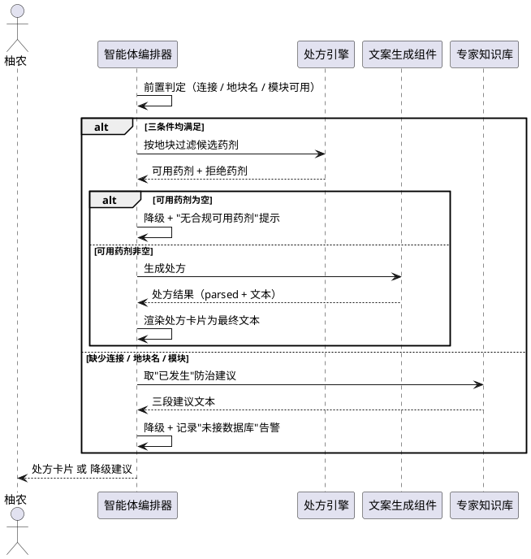
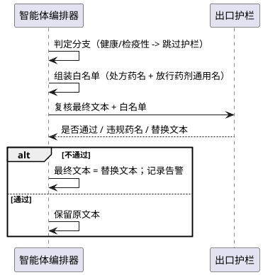
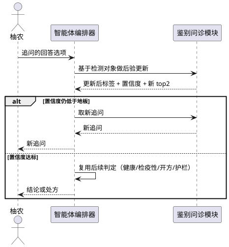
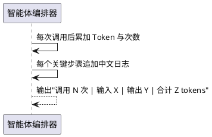
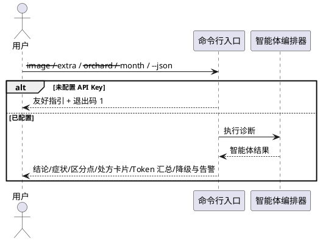

# **1. 组件定位**

## **1.1 核心职责**
本组件负责把"看图诊断 → 判据校验 → 鉴别问诊 → 处方引擎 → 文案生成"串成一条主链路，作为本项目唯一对外的智能体入口，向柚农输出可读、可执行的中文结论。

## **1.2 核心输入**
1. 柚农拍摄的叶片照片（一张或多张本地路径/公网 URL），来源为用户操作。
2. 用户补充文本（如"叶背也有斑"），来源为用户操作，可为空。
3. 地块名称（如"地块A"），来源为用户操作，可为空。
4. 当前月份，来源为系统时间（未指定时取运行当日月份）。
5. 多模态大模型客户端（具备图文诊断能力），来源为视觉诊断客户端。
6. 数据库连接（具备 `query(sql, params) -> list[dict]` 能力的对象），来源为业务数据库；允许为"未接入"。
7. 用户对追问的回答选项 key，来源为用户操作（仅追问续答轮次）。

## **1.3 核心输出**
1. 智能体结果对象 `AgentResult`：含诊断标签、置信度、症状、区分点、最终中文文本、处方结果、追问、降级标记、告警列表、中文步骤日志、Token 计量。
2. 最终中文文本 `final_text`：面向柚农的结论/处方卡片/追问文案/兜底提示，是唯一对用户展示的正文。
3. 命令行文本输出与可选 JSON 报告，目标为用户/评审。
4. Token 汇总字符串，目标为评审（Token 消耗是赛题评估项）。

## **1.4 职责边界**
1. 不负责类别口径维护（由类别映射表唯一维护）。
2. 不负责图像质量算法、不负责模型训练与推理、不负责药品规则引擎内部规则（安全间隔期/抗药性/复配禁忌由处方引擎负责）。
3. 不负责药名白名单的维护与检测算法（由出口护栏模块负责）。
4. 不负责处方文案的美化排版（由文案生成组件负责，本组件仅负责调用与渲染装配）。
5. 不负责数据库表结构、索引与读写实现（由数据库适配层负责）。
6. 不做多轮自由对话管理、不做用户账户与会话持久化。

---

# **2. 领域术语**

**诊断结论（diagnosis）**
: 图文大模型返回的结构化 JSON 对象，含 `label/confidence/alternatives/symptom/distinguish/is_quarantine/image_quality/need_more_info/follow_up_question`。

**检测对象（detection）**
: 本组件内部使用的归一化结论，含 `label/confidence/bbox/top2`，是鉴别问诊模块的入参口径。

**top2**
: 归一化检测对象中的"前二候选"数组，形如 `[{"label":…, "score":…}, {"label":…, "score":…}]`；鉴别问诊的判定与追问匹配全部依赖该字段。

**鉴别问诊**
: 当结论不可靠（置信度低或前二候选过于接近或图像质量差或模型主动要求补图）时，向柚农提出一个关键鉴别问题，而非硬下结论。

**置信度地板（conf_floor）**
: 触发鉴别问诊的置信度下界，默认 0.6；低于该值即视为结论不可靠。

**鉴别阈值（margin）**
: 前二候选分数差阈值，默认 0.15；差值小于该值即视为结论不可靠。

**降级（degraded）**
: 因缺少数据库、缺少文案生成模块、结论解析失败、可用药剂为空等原因，无法产出完整合规处方时的兜底输出状态。

**出口护栏**
: 在最终文本产出前，对文本中出现的药名做白名单复核的本地防护机制，拦截未登记农药。

**白名单**
: 出口护栏允许出现的药名集合，来源于处方结果中的推荐药名与处方引擎放行的药剂通用名；无处方时为空集合。

**处方引擎**
: 依据地块信息、施药历史、物候期、配伍禁忌对候选药剂做硬规则过滤的本地能力。

**文案生成组件（可选）**
: 把处方引擎结果翻译成柚农可读处方卡片的可选模块；缺失时必须走降级路径。

**步骤日志（steps）**
: 每次诊断按执行顺序追加的中文步骤记录，用于答辩演示链路可追溯。

**Token 计量（tokens）**
: 主链路对大模型的调用次数与输入/输出/合计 Token 计数，跨轮次累加。

---

# **3. 角色与边界**

## **3.1 核心角色**
**柚农**：最终使用者。上传叶片照片、阅读结论与处方、回答鉴别追问。
**植保技术员（模拟角色）**：以内置于视觉系统提示词中的"资深柑橘植保专家"身份驱动大模型输出，非真实交互角色。
**系统管理员**：配置大模型 API Key、维护药典数据与数据库连接、观察 Token 用量。

## **3.2 外部系统**
**华为云 MaaS（图文大模型）**：接收"图片 + 补充文本 + 系统提示词"，返回结构化诊断结论与 Token 用量。
**业务数据库**：提供地块信息、候选药剂、施药历史、配伍禁忌、物候期禁忌等查询。
**本地处方引擎**：依据数据库输入做药剂硬规则过滤，返回可用/拒绝药剂列表。
**本地出口护栏**：对最终文本做药名白名单校验，返回是否通过、命中药名、违规药名与替换后文本。
**本地专家知识库**：提供月度风险类别、检疫性判定、防治建议（预防/已发生）与月度常规养护建议。
**本地文案生成组件（可为缺失态）**：把处方引擎结果翻译成处方卡片文本。

## **3.3 交互上下文**

---

# **4. DFX约束**

## **4.1 性能**
1. 单次诊断对大模型的调用次数上限：进入追问分支时只允许 1 次调用；正常开方分支允许 2 次（诊断 1 次 + 文案生成 1 次）；追问续答轮次允许再增 1 次。
2. 进入追问分支时禁止继续消耗 Token（不得二次调用大模型）。
3. 无数据库降级路径的端到端延迟上限：50 毫秒（纯本地字符串拼装）。

## **4.2 可靠性**
1. 未接入数据库、文案生成组件缺失、结论解析失败、可用药剂为空时，必须自动降级并产出可用文本，不允许向上抛出未捕获异常。
2. 大模型返回的结论无法解析为 JSON 对象时，必须返回固定兜底提示，不允许返回残缺结论。
3. 所有异常与降级事实必须记录到告警列表，不允许静默吞没。

## **4.3 安全性**
1. 检疫性病害（黄龙病）结论下，最终文本必须包含"上报当地植保/农业部门""挖除病株""防治柑橘木虱""无药可治"四项要点，且禁止出现任何药剂名。
2. 除健康结论与检疫性结论外，任何最终文本在产出前必须经出口护栏复核；护栏不通过时必须采用替换后文本并记录告警。
3. 白名单外药名不得出现在最终文本中；黄龙病场景白名单为空集合。
4. 未配置大模型 API Key 时，命令行入口必须打印友好指引并以非零状态退出，不得抛出堆栈、不得泄露任何 Key 信息。

## **4.4 可维护性**
1. 每次诊断必须按执行顺序记录中文步骤日志，供链路演示与问题定位。
2. Token 计量必须在每一轮结束后可查询，跨轮次累加不清零。
3. 告警列表必须包含降级原因、解析问题、护栏拦截、白名单外药名等事实描述。

## **4.5 兼容性**
1. 文案生成组件与数据库适配模块必须按"可选依赖"对待：模块不存在或导入失败时，不得影响主链路产出结论。
2. 处方结果结构变化时，本组件对缺失字段必须容错（不抛异常，取默认值）。
3. 类别口径必须与类别映射表一致；本组件不得自行维护类别定义。

---

# **5. 核心能力**

## **5.0 需求总览**

| 编号 | 类型 | 需求描述（EARS） | 验证方法 | 优先级 | 依赖 |
|---|---|---|---|---|---|
| R1 | 强制·事件驱动 | 当收到图文诊断请求时，系统应调用多模态大模型并累加 Token | 桩客户端断言收到调用且 Token 累加 | P0 | 视觉诊断客户端 |
| R2 | 强制·事件驱动 | 当模型结论为合法 JSON 对象时，系统应校验类别口径并把问题记入告警 | 注入非法 label 的结论，断言告警非空 | P0 | 类别校验函数 |
| R3 | 强制·异常型 | 若结论无法解析为 JSON 对象，则系统应返回固定兜底提示并标记降级 | 注入非 JSON 文本，断言文本含"重拍" | P0 | — |
| R4 | 强制·事件驱动 | 当结论可用时，系统应把诊断结论归一化为检测对象（含 top2） | 断言归一化结果的 label/confidence/top2 结构 | P0 | — |
| R5 | 强制·状态型 | 在置信度低于地板/前二候选过近/图像质量差/模型要求补图时，系统应转入鉴别问诊分支 | 置信度 0.45，断言追问非空且仅 1 次调用 | P0 | 鉴别问诊模块 |
| R6 | 强制·状态型 | 在结论为健康类别时，系统应输出月度常规养护建议并声明未检出目标病害 | 注入健康结论，断言文本含月度建议且未走处方 | P0 | 专家知识库 |
| R7 | 强制·状态型 | 在结论为检疫性病害时，系统应输出包含上报/挖除/防木虱/无药可治四要点且无任何药剂的文本 | 注入黄龙病结论，白名单空集护栏复核通过 | P0 | 专家知识库、出口护栏 |
| R8 | 强制·事件驱动 | 当存在数据库连接且文案生成组件可用时，系统应经处方引擎过滤并渲染处方卡片为最终文本 | 注入含可用药剂的桩数据库，断言处方非空、降级为假 | P0 | 处方引擎、文案生成组件 |
| R9 | 强制·异常型 | 若数据库未接入或文案生成组件不可用，则系统应改用防治建议三段文本并标记降级 | 无连接调用，断言降级为真且告警含"未接数据库" | P0 | 专家知识库 |
| R10 | 强制·异常型 | 若处方引擎放行药剂为空，则系统应标记降级并提示"无合规可用药剂，请联系当地农技人员" | 注入全部被拒的桩数据，断言文本含该提示 | P0 | 处方引擎 |
| R11 | 强制·事件驱动 | 当处方引擎可用但未提供地块名时，系统应转入降级路径并记录告警 | 有连接、地块名为空调用，断言降级为真 | P1 | — |
| R12 | 强制·事件驱动 | 当最终文本非空且不属于健康/检疫性分支时，系统应经出口护栏复核，白名单外药名必须被替换并记告警 | 注入含白名单外药名的文本，断言被替换且告警非空 | P0 | 出口护栏 |
| R13 | 强制·事件驱动 | 当收到追问回答时，系统应对检测对象做后验更新并继续后续分支 | 回答后置信度提升，断言进入开方分支且调用次数为 2 | P0 | 鉴别问诊模块 |
| R14 | 强制·状态型 | 在后验更新后置信度仍低于地板时，系统应返回新的追问而不进入开方 | 回答后置信度仍低，断言追问非空 | P1 | 鉴别问诊模块 |
| R15 | 强制·普遍型 | 系统应在任意轮次维护 Token 计量并可输出中文汇总字符串 | 断言汇总字符串含"tokens"与调用次数 | P0 | — |
| R16 | 强制·事件驱动 | 当通过命令行运行且未配置 API Key 时，系统应打印友好指引并以非零状态退出 | 无 Key 运行，断言退出码为 1 且无堆栈 | P0 | 视觉诊断客户端 |
| R17 | 强制·普遍型 | 系统应在全流程测试中不发起任何真实网络请求 | 全量用例使用桩客户端，断言零真实请求 | P0 | — |

---

## **5.1 图文诊断与结论归一化**

### **5.1.1 业务规则**

**R1【强制·事件驱动】**
: **当**收到图文诊断请求时，**系统应**调用多模态大模型，传入图片、补充文本与视觉系统提示词，并把本次的输入/输出/合计 Token 与调用次数累加。
: 验证方法：桩客户端在 `diagnose` 被调用后返回预设结论，断言其调用次数为 1 且 Token 已累加。
: 优先级：P0。
: 依赖：视觉诊断客户端（其 `diagnose(images, extra_text, system_prompt)` 返回含 `parsed/total_tokens/prompt_tokens/completion_tokens` 的字典）。

**R2【强制·事件驱动】**
: **当**模型返回的结论可解析为 JSON 对象时，**系统应**按类别口径校验其合法性；校验产生的问题必须逐条记入告警列表。
: 验证方法：桩客户端返回 `label` 为非类别值的 JSON，断言告警中含类别非法描述。
: 优先级：P0。
: 依赖：类别口径校验函数（入参为解析后的结论，返回问题字符串列表）。

**R3【强制·异常型】**
: **若**结论无法解析为 JSON 对象，**则**系统应输出固定兜底提示"图片未能识别，请重拍清晰叶片照片后再试。"、标记降级并立即返回，不再进入任何后续分支。
: 验证方法：桩客户端返回非 JSON 文本，断言最终文本含"重拍"且降级为真。
: 优先级：P0。
: 依赖：无。

**R4【强制·事件驱动】**
: **当**结论可用时，**系统应**把诊断结论归一化为检测对象；归一化规则如下：
: 1. `label` = 结论的 `label`；
: 2. `confidence` = 结论的 `confidence`（缺省或非数值时取 0.0）；
: 3. `bbox` = 空数组（图文诊断不产出检测框）；
: 4. `top2` = `[{"label": 结论.label, "score": 结论.confidence}]` 与结论 `alternatives` 的第二候选拼接：取 `alternatives` 中第一条的 `label` 与 `confidence` 作为第二项；
: 5. **兜底规则 A（alternatives 缺失或非数组或为空）**：`top2` 仅含第一项，第二项不存在；
: 6. **兜底规则 B（alternatives 仅有单元素）**：取该唯一元素的 `label` 与 `confidence` 作为第二项；
: 7. **兜底规则 C（第二项 label 与第一项相同或为空）**：`top2` 仅保留第一项（避免鉴别问诊对同一病害自问自答）。
: 验证方法：分别注入"含两条 alternatives""含一条 alternatives""无 alternatives"的结论，断言归一化检测对象的 `top2` 长度分别为 2、2、1，且 `confidence` 与结论一致。
: 优先级：P0。
: 依赖：鉴别问诊模块要求检测对象含 `top2` 字段。

**R17【强制·普遍型】**
: **系统应**在全流程测试中不发起任何真实网络请求，所有大模型调用均由桩客户端承担。
: 验证方法：全量用例注入桩客户端；断言测试过程中无真实请求（桩客户端记录调用，无网络依赖）。
: 优先级：P0。
: 依赖：无。

### **5.1.2 交互流程**

### **5.1.3 异常场景**
1. **结论无法解析**
   a. 触发条件：模型返回非 JSON 文本或 JSON 片段残缺。
   b. 系统行为：标记降级、输出固定兜底提示并立即返回。
   c. 用户感知："图片未能识别，请重拍清晰叶片照片后再试。"
2. **类别口径非法**
   a. 触发条件：结论的 label 不在类别口径内，或 confidence 越界，或 alternatives 含非法类别。
   b. 系统行为：把问题记入告警，仍继续按可用结论推进（不因口径问题中断）。
   c. 用户感知：正文正常展示，告警供审计/演示查看。
3. **alternatives 缺失**
   a. 触发条件：模型未给出第二候选。
   b. 系统行为：归一化检测对象的 `top2` 仅含第一项，鉴别问诊自然不触发（不足两项）。
   c. 用户感知：正常给出结论或按置信度地板判定。

---

## **5.2 分支一：鉴别问诊**

### **5.2.1 业务规则**

**R5【强制·状态型】**
: **在**归一化后满足任一条件——置信度低于置信度地板（默认 0.6）、模型结论要求补充信息、图像质量为差、或前二候选分数差小于鉴别阈值（默认 0.15）——**时**，系统应转入鉴别问诊分支：匹配一个关键鉴别问题，把追问文案作为最终文本主体，并附上症状与区分点。
: 验证方法：注入置信度 0.45 的结论，断言追问非空、最终文本含追问内容、且桩客户端调用次数为 1（未二次调用）。
: 优先级：P0。
: 依赖：鉴别问诊模块的"是否需要澄清"与"取下一问题"能力；检测对象含 `top2`。

**追问文案来源优先级**
: **系统应**按以下优先级确定追问文案：模型结论中的追问问题（非空时）优先；否则采用鉴别问诊模块返回的问题文案；两者皆空时退化为按症状/区分点组织的提示文案。
: 验证方法：分别注入"含模型追问问题"与"不含模型追问问题但可匹配问题库"的结论，断言最终文本含对应来源的追问。
: 优先级：P0。

**问诊分支禁止项**
: **禁止**在进入鉴别问诊分支后再次调用大模型（不得二次消耗 Token）。
: 验证方法：断言桩客户端调用次数恒为 1。
: 优先级：P0。

### **5.2.2 交互流程**

### **5.2.3 异常场景**
1. **无可匹配的鉴别问题**
   a. 触发条件：前二候选组合在问题库中无对应问题，或 `top2` 不足两项。
   b. 系统行为：追问内容退化为模型追问问题；两者皆无时输出基于症状/区分点的提示文案。
   c. 用户感知：仍收到一条需要补充信息的提示，不被卡死。

---

## **5.3 分支二：健康结论**

### **5.3.1 业务规则**

**R6【强制·状态型】**
: **在**结论标签等于健康类别时，**系统应**输出该月份的常规养护建议，并拼接一句明确声明"未检出目标病害"；该分支禁止调用处方引擎、禁止调用大模型文案生成。
: 验证方法：注入健康结论，断言最终文本含当月养护建议关键字且处方为空。
: 优先级：P0。
: 依赖：专家知识库的月度常规养护建议能力；当前月份。

### **5.3.2 交互流程**

### **5.3.3 异常场景**
1. **月份提示缺失**
   a. 触发条件：月度养护建议为空（月份越界等）。
   b. 系统行为：仅输出"未检出目标病害"声明，不崩溃。
   c. 用户感知：得到健康结论声明。

---

## **5.4 分支三：检疫性病害**

### **5.4.1 业务规则**

**R7【强制·状态型】**
: **在**结论标签被判定为检疫性病害（黄龙病）时，**系统应**输出包含以下四项要点且不含任何药剂名的最终文本：①立即上报当地植保/农业部门；②挖除病株；③防治传播媒介柑橘木虱；④无药可治。该分支禁止调用处方引擎。
: 验证方法：注入黄龙病结论，断言最终文本含"上报""木虱"，并以其白名单为空集合做出口护栏复核，断言无任何药名被判违规。
: 优先级：P0。
: 依赖：专家知识库的检疫性判定与"已发生"防治建议；出口护栏。

**检疫性分支禁止项**
: **禁止**在该分支输出任何治疗药剂名（依据该病害无有效治疗药剂的事实）。
: 验证方法：以空白名单复核最终文本，断言护栏未检出任何药名。
: 优先级：P0。

### **5.4.2 交互流程**

### **5.4.3 异常场景**
1. **专家建议文本不完整**
   a. 触发条件：知识库对该病害"已发生"建议为空。
   b. 系统行为：系统仍须保证四项要点至少被显式补全，不依赖单一数据源。
   c. 用户感知：始终能看到上报与"无药可治"提示。

---

## **5.5 分支四：处方开方与降级**

### **5.5.1 业务规则**

**R8【强制·事件驱动】**
: **当**存在数据库连接、提供了地块名、且能成功加载处方引擎与文案生成组件时，**系统应**先经处方引擎按地块过滤候选药剂，再调用文案生成组件产出处方结果，并以处方卡片文本作为最终文本；此时处方结果为非空、降级标记为假。
: 验证方法：注入含可用药剂的桩数据库与可用文案生成桩，断言处方非空、降级为假、最终文本含处方卡片要素。
: 优先级：P0。
: 依赖：数据库适配层的输入组装与处方执行入口、处方引擎、文案生成组件、出口护栏。

**R10【强制·异常型】**
: **若**处方引擎放行的药剂为空，**则**系统应标记降级，并在最终文本中说明"当前条件下无合规可用药剂，请联系当地农技人员"。
: 验证方法：注入全部候选药剂均被拒绝的桩数据，断言降级为真且最终文本含"无合规可用药剂"。
: 优先级：P0。
: 依赖：处方引擎过滤能力。

**R9【强制·异常型】**
: **若**数据库未接入或文案生成组件不可用（模块导入失败），**则**系统应改用专家知识库对应当前标签"已发生"防治建议的三段文本（预防措施/用药建议/农事管理）拼装最终文本，标记降级，并在告警中记录"未接数据库，处方未经安全间隔期/抗药性/复配禁忌校验"。
: 验证方法：以无连接方式调用，断言降级为真、告警含"未接数据库"、最终文本含三段建议内容。
: 优先级：P0。
: 依赖：专家知识库"已发生"防治建议能力。

**R11【强制·事件驱动】**
: **当**存在数据库连接但未提供地块名时，**系统应**不进入开方路径，改走降级路径并记录告警。
: 验证方法：以"有连接 + 地块名为空"调用，断言降级为真且告警非空。
: 优先级：P1。
: 依赖：无。

### **5.5.2 交互流程**

### **5.5.3 异常场景**
1. **数据库未接入**
   a. 触发条件：连接为"未接入"。
   b. 系统行为：走降级路径，用专家知识库三段建议拼装文本，标记降级。
   c. 用户感知：仍得到可执行的防治建议，并在告警中体现"未校验处方"事实。
2. **文案生成组件缺失**
   a. 触发条件：文案生成模块导入失败（当前实际状态）。
   b. 系统行为：与"数据库未接入"同样走降级路径；不得因导入失败中断主链路。
   c. 用户感知：得到防治建议文本，链路不报错。
3. **可用药剂为空**
   a. 触发条件：全部候选药剂被安全间隔期/抗药性/次数上限/物候期/配伍禁忌规则拒绝。
   b. 系统行为：标记降级，输出"无合规可用药剂"提示。
   c. 用户感知：明确被告知当前条件下无合规药剂，需联系农技人员。
4. **地块名缺失**
   a. 触发条件：有连接但未提供地块名。
   b. 系统行为：不进入开方，改走降级路径并记告警。
   c. 用户感知：得到通用防治建议。

---

## **5.6 出口护栏**

### **5.6.1 业务规则**

**R12【强制·事件驱动】**
: **当**最终文本非空且不属于健康结论分支与检疫性病害分支时，**系统应**在产出前经出口护栏复核文本中的药名；护栏判定不通过时，应采用其替换后的文本作为最终文本，并把拦截事实（违规药名）记入告警列表。
: 验证方法：构造含白名单外药名的最终文本，断言护栏不通过、最终文本已替换、告警非空。
: 优先级：P0。
: 依赖：出口护栏（签名 `validate_output(text, allowed_pesticide_names) -> {is_valid, detected, violations, suggested_text}`）。

**白名单来源与宽严策略**
: 白名单**应**按以下规则构造：①若存在处方结果，取其结构化处方字段中的每个推荐药名（如 `parsed.prescription[].pesticide_name`）；②叠加处方引擎放行药剂的中文通用名；③无处方结果时，白名单为空集合。
: 宽严策略：**宁可误报，不可漏报**——任何疑似药名只要不被白名单覆盖即视为违规并替换，以杜绝未登记农药的推荐风险；健康与检疫性分支不做护栏（其文本本身禁止含药名）。
: 验证方法：①正常开方场景断言白名单含放行药剂通用名；②黄龙病场景断言白名单为空集且复核通过。
: 优先级：P0。
: 依赖：处方引擎结果、处方的结构化字段、出口护栏。

### **5.6.2 交互流程**

### **5.6.3 异常场景**
1. **护栏不通过**
   a. 触发条件：最终文本出现白名单外或疑似药名。
   b. 系统行为：以替换后文本作为最终文本，把违规药名记入告警。
   c. 用户感知：看到的是已去除违规药名的文本（违规处替换为"请咨询当地农技人员"）。
2. **白名单为空**
   a. 触发条件：无处方结果（如健康/检疫性分支或降级路径）。
   b. 系统行为：健康/检疫性分支跳过护栏；其余分支以空白名单复核，任何药名均判违规。
   c. 用户感知：文本中不残留药名。

---

## **5.7 追问后验续答**

### **5.7.1 业务规则**

**R13【强制·事件驱动】**
: **当**收到对追问的回答选项时，**系统应**基于保存的检测对象做后验更新，刷新标签与置信度，并复用诊断主链路的后续判定（健康/检疫性/开方/护栏）；Token 计量必须跨轮次累加不清零。
: 验证方法：以低置信度结论进入追问，随后回答使置信度提升，断言进入开方分支且桩客户端累计调用次数为 2、Token 已累加。
: 优先级：P0。
: 依赖：鉴别问诊模块的后验更新能力；保存的检测对象。

**R14【强制·状态型】**
: **在**后验更新后置信度仍低于置信度地板时，**系统应**返回携带新追问的结果对象，而不进入开方分支。
: 验证方法：回答使置信度仍低于地板，断言新追问非空且未调用处方。
: 优先级：P1。
: 依赖：鉴别问诊模块。

### **5.7.2 交互流程**

### **5.7.3 异常场景**
1. **回答 key 无效**
   a. 触发条件：回答选项 key 不在问题库中。
   b. 系统行为：后验更新返回原结论，置信度不变；若仍低于地板则再次追问。
   c. 用户感知：被要求重新选择。

---

## **5.8 Token 计量与步骤日志**

### **5.8.1 业务规则**

**R15【强制·普遍型】**
: **系统应**在每次大模型调用后累加输入/输出/合计 Token 与调用次数，并可在任意时刻输出中文汇总字符串，格式为"调用 N 次 | 输入 X | 输出 Y | 合计 Z tokens"。
: 验证方法：两次调用后断言汇总字符串含"tokens"、调用次数为 2、合计等于输入加输出。
: 优先级：P0。
: 依赖：大模型客户端返回的 Token 用量字段。

**步骤日志**
: **系统应**按执行顺序为每个关键步骤追加一行中文日志（如：调用图文诊断、结论校验、归一化、分支判定、处方过滤、文案生成、护栏复核、降级）。
: 验证方法：一次完整诊断后断言步骤日志非空且按顺序包含关键中文步骤。
: 优先级：P1。

### **5.8.2 交互流程**

### **5.8.3 异常场景**
1. **Token 字段缺失**
   a. 触发条件：客户端返回未含 Token 字段。
   b. 系统行为：按 0 计入，不抛异常。
   c. 用户感知：汇总数偏小的诚实计数。

---

## **5.9 命令行入口**

### **5.9.1 业务规则**

**R16【强制·事件驱动】**
: **当**通过命令行运行且未配置大模型 API Key 时，**系统应**打印友好配置指引并以非零状态（1）退出，不得抛出堆栈。
: 验证方法：清空 API Key 运行命令行入口，断言退出码为 1 且输出含配置指引、无堆栈。
: 优先级：P0。
: 依赖：大模型客户端对缺失 Key 的处理。

**命令行输出要求**
: **系统应**在正常运行时打印：诊断结论、症状、区分点、处方卡片、Token 汇总、降级与告警；并可依据参数（图片路径、补充文本、地块名、月份、JSON 报告路径）执行。
: 验证方法：以桩客户端运行入口，断言输出含上述六类信息。
: 优先级：P1。

### **5.9.2 交互流程**

### **5.9.3 异常场景**
1. **未配置 API Key**
   a. 触发条件：环境无 Key。
   b. 系统行为：打印指引，退出码 1。
   c. 用户感知：清晰的中文配置步骤，无堆栈。
2. **图片缺失**
   a. 触发条件：传入不存在的图片路径。
   b. 系统行为：由诊断入口抛出可读错误并捕获展示。
   c. 用户感知：明确提示图片不存在。

---

# **6. 数据约束**

## **6.1 智能体结果（AgentResult）**
1. **label**：字符串，取类别口径之一或健康标签。
2. **confidence**：浮点数，范围 [0.0, 1.0]。
3. **symptom**：字符串，模型给出的症状白话描述，可为空串。
4. **distinguish**：字符串，与易混淆病害的区分点，可为空串。
5. **final_text**：字符串，唯一对柚农展示的正文，必须非空。
6. **prescription**：字典或空，文案生成组件的返回；降级路径下为"未生成"。
7. **question**：字典或空，追问分支的追问对象；非追问分支为空。
8. **degraded**：布尔值，是否走了降级（无数据库/无接口/解析失败等）。
9. **warnings**：字符串列表，告警事实，可为空列表。
10. **steps**：字符串列表，按执行顺序的中文步骤日志。
11. **tokens**：字典，含 `prompt/completion/total/calls` 四个整数。
12. **detection**：字典或空，保存归一化检测对象，供追问续答复用。

## **6.2 归一化检测对象（detection）**
1. **label**：字符串，等于诊断结论的 label。
2. **confidence**：浮点数，等于诊断结论的 confidence（缺省为 0.0）。
3. **bbox**：数组，图文诊断下恒为空数组。
4. **top2**：数组，元素为 `{"label": 字符串, "score": 浮点数}`；第一项必为结论本身；第二项按第 5.1.1 节 R4 的兜底规则决定，长度只能是 1 或 2。

## **6.3 处方结果（prescription）**
1. 处方结果为文案生成组件的返回字典或"未生成"标记。
2. 结构化处方的推荐药名列表用于构造出口护栏白名单。
3. 任何字段缺失时按默认值容错，不得抛异常。

## **6.4 追问对象（question）**
1. **best**：字符串，第一候选标签。
2. **second**：字符串，第二候选标签。
3. **question**：字符串，追问文案（口语化中文）。
4. **question_key**：字符串，问题标识。
5. **answers**：数组，元素含 `{"key": 字符串, "label": 字符串, "likelihood": 字典}`。

## **6.5 Token 计量（tokens）**
1. **prompt**：整数，累计输入 Token。
2. **completion**：整数，累计输出 Token。
3. **total**：整数，累计合计 Token（等于 prompt + completion）。
4. **calls**：整数，累计大模型调用次数，跨轮次不清零。

## **6.6 诊断结论（diagnosis，大模型原始输出）**
1. **label**：字符串，取类别口径之一或健康标签。
2. **confidence**：浮点数，范围 [0.0, 1.0]。
3. **alternatives**：数组，元素含 `label` 与 `confidence`，可为空或缺失。
4. **symptom / distinguish**：字符串，可为空串。
5. **is_quarantine**：布尔值，检疫性标识。
6. **image_quality**：字符串，取值"good"或"poor"。
7. **need_more_info**：布尔值，是否要求补充信息。
8. **follow_up_question**：字符串，追问文案，可为空串。