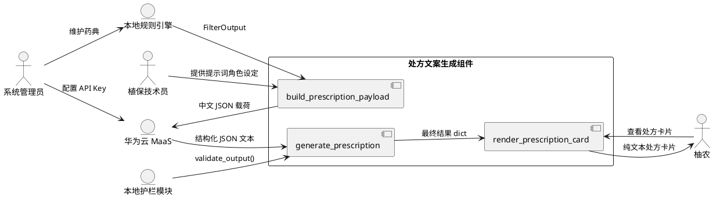
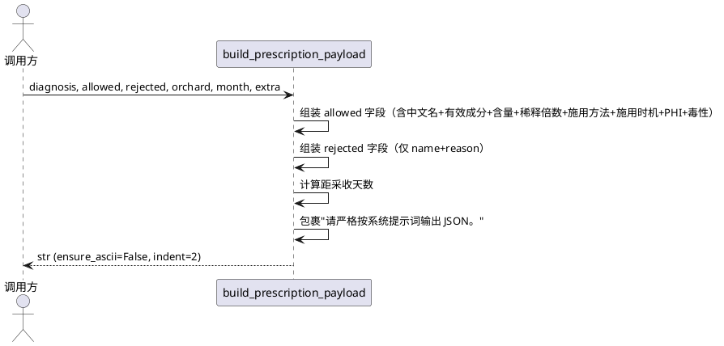
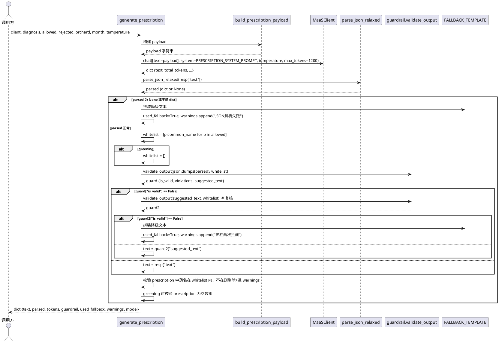
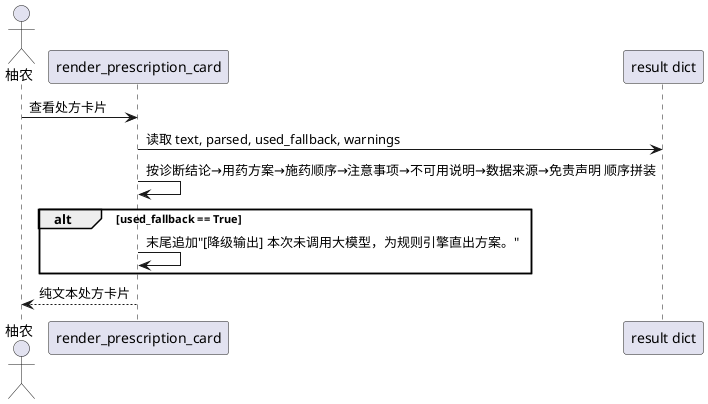

# **1. 组件定位**

## **1.1 核心职责**
本组件负责把本地规则引擎算出的可用/禁用药剂列表，经华为云大模型翻译成柚农看得懂的处方卡片文本，同时用本地护栏锁死药名，杜绝模型幻觉出未登记农药。

## **1.2 核心输入**
1. 规则引擎 `FilterOutput`：`allowed: list[Pesticide]` 与 `rejected: list[FilterResult]`，来源为 `prescription/rule_engine.py`
2. 诊断结论 `diagnosis: dict`：含 `label/confidence/symptom/distinguish/is_quarantine`，来源为视觉模型识别结果
3. 地块信息 `orchard: Orchard`：含 `block_name/variety/tree_age/current_phenophase/expected_harvest_date/area_mu`，来源为业务数据库
4. 当前月份 `month: int`，用于判断施药季节
5. 华为云 MaaS 客户端 `MaaSClient`，来源为 `agent/vision_client.py`
6. 护栏模块 `guardrail.validate_output`，来源为 `prescription/guardrail.py`

## **1.3 核心输出**
1. 处方卡片文本 `text`：面向柚农的中文纯文本处方，含诊断结论、用药方案、施药顺序、注意事项、不可用说明、数据来源、免责声明
2. 结构化解析结果 `parsed: dict|None`：模型返回的 JSON 对象，含 `diagnosis_summary/prescription/application_order/precautions/rejected_explanation/non_chemical_advice/disclaimer/data_source`
3. 护栏校验结果 `guardrail: dict`：含 `is_valid/detected/violations/suggested_text`
4. 降级标记 `used_fallback: bool`：标识本次是否使用了本地降级模板
5. 警告列表 `warnings: list[str]`：记录白名单外药名剔除、护栏拦截、网络异常等事件

## **1.4 职责边界**
1. 不负责病害识别诊断（由 `agent/vision_client.py` 的 `diagnose()` 负责）
2. 不负责药剂规则过滤（由 `prescription/rule_engine.py` 的 `filter_pesticides()` 负责）
3. 不负责药名白名单维护与护栏检测（由 `prescription/guardrail.py` 负责）
4. 不负责数据库读写、不负责图片处理、不负责硬件设备控制
5. 不负责处方卡片的 UI 渲染（仅输出纯文本，UI 层自行排版）

---

# **2. 领域术语**

**处方卡片**：面向柚农的中文用药指导文本，包含诊断结论、推荐药剂、施药方法、注意事项等模块。

**可用药剂（allowed）**：经规则引擎全部硬规则校验通过的药剂列表，可直接推荐给柚农。

**拒绝药剂（rejected）**：经规则引擎校验未通过的药剂列表，每条附带中文拒绝理由，需在处方中说明"为什么不能用"。

**护栏（guardrail）**：在模型输出后对药名进行白名单校验的本地模块，拦截幻觉出的未登记农药。

**降级输出（fallback）**：当大模型不可用（无 API Key、网络异常、JSON 解析失败、护栏连续拦截）时，使用纯本地模板拼装处方文本，零幻觉风险。

**黄龙病（greening）**：检疫性病害，处方中禁止输出任何治疗药剂，仅允许上报/挖除/防木虱/选无病苗木等非化学建议。

**安全间隔期（PHI）**：最后一次施药到采收之间必须间隔的天数，距采收天数不足 PHI 的药剂一律拒绝。

**白名单（whitelist）**：当前可用药剂的通用名集合，护栏模块以此为基准判定药名是否合法。

---

# **3. 角色与边界**

## **3.1 核心角色**

**柚农**：处方卡片的最终使用者，需要大白话、口语化的用药指导，不含专业术语。

**植保技术员**：系统模拟的角色身份，作为系统提示词中的"资深柑橘植保技术员"，指导模型生成专业且易懂的处方内容。

**系统管理员**：配置 MAAS_API_KEY、监控 Token 用量、维护药典数据。

## **3.2 外部系统**

**华为云 MaaS**：提供多模态大模型推理服务，接收中文 JSON 处方载荷，返回结构化 JSON 处方文本。

**本地规则引擎**：提供 `FilterOutput`（allowed + rejected），是处方生成的硬规则数据源。

**本地护栏模块**：提供 `validate_output()` 对模型输出进行药名白名单校验。

## **3.3 交互上下文



---

# **4. DFX约束**

## **4.1 性能**
1. 处方生成端到端延迟上限：15 秒（含 MaaS 调用 + 护栏校验 + 降级回退）
2. 单次处方 Token 消耗上限：2000 tokens（max_tokens=1200 + prompt 余量）
3. 降级模板生成延迟上限：50 毫秒（纯本地字符串拼装）

## **4.2 可靠性**
1. 模型调用失败时必须自动降级到本地模板，不允许向上抛出未捕获异常
2. 护栏连续两次拦截未通过时必须切换降级，不允许无限重试
3. JSON 解析失败时必须走降级路径，不允许返回残缺数据

## **4.3 安全性**
1. 模型输出中任何白名单外药名必须被护栏拦截或剔除，不允许出现在最终处方文本中
2. 黄龙病场景下必须禁止输出任何治疗药剂，该约束须在系统提示词与白名单双重锁定
3. 处方文本中不得出现未登记作物的用法推荐、不得推荐无关品牌
4. API Key 错误（401/403）必须捕获并降级，不得将 Key 泄露到日志或输出文本

## **4.4 可维护性**
1. 系统提示词必须以模块级常量 `PRESCRIPTION_SYSTEM_PROMPT` 导出，便于版本管理
2. 降级模板必须以模块级常量 `FALLBACK_TEMPLATE` 导出，便于独立测试
3. 所有 Token 用量必须通过 `MaaSClient` 的 `total_tokens/prompt_tokens/completion_tokens` 字段透传
4. 护栏拦截事件必须记录在 `warnings` 列表中，便于审计追溯

## **4.5 兼容性**
1. `generate_prescription()` 返回 dict 结构必须向后兼容，新增字段用默认值填充
2. 降级模板字段必须与模型 JSON schema 字段对齐，保证 `render_prescription_card()` 统一渲染
3. 当 `allowed` 为空列表时，payload 与降级模板均不得崩溃

---

# **5. 核心能力**

## **5.1 处方载荷构建**

### **5.1.1 业务规则**
1. **规则名称**：payload 必须包含 allowed、rejected、orchard、month 四个顶层键
   a. 验收条件：`json.loads(build_prescription_payload(...))` 解析成功且四键均存在 → 通过
2. **规则名称**：药名必须携带中文通用名（CLASS_CN）+ 有效成分 + 含量 + 稀释倍数 + 施用方法 + 施用时机 + 安全间隔期 + 毒性等级
   a. 验收条件：payload 中每个 allowed 药剂条目均含上述 8 个字段 → 通过
3. **规则名称**：rejected 条目只传 name 与 reason，不传其他字段
   a. 验收条件：payload 中 rejected 每个条目仅含 name 与 reason 两键 → 通过
4. **规则名称**：距采收天数 = `orchard.expected_harvest_date - today`，无预计采收日期时写"未知"
   a. 验收条件：expected_harvest_date 为 None 时 payload 中距采收天数字段为"未知" → 通过
5. **规则名称**：payload 外层必须包裹"请严格按系统提示词输出 JSON。"
   a. 验收条件：payload 字符串以指定前缀开头 → 通过
6. **禁止项**：payload 中不得出现 ``` 代码块标记
   a. 验收条件：payload 字符串不含 "```" → 通过

### **5.1.2 交互流程**


### **5.1.3 异常场景**
1. **allowed 为空列表**
   a. 触发条件：规则引擎返回 allowed=[]
   b. 系统行为：payload 中 allowed 字段为空数组，不抛异常
   c. 用户感知：generate_prescription 走降级路径，text 含"暂无可用药剂"
2. **rejected 为空列表**
   a. 触发条件：全部候选药剂均通过规则校验
   b. 系统行为：payload 中 rejected 字段为空数组
   c. 用户感知：处方中"不可用说明"段落显示"本次无被拒绝药剂"
3. **orchard.expected_harvest_date 为 None**
   a. 触发条件：地块未录入预计采收日期
   b. 系统行为：距采收天数字段填"未知"
   c. 用户感知：处方中显示"距采收天数：未知"

---

## **5.2 处方生成（大模型调用 + 护栏 + 降级）**

### **5.2.1 业务规则**
1. **规则名称**：系统提示词必须包含"只能从 allowed_pesticides 里选药，不许改药名"硬约束
   a. 验收条件：PRESCRIPTION_SYSTEM_PROMPT 中出现"只能"与"禁止"关键字 → 通过
2. **规则名称**：系统提示词必须包含黄龙病禁药条款——disease == "greening" 时禁止输出任何治疗药剂
   a. 验收条件：PRESCRIPTION_SYSTEM_PROMPT 中出现"greening"与"禁止"与"治疗药剂"关键字 → 通过
3. **规则名称**：稀释倍数/施用方法/施用时机只能照抄输入字段，缺值时写"按当地农技人员指导"
   a. 验收条件：模型输出中稀释倍数与 payload 中一致或为"按当地农技人员指导" → 通过
4. **规则名称**：rejected_pesticides 里的药只能出现在"为什么不能用"段落，原样引用 reason
   a. 验收条件：模型输出中 rejected_explanation 段落的药名与 reason 与 payload 一致 → 通过
5. **规则名称**：输出严格 JSON（无 ``` 标记），schema 必须含 diagnosis_summary/prescription/application_order/precautions/rejected_explanation/non_chemical_advice/disclaimer/data_source
   a. 验收条件：parse_json_relaxed 返回的 dict 含全部 8 个键 → 通过
6. **规则名称**：temperature=0.2，max_tokens=1200
   a. 验收条件：client.chat 调用参数中 temperature=0.2, max_tokens=1200 → 通过
7. **规则名称**：护栏校验不通过时，必须把 suggested_text 再喂一次 validate_output 复核
   a. 验收条件：guard["is_valid"] 为 False 时，第二次 validate_output 被调用 → 通过
8. **规则名称**：护栏两次仍不通过或 parsed 为 None 或不是 dict，必须走 FALLBACK_TEMPLATE，used_fallback=True
   a. 验收条件：最终返回 dict 中 used_fallback=True 且 text 来自 FALLBACK_TEMPLATE → 通过
9. **规则名称**：client 抛 RuntimeError（无 Key / 401 / 网络错）必须捕获，used_fallback=True，错误放 warnings
   a. 验收条件：FakeClient 抛 RuntimeError 时 generate_prescription 不抛异常，warnings 非空 → 通过
10. **规则名称**：parsed["prescription"] 中每个 pesticide_name 必须在 whitelist 内，不在的直接剔除并进 warnings
    a. 验收条件：whitelist 外药名出现在 prescription 中时，该条目被剔除且 warnings 含对应提示 → 通过
11. **规则名称**：greening 时 prescription 必须为空数组
    a. 验收条件：diagnosis.label == "greening" 时 parsed["prescription"] == [] → 通过
12. **规则名称**：greening 时 whitelist 传空列表
    a. 验收条件：diagnosis.label == "greening" 时 whitelist = [] → 通过
13. **禁止项**：不推荐未登记作物/含量的用法
    a. 验收条件：模型输出中出现"可用于XX作物（未登记）"类表述 → 护栏拦截或降级
14. **禁止项**：不推荐无关品牌
    a. 验收条件：模型输出中出现具体品牌名（如"XX牌XX药"）→ 护栏拦截或降级

### **5.2.2 交互流程**


### **5.2.3 异常场景**
1. **MaaSClient 抛 RuntimeError（无 Key / 401 / 网络错）**
   a. 触发条件：client.chat() 抛出 RuntimeError
   b. 系统行为：捕获异常，used_fallback=True，warnings 追加错误信息，走 FALLBACK_TEMPLATE
   c. 用户感知：处方卡片末尾显示"[降级输出] 本次未调用大模型，为规则引擎直出方案。"
2. **模型返回非 JSON 垃圾文本**
   a. 触发条件：parse_json_relaxed 返回 None
   b. 系统行为：used_fallback=True，warnings 追加"JSON解析失败"
   c. 用户感知：同上降级提示
3. **护栏首次拦截（白名单外药名）**
   a. 触发条件：模型输出含"多菌灵"等不在 allowed 中的药名
   b. 系统行为：guard["is_valid"]=False，用 suggested_text 复核
   c. 用户感知：若复核通过则显示修正后文本；若不通过则降级
4. **护栏两次拦截**
   a. 触发条件：首次拦截后 suggested_text 仍含违规药名
   b. 系统行为：used_fallback=True，warnings 追加"护栏两次拦截"
   c. 用户感知：降级文本
5. **prescription 中出现白名单外药名**
   a. 触发条件：parsed["prescription"] 中某条目 pesticide_name 不在 whitelist
   b. 系统行为：该条目从 prescription 中剔除，warnings 追加"药名不在白名单内"
   c. 用户感知：最终 text 中不含该药名
6. **greening 场景模型输出治疗药剂**
   a. 触发条件：diagnosis.label == "greening" 但 parsed["prescription"] 非空
   b. 系统行为：强制清空 prescription，warnings 追加"黄龙病场景已清空治疗药剂"
   c. 用户感知：处方中仅含非化学建议（上报/挖除/防木虱/选无病苗木）

---

## **5.3 处方卡片渲染**

### **5.3.1 业务规则**
1. **规则名称**：卡片必须按"诊断结论 → 用药方案（编号列表）→ 施药顺序 → 注意事项 → 不可用说明 → 数据来源 → 免责声明"顺序渲染
   a. 验收条件：render_prescription_card 输出文本中上述 7 个模块按序出现 → 通过
2. **规则名称**：used_fallback=True 时末尾必须加一行"[降级输出] 本次未调用大模型，为规则引擎直出方案。"
   a. 验收条件：result["used_fallback"]=True 时输出含"降级输出"关键字 → 通过
3. **规则名称**：输出必须含"免责"二字
   a. 验收条件：render_prescription_card 输出文本含"免责" → 通过
4. **规则名称**：prescription 为空时用药方案段落显示"暂无可用药剂，请咨询当地农技人员。"
   a. 验收条件：parsed["prescription"]=[] 时输出含"暂无可用药剂" → 通过
5. **禁止项**：不得渲染任何白名单外药名
   a. 验收条件：最终 text 中不含 warnings 中记录的违规药名 → 通过

### **5.3.2 交互流程**


### **5.3.3 异常场景**
1. **parsed 为 None（降级路径）**
   a. 触发条件：generate_prescription 返回 parsed=None
   b. 系统行为：render_prescription_card 从 result["text"]（即 FALLBACK_TEMPLATE 文本）直接渲染
   c. 用户感知：显示降级处方卡片，含降级标记
2. **warnings 非空**
   a. 触发条件：护栏拦截、药名剔除、网络异常等
   b. 系统行为：warnings 列表不展示给柚农，仅用于审计日志
   c. 用户感知：无感知（柚农不看到 warnings）

---

# **6. 数据约束**

## **6.1 诊断结论（diagnosis）**
1. **label**：必须为 CLASS_NAMES 之一（"red_spider_mite"/"anthracnose"/"canker"/"greening"）或 "healthy"
2. **confidence**：浮点数，范围 [0.0, 1.0]
3. **symptom**：字符串，描述症状特征
4. **distinguish**：字符串，与易混淆病害的区分要点
5. **is_quarantine**：布尔值，标识是否为检疫性病害（greening 时为 True）

## **6.2 可用药剂（Pesticide）**
1. **common_name**：字符串，中文通用名，必须非空
2. **active_ingredient**：字符串，有效成分名称
3. **content**：字符串，含量（如 "5%"）
4. **dilution_ratio**：字符串，稀释倍数（如 "3000倍"），可为空
5. **application_method**：字符串，施用方法（如 "叶面喷雾"），可为空
6. **application_timing**：字符串，施用时机（如 "萌芽期"），可为空
7. **phi_days**：整数，安全间隔期天数，可为空
8. **toxicity_level**：字符串，毒性等级（如 "低毒"/"中等毒"），可为空

## **6.3 拒绝药剂（FilterResult）**
1. **pesticide_id**：整数，药剂唯一标识
2. **name**：字符串，药剂中文通用名
3. **reason**：字符串，中文拒绝理由，必须非空

## **6.4 地块信息（Orchard）**
1. **block_name**：字符串，地块名称
2. **variety**：字符串，柚子品种
3. **tree_age**：整数，树龄（年）
4. **current_phenophase**：字符串，当前物候期（萌芽期/花期/幼果期/膨大期/转色期/采收期/休眠期）
5. **expected_harvest_date**：日期，预计采收日期，可为空
6. **area_mu**：浮点数，地块面积（亩），可为空

## **6.5 处方 JSON Schema（parsed）**
1. **diagnosis_summary**：字符串，诊断结论摘要
2. **prescription**：数组，每个元素含 pesticide_name/dilution_ratio/application_method/application_timing/phi_days/toxicity_level
3. **application_order**：字符串，施药顺序说明
4. **precautions**：字符串，注意事项
5. **rejected_explanation**：字符串，不可用药剂及原因
6. **non_chemical_advice**：字符串，非化学防治建议
7. **disclaimer**：字符串，免责声明
8. **data_source**：字符串，数据来源说明

## **6.6 返回结果（generate_prescription 返回 dict）**
1. **text**：字符串，最终中文处方文本
2. **parsed**：dict 或 None，结构化解析结果
3. **tokens**：整数，总 token 数
4. **prompt_tokens**：整数，输入 token 数
5. **completion_tokens**：整数，输出 token 数
6. **guardrail**：dict，护栏校验结果
7. **used_fallback**：布尔值，是否降级
8. **warnings**：字符串列表，警告信息
9. **model**：字符串，使用的模型名